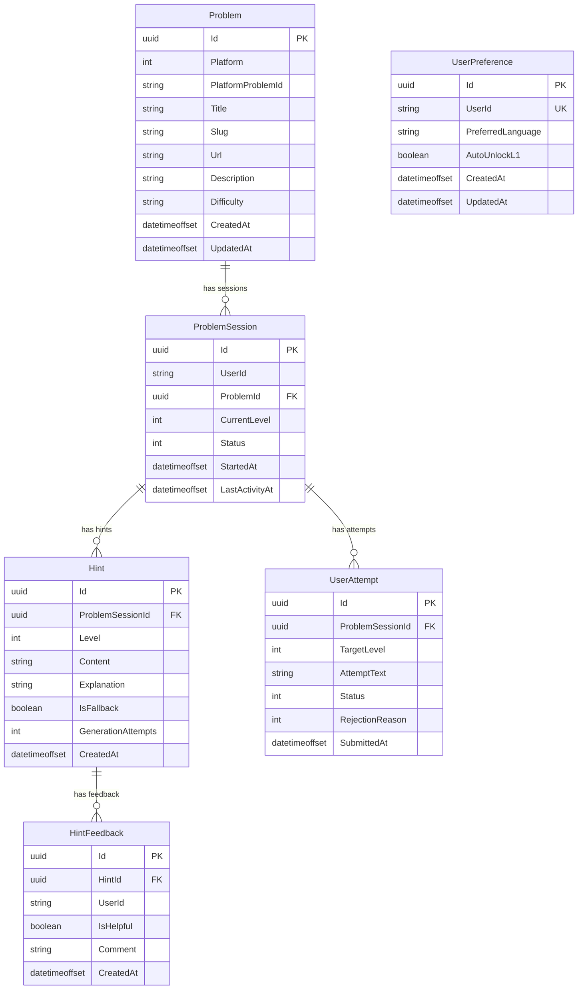

# Codexo — Database Design

> **Status:** IMPLEMENTED (M2 Database)

## Entity-Relationship Diagram

---

## Tables and Column Specifications

### 1. `Problems`
Stores canonical DSA problems tracked from platforms (e.g. LeetCode).

| Column | Type | Constraints | Description |
|---|---|---|---|
| `Id` | `uniqueidentifier` | PK | Unique identifier |
| `Platform` | `int` | NOT NULL | Platform enum (1 = LeetCode) |
| `PlatformProblemId` | `nvarchar(100)` | NOT NULL | Problem identifier on platform (e.g. "1") |
| `Title` | `nvarchar(250)` | NOT NULL | Problem title (e.g. "Two Sum") |
| `Slug` | `nvarchar(250)` | NOT NULL | Normalized slug (e.g. "two-sum") |
| `Url` | `nvarchar(500)` | NOT NULL | Canonical problem URL |
| `Description` | `nvarchar(max)` | NOT NULL | Full problem text & constraints |
| `Difficulty` | `nvarchar(50)` | NOT NULL | Difficulty level ("Easy", "Medium", "Hard") |
| `CreatedAt` | `datetimeoffset` | NOT NULL | Record creation timestamp (UTC) |
| `UpdatedAt` | `datetimeoffset` | NOT NULL | Last update timestamp (UTC) |

**Indexes & Constraints:**
- `PK_Problems`: Primary key on `Id`.
- `IX_Problems_Platform_PlatformProblemId`: **UNIQUE** composite index on `(Platform, PlatformProblemId)`.
- `IX_Problems_Slug`: Non-clustered index on `Slug` for rapid URL/context lookups.

---

### 2. `ProblemSessions`
Tracks an individual user's progressive hint session for a specific problem.

| Column | Type | Constraints | Description |
|---|---|---|---|
| `Id` | `uniqueidentifier` | PK | Session identifier |
| `UserId` | `nvarchar(100)` | NOT NULL | User identifier (Identity / JWT subject) |
| `ProblemId` | `uniqueidentifier` | FK, NOT NULL | Foreign key to `Problems.Id` |
| `CurrentLevel` | `int` | NOT NULL | Current unlocked hint level (0 = None, 1 = L1.. 5 = L5) |
| `Status` | `int` | NOT NULL | Session status (1 = Active, 2 = Completed, 3 = Abandoned) |
| `StartedAt` | `datetimeoffset` | NOT NULL | Session start timestamp (UTC) |
| `LastActivityAt` | `datetimeoffset` | NOT NULL | Last request / activity timestamp (UTC) |

**Indexes & Constraints:**
- `PK_ProblemSessions`: Primary key on `Id`.
- `FK_ProblemSessions_Problems_ProblemId`: Foreign key to `Problems(Id)` with `ON DELETE CASCADE`.
- `IX_ProblemSessions_UserId_ProblemId`: Non-clustered index on `(UserId, ProblemId)`.
- `IX_ProblemSessions_UserId_Status`: Non-clustered index on `(UserId, Status)` for active session queries.

---

### 3. `Hints`
Stores generated progressive hints for a problem session.

| Column | Type | Constraints | Description |
|---|---|---|---|
| `Id` | `uniqueidentifier` | PK | Hint identifier |
| `ProblemSessionId` | `uniqueidentifier` | FK, NOT NULL | Foreign key to `ProblemSessions.Id` |
| `Level` | `int` | NOT NULL | Hint level (1 = L1_Understand.. 5 = L5_Deep) |
| `Content` | `nvarchar(max)` | NOT NULL | Verified safe hint content |
| `Explanation` | `nvarchar(max)` | NOT NULL | Pedagogical justification |
| `IsFallback` | `bit` | NOT NULL | True if generated via fallback mechanism |
| `GenerationAttempts`| `int` | NOT NULL | Number of AI generation rounds required |
| `CreatedAt` | `datetimeoffset` | NOT NULL | Generation timestamp (UTC) |

**Indexes & Constraints:**
- `PK_Hints`: Primary key on `Id`.
- `FK_Hints_ProblemSessions_ProblemSessionId`: Foreign key to `ProblemSessions(Id)` with `ON DELETE CASCADE`.
- `IX_Hints_ProblemSessionId_Level`: Non-clustered index on `(ProblemSessionId, Level)`.

---

### 4. `UserAttempts`
Stores user-submitted reflections required to unlock L2 through L5 hints.

| Column | Type | Constraints | Description |
|---|---|---|---|
| `Id` | `uniqueidentifier` | PK | Attempt identifier |
| `ProblemSessionId` | `uniqueidentifier` | FK, NOT NULL | Foreign key to `ProblemSessions.Id` |
| `TargetLevel` | `int` | NOT NULL | Hint level attempted to unlock |
| `AttemptText` | `nvarchar(max)` | NOT NULL | User-submitted reflection text |
| `Status` | `int` | NOT NULL | Validation outcome (1 = Approved, 2 = Rejected) |
| `RejectionReason` | `int` | NULL | Enum reason if rejected |
| `SubmittedAt` | `datetimeoffset` | NOT NULL | Submission timestamp (UTC) |

**Indexes & Constraints:**
- `PK_UserAttempts`: Primary key on `Id`.
- `FK_UserAttempts_ProblemSessions_ProblemSessionId`: Foreign key to `ProblemSessions(Id)` with `ON DELETE CASCADE`.
- `IX_UserAttempts_ProblemSessionId_TargetLevel`: Non-clustered index on `(ProblemSessionId, TargetLevel)`.

---

### 5. `HintFeedbacks`
Captures user feedback on specific hints.

| Column | Type | Constraints | Description |
|---|---|---|---|
| `Id` | `uniqueidentifier` | PK | Feedback identifier |
| `HintId` | `uniqueidentifier` | FK, NOT NULL | Foreign key to `Hints.Id` |
| `UserId` | `nvarchar(100)` | NOT NULL | Submitting user ID |
| `IsHelpful` | `bit` | NOT NULL | Positive (true) or negative (false) |
| `Comment` | `nvarchar(1000)` | NULL | Optional feedback comment |
| `CreatedAt` | `datetimeoffset` | NOT NULL | Submission timestamp (UTC) |

**Indexes & Constraints:**
- `PK_HintFeedbacks`: Primary key on `Id`.
- `FK_HintFeedbacks_Hints_HintId`: Foreign key to `Hints(Id)` with `ON DELETE CASCADE`.
- `IX_HintFeedbacks_HintId_UserId`: Non-clustered index on `(HintId, UserId)`.

---

### 6. `UserPreferences`
User-level settings.

| Column | Type | Constraints | Description |
|---|---|---|---|
| `Id` | `uniqueidentifier` | PK | Preference identifier |
| `UserId` | `nvarchar(100)` | NOT NULL | User identifier |
| `PreferredLanguage` | `nvarchar(50)` | NOT NULL | Preferred programming language |
| `AutoUnlockL1` | `bit` | NOT NULL | Automatically unlock L1 on problem detection |
| `CreatedAt` | `datetimeoffset` | NOT NULL | Timestamp |
| `UpdatedAt` | `datetimeoffset` | NOT NULL | Timestamp |

**Indexes & Constraints:**
- `PK_UserPreferences`: Primary key on `Id`.
- `IX_UserPreferences_UserId`: **UNIQUE** index on `UserId`.
