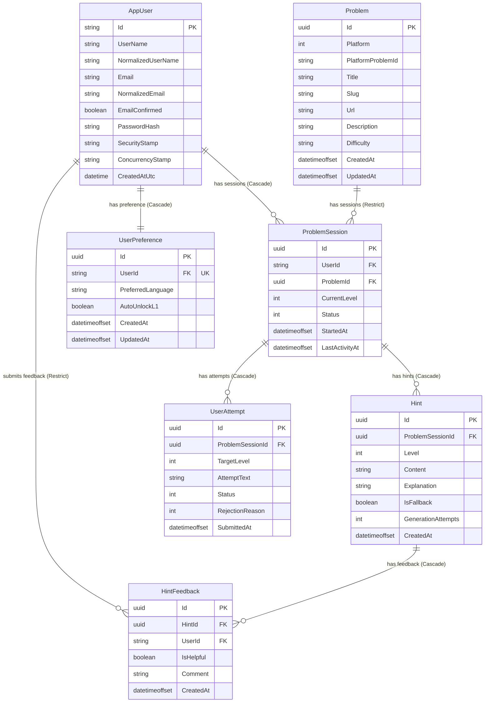

# Codexo — Database Design

> **Status:** IMPLEMENTED (M2 Database, M2-CLEANUP Restrict FK, M3 ASP.NET Core Identity & User FKs)

## Entity-Relationship Diagram

---

## Tables & Relationships

### 1. `AspNetUsers` (Identity `AppUser`)
- **Primary Key:** `Id` (`nvarchar(450)`)
- Custom property: `CreatedAtUtc` (`datetime2`, UTC)
- Manages authentication credentials, password hashes (PBKDF2/HMAC-SHA256), email confirmation, and security stamps.

### 2. `ProblemSessions`
- **Primary Key:** `Id` (`uniqueidentifier`)
- **Foreign Key to `AspNetUsers`:** `UserId` (`nvarchar(450)`, `ON DELETE CASCADE`)
- **Foreign Key to `Problems`:** `ProblemId` (`uniqueidentifier`, `ON DELETE RESTRICT`)
- **Composite Indexes:**
  - `IX_ProblemSessions_UserId_ProblemId` — fast lookup of a user's session for a specific problem.
  - `IX_ProblemSessions_UserId_Status` — query active vs completed sessions.

### 3. `UserPreferences`
- **Primary Key:** `Id` (`uniqueidentifier`)
- **Foreign Key to `AspNetUsers`:** `UserId` (`nvarchar(450)`, `ON DELETE CASCADE`)
- **Unique Index:** `IX_UserPreferences_UserId` — enforces exactly one preference profile per user.

### 4. `HintFeedbacks`
- **Primary Key:** `Id` (`uniqueidentifier`)
- **Foreign Key to `Hints`:** `HintId` (`uniqueidentifier`, `ON DELETE CASCADE`)
- **Foreign Key to `AspNetUsers`:** `UserId` (`nvarchar(450)`, `ON DELETE NO ACTION / RESTRICT`)
  - *Design Note:* SQL Server forbids multiple cascade paths to the same child table. Because deleting an `AppUser` cascades through `ProblemSessions -> Hints -> HintFeedbacks`, the direct foreign key from `AspNetUsers` to `HintFeedbacks` must specify `NO ACTION / RESTRICT`.

---

## Seed Data & Development Isolation

- In **Development**, `DbInitializer.SeedAsync()` seeds:
  - Benchmark problems: *Two Sum*, *Valid Anagram*, *Merge Two Sorted Lists*.
  - A deterministic development user: `dev@codexo.dev` (`00000000-0000-0000-0000-000000000001`).
  - Default user preference for the development user.
- In **Production**, `DbInitializer` does nothing; migrations and database schema updates are executed via deployment pipelines.
