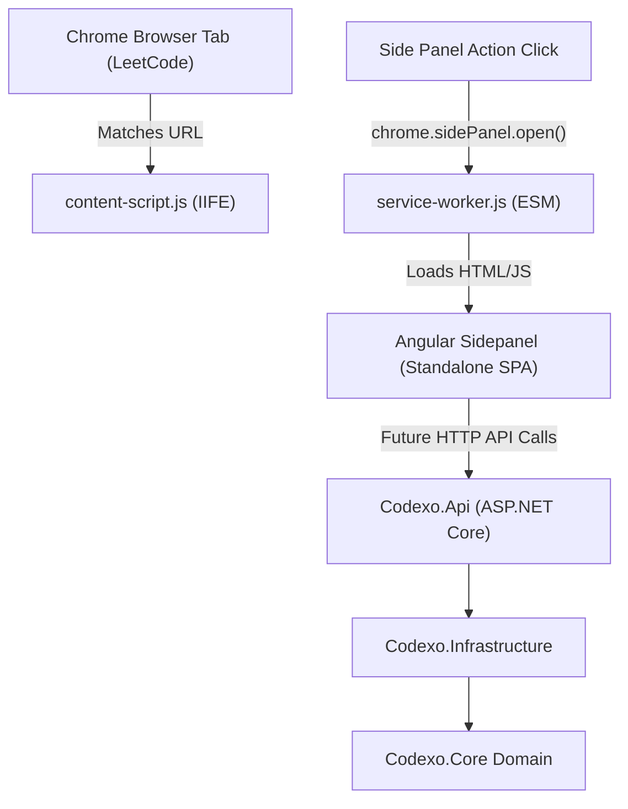

# Codexo — Learning Log

## Module Status

| Module | Name | Status | Branch | Date |
|--------|------|--------|--------|------|
| M0 | Scaffolding | IMPLEMENTED | `main` | 2026-11-15 |
| M1 | Domain + Hint Logic | NOT IMPLEMENTED | — | — |
| M2 | Database | NOT IMPLEMENTED | — | — |
| M3 | Authentication | NOT IMPLEMENTED | — | — |
| M4 | Problems + Sessions | NOT IMPLEMENTED | — | — |
| M5 | AI Layer | NOT IMPLEMENTED | — | — |
| M6 | Hint Orchestration | NOT IMPLEMENTED | — | — |
| M7 | Feedback + Preferences | NOT IMPLEMENTED | — | — |
| M8 | Hardening | NOT IMPLEMENTED | — | — |
| M9 | Extension Scaffold | NOT IMPLEMENTED | — | — |
| M10 | Content Script | NOT IMPLEMENTED | — | — |
| M11 | Side Panel UI | NOT IMPLEMENTED | — | — |
| M12 | Integration | NOT IMPLEMENTED | — | — |
| M13 | Release | NOT IMPLEMENTED | — | — |

---

*Learning entries will be appended below as modules are completed.*


## M0: Scaffolding

### What We Built
We set up the complete foundational structure for Codexo across .NET 10 and Chrome Extension targets. The solution contains three backend projects (`Codexo.Api`, `Codexo.Infrastructure`, `Codexo.Core`) and two test projects enforcing strict dependency inversion (`Api -> Infrastructure -> Core`). The extension shell separates the Angular 21 side-panel application from the MV3 background service worker and content script bundled via esbuild. Foundational documentation, security baseline, and GitHub Actions CI pipelines were established with zero business logic.

### Concepts
- **Clean Architecture Dependency Rule:** Source code dependencies point inward toward business concepts. `Codexo.Core` has no dependencies on database, Web API, or AI libraries. File: [src/Codexo.Core/Codexo.Core.csproj](file:///c:/Ariram/CodeXO/src/Codexo.Core/Codexo.Core.csproj).
- **Chrome Extension Manifest V3 (MV3):** Google's extension platform requiring non-persistent background service workers, dedicated Side Panel API, and banning remotely hosted/inline code. File: [extension/public/manifest.json](file:///c:/Ariram/CodeXO/extension/public/manifest.json).
- **Dual-Bundler Build Architecture:** Angular CLI compiles SPA components into static HTML/JS/CSS, while `esbuild` compiles the service worker and content script into isolated scripts without polluting browser scopes. File: [extension/scripts/build-extension.mjs](file:///c:/Ariram/CodeXO/extension/scripts/build-extension.mjs).

### Runtime Flow


1. User opens a LeetCode problem page; Chrome injects `content-script.js`.
2. User triggers the extension icon; `service-worker.js` listens to `action.onClicked` and invokes `chrome.sidePanel.open()`.
3. Side panel loads `sidepanel/browser/index.html` hosting the standalone Angular application.
4. Future modules route requests to `Codexo.Api`, propagating downward to Core.

### Design Decisions & Rejected Alternatives
- **Decision:** Bundled content script and background worker using `esbuild` rather than adding multiple projects to `angular.json`.
  *Rejected alternative:* Multi-project Angular workspace for extension scripts. MV3 forbids DOM access in service workers and requires specific module formats that Angular's application builder complicates.
- **Decision:** Used .NET 10 solution (`.slnx`) with project references enforcing `Api -> Infrastructure -> Core`.
  *Rejected alternative:* Direct reference from Core to external packages.

### Interview Questions & Model Answers
- **Q: Why separate the content script and service worker build from Angular's application build in an MV3 extension?**
  *A:* MV3 content scripts run directly in the webpage context (IIFE format) while background service workers run in an isolated worker context without DOM access. Angular's CLI targets browser SPAs; bundling background scripts separately via esbuild gives precise control over formats, sourcemaps, and avoids loading heavy framework runtimes where unnecessary.
- **Q: Why does `Codexo.Core` have zero package references to EF Core or ASP.NET Core?**
  *A:* Clean architecture ensures core domain rules and algorithms are independent of UI frameworks, persistence mechanisms, or external services. This allows pure, fast unit testing without mocking HTTP contexts or databases.
- **Q: Why is `outputHashing: "none"` set for the Angular extension build?**
  *A:* Chrome extensions require static paths defined in `manifest.json`. Cache-busted hash names break references like `sidepanel/browser/index.html`.

### Run & Test Commands
```bash
# Build backend solution
dotnet build Codexo.slnx

# Run all backend unit & integration tests
dotnet test Codexo.slnx --verbosity normal

# Install and build extension
cd extension
npm run build
```

### Common Pitfalls
- **Manifest path mismatches:** Angular 21 defaults output to `dist/codexo/sidepanel/browser/index.html`. Ensure `manifest.json` points to the exact path generated.
- **Leaking references into Core:** Accompanying NuGet packages like `Microsoft.AspNetCore.Http` into Core violates architectural boundaries.
