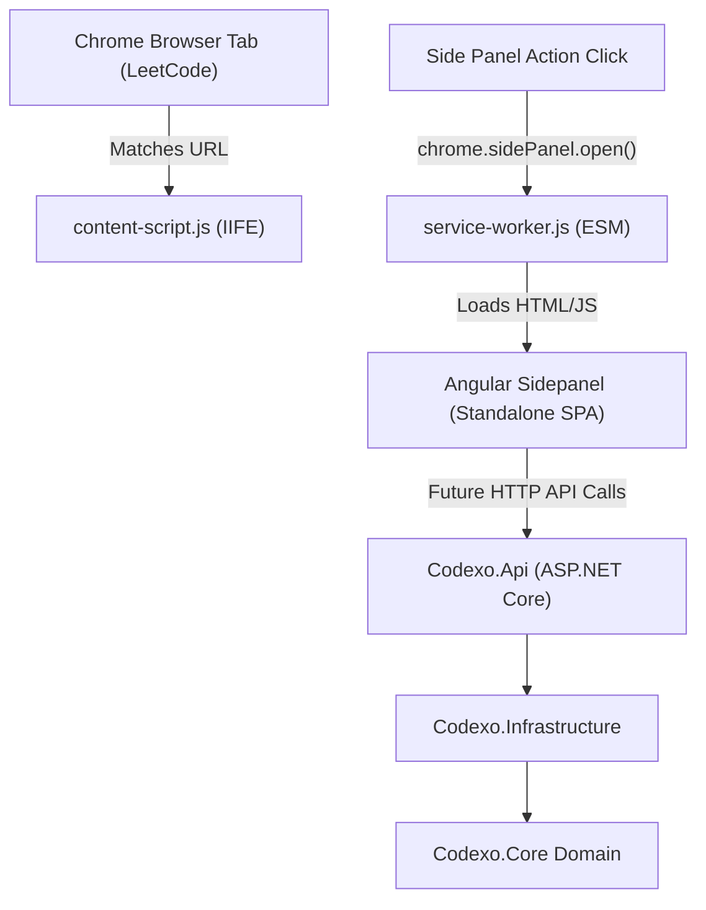
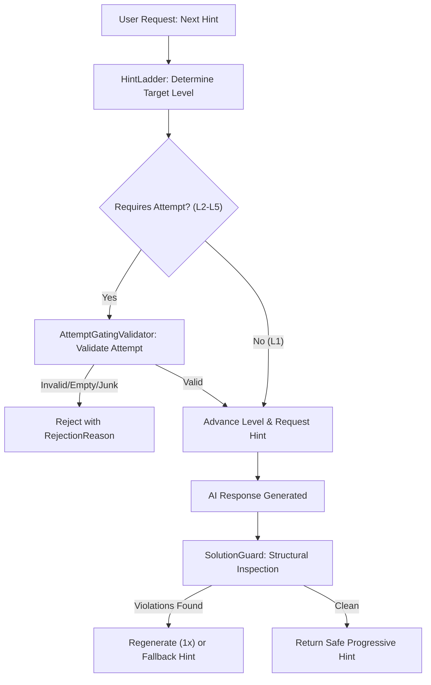
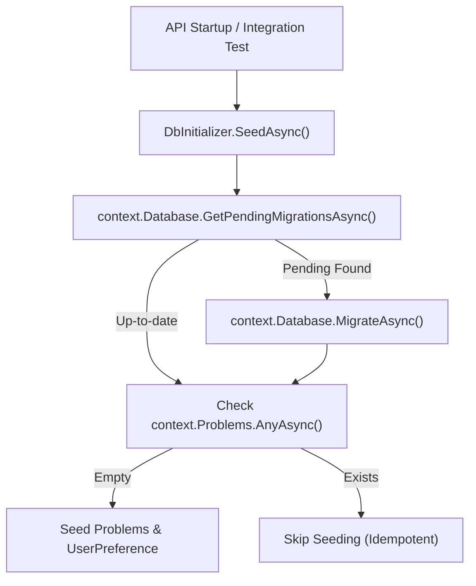
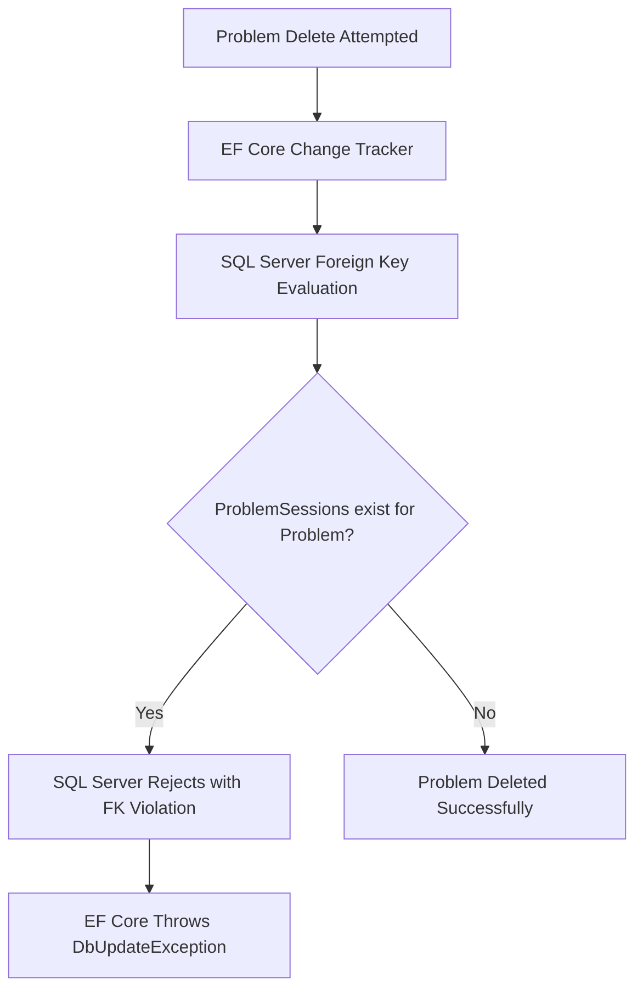
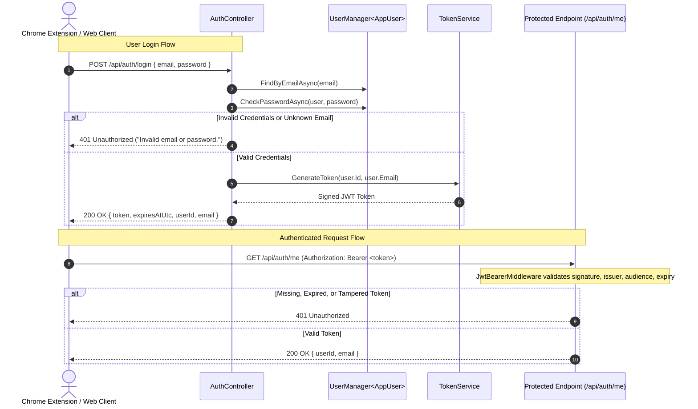

# Codexo — Learning Log

## Module Status

| Module | Name | Status | Branch | Commits | Date |
|--------|------|--------|--------|---------|------|
| M0 | Scaffolding | IMPLEMENTED | `main` | `896762b..8d9b0c1` | 2026-11-15 |
| M1 | Domain + Hint Logic | IMPLEMENTED | `main` | `e8ffb00..9b7fc2b` | 2026-11-15 |
| M2 | Database | IMPLEMENTED | `main` | `719c47e..a073149` | 2026-11-15 |
| M2-CLEANUP | Database Refinements | IMPLEMENTED | `main` | `2831a96..79bd1f6` | 2026-11-16 |
| M3 | Authentication | IMPLEMENTED | `main` | `306ef41..285d595` | 2026-11-16 |
| M4 | Problems + Sessions | NOT IMPLEMENTED | — | — | — |
| M5 | AI Layer | NOT IMPLEMENTED | — | — | — |
| M6 | Hint Orchestration | NOT IMPLEMENTED | — | — | — |
| M7 | Feedback + Preferences | NOT IMPLEMENTED | — | — | — |
| M8 | Hardening | NOT IMPLEMENTED | — | — | — |
| M9 | Extension Scaffold | NOT IMPLEMENTED | — | — | — |
| M10 | Content Script | NOT IMPLEMENTED | — | — | — |
| M11 | Side Panel UI | NOT IMPLEMENTED | — | — | — |
| M12 | Integration | NOT IMPLEMENTED | — | — | — |
| M13 | Release | NOT IMPLEMENTED | — | — | — |

---

*Learning entries will be appended below as modules are completed.*


## M0: Scaffolding

### What We Built
We set up the complete foundational structure for Codexo across .NET 10 and Chrome Extension targets. The solution contains three backend projects (`Codexo.Api`, `Codexo.Infrastructure`, `Codexo.Core`) and two test projects enforcing strict dependency inversion (`Api -> Infrastructure -> Core`). The extension shell separates the Angular 21 side-panel application from the MV3 background service worker and content script bundled via esbuild. Foundational documentation, security baseline, and GitHub Actions CI pipelines were established with zero business logic.

### Concepts
- **Clean Architecture Dependency Rule:** Source code dependencies point inward toward business concepts. `Codexo.Core` has no dependencies on database, Web API, or AI libraries. File: [src/Codexo.Core/Codexo.Core.csproj](file:///c:/Ariram/CodeXO/src/Codexo.Core/Codexo.Core.csproj).
- **Chrome Extension Manifest V3 (MV3):** Google's extension platform requiring non-persistent background service workers, dedicated Side Panel API, and banning remotely hosted/inline code. File: [extension/public/manifest.json](file:///c:/Ariram/CodeXO/extension/public/manifest.json).
- **Dual-Bundler Build Architecture:** Angular CLI compiles SPA components into static HTML/JS/CSS, while `esbuild` compiles the service worker and content script into isolated scripts without polluting browser scopes. File: [extension/scripts/build-extension.mjs](file:///c:/Ariram/CodeXO/extension/scripts/build-extension.mjs).

### Runtime Flow


1. User opens a LeetCode problem page; Chrome injects `content-script.js`.
2. User triggers the extension icon; `service-worker.js` listens to `action.onClicked` and invokes `chrome.sidePanel.open()`.
3. Side panel loads `sidepanel/browser/index.html` hosting the standalone Angular application.
4. Future modules route requests to `Codexo.Api`, propagating downward to Core.

### Design Decisions & Rejected Alternatives
- **Decision:** Bundled content script and background worker using `esbuild` rather than adding multiple projects to `angular.json`.
  *Rejected alternative:* Multi-project Angular workspace for extension scripts. MV3 forbids DOM access in service workers and requires specific module formats that Angular's application builder complicates.
- **Decision:** Used .NET 10 solution (`.slnx`) with project references enforcing `Api -> Infrastructure -> Core`.
  *Rejected alternative:* Direct reference from Core to external packages.

### Interview Questions & Model Answers
- **Q: Why separate the content script and service worker build from Angular's application build in an MV3 extension?**
  *A:* MV3 content scripts run directly in the webpage context (IIFE format) while background service workers run in an isolated worker context without DOM access. Angular's CLI targets browser SPAs; bundling background scripts separately via esbuild gives precise control over formats, sourcemaps, and avoids loading heavy framework runtimes where unnecessary.
- **Q: Why does `Codexo.Core` have zero package references to EF Core or ASP.NET Core?**
  *A:* Clean architecture ensures core domain rules and algorithms are independent of UI frameworks, persistence mechanisms, or external services. This allows pure, fast unit testing without mocking HTTP contexts or databases.
- **Q: Why is `outputHashing: "none"` set for the Angular extension build?**
  *A:* Chrome extensions require static paths defined in `manifest.json`. Cache-busted hash names break references like `sidepanel/browser/index.html`.

### Run & Test Commands
```bash
# Build backend solution
dotnet build Codexo.slnx

# Run all backend unit & integration tests
dotnet test Codexo.slnx --verbosity normal

# Install and build extension
cd extension
npm run build
```

### Common Pitfalls
- **Manifest path mismatches:** Angular 21 defaults output to `dist/codexo/sidepanel/browser/index.html`. Ensure `manifest.json` points to the exact path generated.
- **Leaking references into Core:** Accompanying NuGet packages like `Microsoft.AspNetCore.Http` into Core violates architectural boundaries.


## M1: Domain + Hint Logic

### What We Built
We implemented the domain model and hint-safety engine in `Codexo.Core` with zero external dependencies. The domain entities model DSA problems, user sessions, progressive hints, attempts, and feedback. `HintLadder` enforces server-authoritative 5-level progression (L1 to L5) and prevents duplicate level advancements. `AttemptGatingValidator` validates that unlocking L2+ requires a meaningful written attempt, rejecting empty submissions, keysmash gibberish, trivial one-liners, and full-solution solicitations. `SolutionGuard` and `AiResponseValidator` structurally inspect AI outputs for markdown code blocks, compilable statements, full solution dumps, and level-specific spoilers (banning algorithms/data structures at L1 and algorithm/pattern names at L2).

### Concepts
- **Server-Authoritative Progression:** The server alone computes and advances hint levels; client-provided level values are ignored to prevent tampering or skipping ahead. File: [src/Codexo.Core/Hints/HintLadder.cs](file:///c:/Ariram/CodeXO/src/Codexo.Core/Hints/HintLadder.cs).
- **Structural Solution Guarding:** Rather than relying merely on naive keyword searches, `SolutionGuard` detects programming syntax patterns (function declarations, semicolon-terminated assignments, loops) and code fences to guarantee that no compilable code is leaked. File: [src/Codexo.Core/Hints/SolutionGuard.cs](file:///c:/Ariram/CodeXO/src/Codexo.Core/Hints/SolutionGuard.cs).
- **Attempt Gating:** A pedagogical safeguard that blocks hints past L1 until the user submits a verifiable written reflection (minimum 15 characters, 3 words, non-trivial, non-gibberish) describing what they tried or understood. File: [src/Codexo.Core/Hints/AttemptGatingValidator.cs](file:///c:/Ariram/CodeXO/src/Codexo.Core/Hints/AttemptGatingValidator.cs).

### Runtime Flow


1. User requests a hint for their active session; `HintLadder` calculates the next level.
2. If advancing past L1, `AttemptGatingValidator` checks the user's attempt for length, word count, gibberish, and solution begging.
3. Once validated, the AI generates candidate hint content.
4. `SolutionGuard` inspects the text for code blocks, compilable statements, and spoilers.
5. If safe, the hint is persisted and returned; otherwise a constrained retry or static fallback is returned.

### Design Decisions & Rejected Alternatives
- **Decision:** Structural parsing using regex and token heuristics for code detection rather than full language AST parsers.
  *Rejected alternative:* Incorporating Roslyn or Tree-sitter for multiple languages. Regex/structural patterns cover multi-language code snippets with zero external dependencies and sub-millisecond execution.
- **Decision:** Consonant-cluster and n-gram analysis for keysmash detection rather than keyboard-row letter matching.
  *Rejected alternative:* Row regex (`^[qwertyuiop]+$`). This naive check falsely rejected legitimate English words like "error" and "require".

### Interview Questions & Model Answers
- **Q: Why must hint progression be server-authoritative rather than client-driven?**
  *A:* Trusting the client allows users to inspect network calls or manipulate browser state to skip levels, bypass attempt requirements, or receive final solutions immediately. Server authority guarantees progressive learning pedagogy and idempotency against parallel duplicate clicks.
- **Q: How does `SolutionGuard` prevent false positives when users write algorithmic explanations?**
  *A:* It separates structural code indicators (code fences, return types, semicolons, assignment operators) from natural language explanations, allowing conceptual discussion while strictly blocking compilable implementation syntax.

### Run & Test Commands
```bash
# Run Core unit tests
dotnet test tests/Codexo.Core.Tests/Codexo.Core.Tests.csproj --verbosity normal
```

### Common Pitfalls
- **Overly aggressive keysmash detection:** Testing for repetitive keyboard rows flags normal words. Use consonant clustering and letter distribution metrics instead.
- **Spoiler leakage in L1/L2:** High-level algorithmic names (e.g., "Two Pointers", "Hash Map") spoil the core problem-solving deduction step and must be quarantined until L3.


## M2: Database

### What We Built
We designed and implemented the relational persistence layer in `Codexo.Infrastructure` using Entity Framework Core 10 with SQL Server LocalDB (`MSSQLLocalDB`). We configured six domain entities using the Fluent API across dedicated configuration classes, enforcing primary keys, column constraints, composite indexes, and cascading/restricted delete behaviors. We established the initial EF Core migration (`InitialCreate`) and an idempotent `DbInitializer` seeding benchmark problems (*Two Sum*, *Valid Anagram*, *Merge Two Sorted Lists*) and development preferences. Five integration tests were implemented using `WebApplicationFactory` to verify migrations, unique constraints, and cascades.

### Concepts
- **Fluent API Entity Configuration:** Decoupling entity modeling from domain entities into separate `IEntityTypeConfiguration<T>` classes keeps domain models pure and persistence concerns encapsulated. File: [src/Codexo.Infrastructure/Data/EntityConfigurations/ProblemConfiguration.cs](file:///c:/Ariram/CodeXO/src/Codexo.Infrastructure/Data/EntityConfigurations/ProblemConfiguration.cs).
- **Composite Unique Constraints:** Enforcing uniqueness across `(Platform, PlatformProblemId)` prevents duplicate problems from being inserted into the database. File: [src/Codexo.Infrastructure/Data/EntityConfigurations/ProblemConfiguration.cs](file:///c:/Ariram/CodeXO/src/Codexo.Infrastructure/Data/EntityConfigurations/ProblemConfiguration.cs).
- **Idempotent Database Initialization:** Seeding checks if records already exist prior to inserting, ensuring that server restarts do not cause unique index collision errors. File: [src/Codexo.Infrastructure/Data/DbInitializer.cs](file:///c:/Ariram/CodeXO/src/Codexo.Infrastructure/Data/DbInitializer.cs).

### Runtime Flow


1. Application or test host boots up.
2. In Development, `DbInitializer.SeedAsync` checks for pending EF Core migrations and applies them automatically.
3. The initializer checks if any problems exist in the database.
4. If empty, it persists seed records; if records exist, it exits safely.

### Design Decisions & Rejected Alternatives
- **Decision:** Used SQL Server LocalDB with explicit Fluent API configuration classes rather than data annotations on domain entities.
  *Rejected alternative:* Using Data Annotations (`[Key]`, `[MaxLength]`) on Core entities. In Clean Architecture, domain entities should remain framework-agnostic.
- **Decision:** Pinned NuGet packages to `10.0.*` to ensure compatibility with .NET 10.
  *Rejected alternative:* Using unpinned or floating versions, which pulled in EF Core 11 daily builds incompatible with the .NET 10 runtime.

### Interview Questions & Model Answers
- **Q: Why use Fluent API over Data Annotations in Clean Architecture?**
  *A:* Data Annotations place persistence and database metadata directly on domain classes, coupling domain entities to database concepts and schema details. The Fluent API separates entity definitions from relational schema mapping, keeping the Core domain pure.
- **Q: How do you prevent migration race conditions or crashes in multi-instance or test environments?**
  *A:* By checking `GetPendingMigrationsAsync()` and ensuring seeding operations are strictly idempotent with `AnyAsync()` checks before writes.
- **Q: Why is composite indexing necessary on `(Platform, PlatformProblemId)`?**
  *A:* Different platforms (e.g. LeetCode and HackerRank) might use the same problem IDs (e.g. "1"). A composite unique index guarantees uniqueness per platform while speeding up lookups by platform and platform ID.

### Run & Test Commands
```bash
# Add EF Core migration
dotnet ef migrations add <MigrationName> --project src/Codexo.Infrastructure --startup-project src/Codexo.Api

# Update LocalDB database
dotnet ef database update --project src/Codexo.Infrastructure --startup-project src/Codexo.Api

# Run integration tests against LocalDB
dotnet test tests/Codexo.Api.IntegrationTests/Codexo.Api.IntegrationTests.csproj
```

### Common Pitfalls
- **Package Version Drift:** Adding EF Core packages without specifying version constraints can pull in next-major daily builds (e.g. 11.0.0 on a net10.0 target). Pin to matching LTS versions (`10.0.*`).
- **Missing Foreign Key Cascade Rules:** Neglecting cascade deletes causes orphaned records in child tables (e.g. hints or attempts when a session is cleared).


## M2-CLEANUP: Database Refinements

### What We Built
We refined the database architecture to safeguard user solving history by altering the `Problem -> ProblemSession` foreign key delete behavior from `Cascade` to `Restrict`. We generated EF Core migration `RestrictProblemDeleteBehavior` and applied it to SQL Server LocalDB (`MSSQLLocalDB`). We updated `DbInitializer` to enforce development-only execution and explicitly labeled `seed-user-1` as a dev placeholder prior to M3 Identity integration. We documented the complete Mermaid entity relationship diagram in documentation and established `.githooks/pre-push` to enforce build and test gates before pushing.

### Concepts
- **Referential Integrity Restrict Action:** Changing foreign key deletion from `Cascade` to `Restrict` (`ON DELETE NO ACTION` in SQL Server) prevents accidental deletion of parent problem records whenever user study sessions reference them. File: [src/Codexo.Infrastructure/Data/EntityConfigurations/ProblemSessionConfiguration.cs](file:///c:/Ariram/CodeXO/src/Codexo.Infrastructure/Data/EntityConfigurations/ProblemSessionConfiguration.cs).
- **Environment-Gated Data Seeding:** Restricting database seeding and automatic migrations strictly to `Development` ensures production environments rely exclusively on formal CI/CD database migration pipelines. File: [src/Codexo.Infrastructure/Data/DbInitializer.cs](file:///c:/Ariram/CodeXO/src/Codexo.Infrastructure/Data/DbInitializer.cs).
- **Pre-Push Git Hook:** A client-side Git hook that compiles the solution and executes all test suites, terminating the push command with a non-zero exit code if any test fails. File: [.githooks/pre-push](file:///c:/Ariram/CodeXO/.githooks/pre-push).

### Runtime Flow


1. Application attempts to delete a `Problem` entity.
2. EF Core issues a `DELETE FROM Problems WHERE Id = @id` statement to SQL Server.
3. SQL Server checks constraint `FK_ProblemSessions_Problems_ProblemId`.
4. If any `ProblemSession` records reference the target problem, the server aborts the transaction with an FK violation.
5. EF Core wraps the error and surfaces a `DbUpdateException`, preventing data loss.

### Design Decisions & Rejected Alternatives
- **Decision:** Set `Problem -> ProblemSession` to `DeleteBehavior.Restrict` while retaining `Cascade` on `ProblemSession -> Hints` and `ProblemSession -> UserAttempts`.
  *Rejected alternative:* Cascade delete from Problem all the way down. If an administrator deletes or re-imports a problem, cascading would wipe out every user's personal attempt history and hint ladder state.
- **Decision:** Created `.githooks/pre-push` running `dotnet build` and `dotnet test`.
  *Rejected alternative:* Relying solely on remote CI. Pre-push hooks catch regressions locally before pushing broken commits to remote branches.

### Interview Questions & Model Answers
- **Q: Why should parent entities like Problems use `Restrict` instead of `Cascade` when referenced by user activity logs?**
  *A:* Cascading deletions on master/catalog data can result in catastrophic unintentional data destruction. If a problem record is removed, cascading would erase all associated user learning logs, attempts, and progress. Restrict forces administrators to either archive problems or reassign sessions.
- **Q: How does EF Core handle `DeleteBehavior.Restrict` differently when dependent entities are loaded in memory vs only in the database?**
  *A:* If dependents are loaded in the `DbContext` change tracker, EF Core attempts to nullify the foreign key client-side (throwing `InvalidOperationException` if required). If dependents exist only in the database, EF Core sends the `DELETE` command and SQL Server throws a `DbUpdateException`.
- **Q: Why should database seeding routines check `app.Environment.IsDevelopment()`?**
  *A:* Automatic seeding in production can overwrite live records, introduce dummy test users into security audits, or trigger race conditions in multi-instance horizontally scaled deployments.

### Run & Test Commands
```bash
# Enable pre-push hook locally
git config core.hooksPath .githooks

# Run all tests across solution
dotnet test Codexo.slnx --verbosity normal
```

### Common Pitfalls
- **Untracked Test Collisions:** Integration tests that insert static IDs can fail on repeated runs if previous test runs failed before cleanup. Always use unique identifiers (e.g. `Guid.NewGuid()`) for test problem records.
- **Severed Required Relationships in Memory:** Attempting to delete a parent with tracked children under `Restrict` trips client-side conceptual null checks before the SQL constraint can even be reached.


## M3: Authentication

### What We Built
We implemented complete token-based authentication and user management using **ASP.NET Core Identity** and **JSON Web Tokens (JWT)**. `AppDbContext` was upgraded to inherit from `IdentityDbContext<AppUser>`, introducing ASP.NET Core Identity tables (`AspNetUsers`, `AspNetRoles`, `AspNetUserClaims`, etc.) and establishing foreign key relationships from `ProblemSessions`, `UserPreferences`, and `HintFeedbacks` to `AspNetUsers(Id)`, eliminating the `seed-user-1` placeholder. We created `TokenService` implementing `ITokenService` to issue HMAC-SHA256 signed JWTs containing `sub`, `email`, and `jti` claims. We implemented `AuthController` endpoints (`/api/auth/register`, `/api/auth/login`, and protected `/api/auth/me`) guarded by FluentValidation and account enumeration defense. Nine integration tests verify registration, password complexity validation, login, token tampering detection, and claims authorization.

### Concepts
- **ASP.NET Core Identity Integration with Clean Architecture:** `AppUser` extends `IdentityUser` inside `Codexo.Infrastructure` while `Codexo.Core` maintains agnostic domain models storing `UserId` as a GUID string. EF Core Fluent configurations map foreign keys (`FK_ProblemSessions_AspNetUsers_UserId`) cleanly without polluting the Core domain with Identity dependencies. File: [src/Codexo.Infrastructure/Identity/AppUser.cs](file:///c:/Ariram/CodeXO/src/Codexo.Infrastructure/Identity/AppUser.cs).
- **Cryptographic JWT Authentication:** Tokens are signed using symmetric HMAC-SHA256 credentials with keys retrieved via .NET User Secrets or secure configuration. Token validation parameters enforce issuer, audience, signature, and zero clock skew. File: [src/Codexo.Infrastructure/Auth/TokenService.cs](file:///c:/Ariram/CodeXO/src/Codexo.Infrastructure/Auth/TokenService.cs).
- **Account Enumeration Defense:** Registration and login endpoints provide uniform error responses (`"Invalid email or password."`) whether an email exists or does not exist, eliminating timing and content side-channels that attackers exploit to harvest registered user emails. File: [src/Codexo.Api/Controllers/AuthController.cs](file:///c:/Ariram/CodeXO/src/Codexo.Api/Controllers/AuthController.cs).
- **SQL Server Multiple Cascade Paths Defense:** SQL Server prohibits multiple cascade delete paths leading to the same child table. Because deleting an `AppUser` cascades through `ProblemSessions -> Hints -> HintFeedbacks`, the direct foreign key from `AspNetUsers` to `HintFeedbacks` was configured with `DeleteBehavior.Restrict` (`ON DELETE NO ACTION`), while `ProblemSessions` and `UserPreferences` use `Cascade`. File: [src/Codexo.Infrastructure/Data/EntityConfigurations/HintFeedbackConfiguration.cs](file:///c:/Ariram/CodeXO/src/Codexo.Infrastructure/Data/EntityConfigurations/HintFeedbackConfiguration.cs).
- **Startup Secret Presence Check:** In accordance with Codexo security rules, the application verifies that the JWT signing key is configured and at least 32 bytes at startup, reporting strictly `[Startup Check] JWT signing key configured: yes/no` without exposing secret values to logs or consoles. File: [src/Codexo.Api/Program.cs](file:///c:/Ariram/CodeXO/src/Codexo.Api/Program.cs).

### Runtime Flow


### Design Decisions & Rejected Alternatives
- **Decision:** Retained string `UserId` on `Codexo.Core` domain entities and mapped foreign keys in `Codexo.Infrastructure` via Fluent API without navigation properties on Core entities.
  *Rejected alternative:* Having `ProblemSession` reference `AppUser` directly. This would violate the Clean Architecture dependency rule by forcing `Codexo.Core` to depend on `Microsoft.AspNetCore.Identity.EntityFrameworkCore`.
- **Decision:** Configured `DeleteBehavior.Restrict` on `HintFeedback -> AppUser` and `Cascade` on `ProblemSession -> AppUser`.
  *Rejected alternative:* Cascade on all user foreign keys. SQL Server rejected the schema migration with error 1785 (cycles or multiple cascade paths) because `HintFeedbacks` would receive cascade delete signals from both `Hints` and `AspNetUsers`.
- **Decision:** Short access token lifetime (60 minutes) with refresh tokens specified as design-only in M3.
  *Rejected alternative:* Building complex refresh token rotation endpoints before extension client storage architecture is implemented.

### Interview Questions & Model Answers
- **Q: How did you implement Clean Architecture when integrating ASP.NET Core Identity with your domain entities?**
  *A:* ASP.NET Core Identity is an infrastructure and framework concern. In `Codexo.Core`, our domain entities (`ProblemSession`, `HintFeedback`, `UserPreference`) define `UserId` as a pure primitive `string` with no dependencies on Identity. In `Codexo.Infrastructure`, `AppDbContext` inherits from `IdentityDbContext<AppUser>`, and entity configurations establish relational foreign keys to `AspNetUsers(Id)` via Fluent API shadow foreign keys (`builder.HasOne<AppUser>().WithMany().HasForeignKey(s => s.UserId)`). This keeps our Core domain completely agnostic of authentication frameworks.
- **Q: Why did SQL Server reject the migration when configuring cascade delete from AspNetUsers to HintFeedbacks, and how did you resolve it?**
  *A:* SQL Server prohibits multiple cascade delete paths to a single table to prevent referential ambiguity and delete cycles. In our schema, deleting an `AppUser` cascades through `ProblemSessions -> Hints -> HintFeedbacks`. Adding a direct cascade foreign key from `AspNetUsers` to `HintFeedbacks` created two simultaneous cascade paths to `HintFeedbacks`. We resolved this by setting the direct relationship `HintFeedbacks.UserId -> AspNetUsers.Id` to `DeleteBehavior.Restrict` (`ON DELETE NO ACTION`), allowing the cascade to proceed exclusively through the session/hint hierarchy.
- **Q: What is account enumeration, and how does your API defend against it?**
  *A:* Account enumeration occurs when an API provides different responses (e.g. "Email does not exist" vs "Incorrect password") or observable execution timing differences that allow an attacker to determine whether a given email address has an active account. In Codexo, both registration and login endpoints return uniform, non-distinguishing error messages and HTTP status codes (`401 Unauthorized: "Invalid email or password."`) regardless of whether the email was registered or the password was incorrect.

### Run & Test Commands
```bash
# Set local dev JWT key securely in User Secrets
dotnet user-secrets set "Jwt:Key" "<strong-32-byte-secret>" --project src/Codexo.Api/Codexo.Api.csproj

# Run all unit and integration tests (85 total)
dotnet test Codexo.slnx --verbosity normal
```

### Common Pitfalls
- **SQL Server Error 1785 (Multiple Cascade Paths):** SQL Server does not permit multiple cascade delete paths leading to the same table. Always trace all foreign key paths and apply `Restrict` / `NoAction` to redundant paths.
- **Leaking Secrets in Console/Logs:** Never print secret keys or configuration values during startup checks. Check key presence and length, and output only boolean indicators (`yes/no`).
