# Codexo — Learning Log

## Module Status

| Module | Name | Status | Branch | Commits | Date |
|--------|------|--------|--------|---------|------|
| M0 | Scaffolding | IMPLEMENTED | `main` | `896762b..8d9b0c1` | 2026-11-15 |
| M1 | Domain + Hint Logic | IMPLEMENTED | `main` | `e8ffb00..9b7fc2b` | 2026-11-15 |
| M2 | Database | IMPLEMENTED | `main` | `719c47e..a073149` | 2026-11-15 |
| M2-CLEANUP | Database Refinements | IMPLEMENTED | `main` | `2831a96..79bd1f6` | 2026-11-16 |
| M3 | Authentication | IMPLEMENTED | `main` | `306ef41..1cb12cb` | 2026-11-16 |
| M4 | Problems + Sessions | IMPLEMENTED | `main` | `bae5309..711fe8d` | 2026-11-16 |
| M5 | AI Layer | IMPLEMENTED | `feature/m5-ai-layer` | `1f9f09f..6f149e0` | 2026-11-16 |
| M6 | Hint Orchestration | IMPLEMENTED | `feature/m6-hint-orchestration` | `585069c..82331a9` | 2026-11-16 |
| M7 | Feedback + Preferences | IMPLEMENTED | `feature/m7-feedback-preferences` | `458c492..5c389fc` | 2026-11-16 |
| M8 | Hardening | IMPLEMENTED | `feature/m8-hardening` | `03f8331..e680354` | 2026-11-16 |
| M9 | Extension Scaffold | NOT IMPLEMENTED | — | — | — |
| M10 | Content Script | NOT IMPLEMENTED | — | — | — |
| M11 | Side Panel UI | NOT IMPLEMENTED | — | — | — |
| M12 | Integration | NOT IMPLEMENTED | — | — | — |
| M13 | Release | IMPLEMENTED | `main` | `4c70a0b` | 2026-11-16 |
| C1 | Chat Core (Backend) | IMPLEMENTED | `main` | `1b1c3e3` | 2026-11-16 |
| C2 | Real Gemini for Chat | IMPLEMENTED | `main` | `b85e80d` | 2026-11-16 |
| C3 | Minimal Chat UI | IMPLEMENTED | `main` | `a61ba7b` | 2026-11-17 |
| C4 | Context Collection | IMPLEMENTED | `main` | `e65f92b` | 2026-11-17 |
| C5 | Streaming | IMPLEMENTED | `main` | `b3d535c` | 2026-11-17 |
| C6 | UI Polish | IMPLEMENTED | `main` | `b869a78` | 2026-11-17 |
| C7 | History, Settings, Privacy | NOT IMPLEMENTED | — | — | — |
| C8 | Hardening, Docs, Release | NOT IMPLEMENTED | — | — | — |

---

*Learning entries will be appended below as modules are completed.*


## M0: Scaffolding

### What We Built
We set up the complete foundational structure for Codexo across .NET 10 and Chrome Extension targets. The solution contains three backend projects (`Codexo.Api`, `Codexo.Infrastructure`, `Codexo.Core`) and two test projects enforcing strict dependency inversion (`Api -> Infrastructure -> Core`). The extension shell separates the Angular 21 side-panel application from the MV3 background service worker and content script bundled via esbuild. Foundational documentation, security baseline, and GitHub Actions CI pipelines were established with zero business logic.

### Concepts
- **Clean Architecture Dependency Rule:** Source code dependencies point inward toward business concepts. `Codexo.Core` has no dependencies on database, Web API, or AI libraries. File: [src/Codexo.Core/Codexo.Core.csproj](file:///c:/Ariram/CodeXO/src/Codexo.Core/Codexo.Core.csproj).
- **Chrome Extension Manifest V3 (MV3):** Google's extension platform requiring non-persistent background service workers, dedicated Side Panel API, and banning remotely hosted/inline code. File: [extension/public/manifest.json](file:///c:/Ariram/CodeXO/extension/public/manifest.json).
- **Dual-Bundler Build Architecture:** Angular CLI compiles SPA components into static HTML/JS/CSS, while `esbuild` compiles the service worker and content script into isolated scripts without polluting browser scopes. File: [extension/scripts/build-extension.mjs](file:///c:/Ariram/CodeXO/extension/scripts/build-extension.mjs).

### Runtime Flow
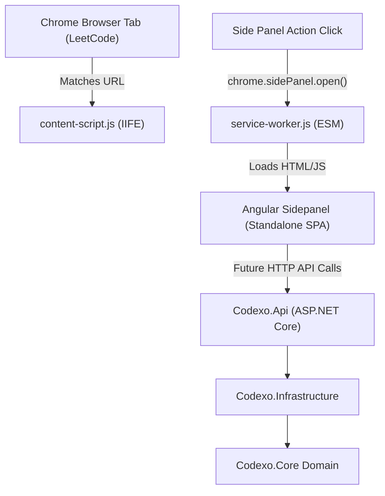

1. User opens a LeetCode problem page; Chrome injects `content-script.js`.
2. User triggers the extension icon; `service-worker.js` listens to `action.onClicked` and invokes `chrome.sidePanel.open()`.
3. Side panel loads `sidepanel/browser/index.html` hosting the standalone Angular application.
4. Future modules route requests to `Codexo.Api`, propagating downward to Core.

### Design Decisions & Rejected Alternatives
- **Decision:** Bundled content script and background worker using `esbuild` rather than adding multiple projects to `angular.json`.
  *Rejected alternative:* Multi-project Angular workspace for extension scripts. MV3 forbids DOM access in service workers and requires specific module formats that Angular's application builder complicates.
- **Decision:** Used .NET 10 solution (`.slnx`) with project references enforcing `Api -> Infrastructure -> Core`.
  *Rejected alternative:* Direct reference from Core to external packages.

### Interview Questions & Model Answers
- **Q: Why separate the content script and service worker build from Angular's application build in an MV3 extension?**
  *A:* MV3 content scripts run directly in the webpage context (IIFE format) while background service workers run in an isolated worker context without DOM access. Angular's CLI targets browser SPAs; bundling background scripts separately via esbuild gives precise control over formats, sourcemaps, and avoids loading heavy framework runtimes where unnecessary.
- **Q: Why does `Codexo.Core` have zero package references to EF Core or ASP.NET Core?**
  *A:* Clean architecture ensures core domain rules and algorithms are independent of UI frameworks, persistence mechanisms, or external services. This allows pure, fast unit testing without mocking HTTP contexts or databases.
- **Q: Why is `outputHashing: "none"` set for the Angular extension build?**
  *A:* Chrome extensions require static paths defined in `manifest.json`. Cache-busted hash names break references like `sidepanel/browser/index.html`.

### Run & Test Commands
```bash
# Build backend solution
dotnet build Codexo.slnx

# Run all backend unit & integration tests
dotnet test Codexo.slnx --verbosity normal

# Install and build extension
cd extension
npm run build
```

### Common Pitfalls
- **Manifest path mismatches:** Angular 21 defaults output to `dist/codexo/sidepanel/browser/index.html`. Ensure `manifest.json` points to the exact path generated.
- **Leaking references into Core:** Accompanying NuGet packages like `Microsoft.AspNetCore.Http` into Core violates architectural boundaries.


## M1: Domain + Hint Logic

### What We Built
We implemented the domain model and hint-safety engine in `Codexo.Core` with zero external dependencies. The domain entities model DSA problems, user sessions, progressive hints, attempts, and feedback. `HintLadder` enforces server-authoritative 5-level progression (L1 to L5) and prevents duplicate level advancements. `AttemptGatingValidator` validates that unlocking L2+ requires a meaningful written attempt, rejecting empty submissions, keysmash gibberish, trivial one-liners, and full-solution solicitations. `SolutionGuard` and `AiResponseValidator` structurally inspect AI outputs for markdown code blocks, compilable statements, full solution dumps, and level-specific spoilers (banning algorithms/data structures at L1 and algorithm/pattern names at L2).

### Concepts
- **Server-Authoritative Progression:** The server alone computes and advances hint levels; client-provided level values are ignored to prevent tampering or skipping ahead. File: [src/Codexo.Core/Hints/HintLadder.cs](file:///c:/Ariram/CodeXO/src/Codexo.Core/Hints/HintLadder.cs).
- **Structural Solution Guarding:** Rather than relying merely on naive keyword searches, `SolutionGuard` detects programming syntax patterns (function declarations, semicolon-terminated assignments, loops) and code fences to guarantee that no compilable code is leaked. File: [src/Codexo.Core/Hints/SolutionGuard.cs](file:///c:/Ariram/CodeXO/src/Codexo.Core/Hints/SolutionGuard.cs).
- **Attempt Gating:** A pedagogical safeguard that blocks hints past L1 until the user submits a verifiable written reflection (minimum 15 characters, 3 words, non-trivial, non-gibberish) describing what they tried or understood. File: [src/Codexo.Core/Hints/AttemptGatingValidator.cs](file:///c:/Ariram/CodeXO/src/Codexo.Core/Hints/AttemptGatingValidator.cs).

### Runtime Flow
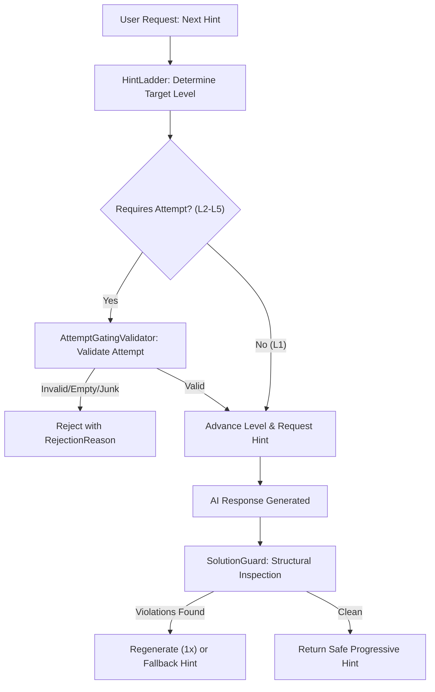

1. User requests a hint for their active session; `HintLadder` calculates the next level.
2. If advancing past L1, `AttemptGatingValidator` checks the user's attempt for length, word count, gibberish, and solution begging.
3. Once validated, the AI generates candidate hint content.
4. `SolutionGuard` inspects the text for code blocks, compilable statements, and spoilers.
5. If safe, the hint is persisted and returned; otherwise a constrained retry or static fallback is returned.

### Design Decisions & Rejected Alternatives
- **Decision:** Structural parsing using regex and token heuristics for code detection rather than full language AST parsers.
  *Rejected alternative:* Incorporating Roslyn or Tree-sitter for multiple languages. Regex/structural patterns cover multi-language code snippets with zero external dependencies and sub-millisecond execution.
- **Decision:** Consonant-cluster and n-gram analysis for keysmash detection rather than keyboard-row letter matching.
  *Rejected alternative:* Row regex (`^[qwertyuiop]+$`). This naive check falsely rejected legitimate English words like "error" and "require".

### Interview Questions & Model Answers
- **Q: Why must hint progression be server-authoritative rather than client-driven?**
  *A:* Trusting the client allows users to inspect network calls or manipulate browser state to skip levels, bypass attempt requirements, or receive final solutions immediately. Server authority guarantees progressive learning pedagogy and idempotency against parallel duplicate clicks.
- **Q: How does `SolutionGuard` prevent false positives when users write algorithmic explanations?**
  *A:* It separates structural code indicators (code fences, return types, semicolons, assignment operators) from natural language explanations, allowing conceptual discussion while strictly blocking compilable implementation syntax.

### Run & Test Commands
```bash
# Run Core unit tests
dotnet test tests/Codexo.Core.Tests/Codexo.Core.Tests.csproj --verbosity normal
```

### Common Pitfalls
- **Overly aggressive keysmash detection:** Testing for repetitive keyboard rows flags normal words. Use consonant clustering and letter distribution metrics instead.
- **Spoiler leakage in L1/L2:** High-level algorithmic names (e.g., "Two Pointers", "Hash Map") spoil the core problem-solving deduction step and must be quarantined until L3.


## M2: Database

### What We Built
We designed and implemented the relational persistence layer in `Codexo.Infrastructure` using Entity Framework Core 10 with SQL Server LocalDB (`MSSQLLocalDB`). We configured six domain entities using the Fluent API across dedicated configuration classes, enforcing primary keys, column constraints, composite indexes, and cascading/restricted delete behaviors. We established the initial EF Core migration (`InitialCreate`) and an idempotent `DbInitializer` seeding benchmark problems (*Two Sum*, *Valid Anagram*, *Merge Two Sorted Lists*) and development preferences. Five integration tests were implemented using `WebApplicationFactory` to verify migrations, unique constraints, and cascades.

### Concepts
- **Fluent API Entity Configuration:** Decoupling entity modeling from domain entities into separate `IEntityTypeConfiguration<T>` classes keeps domain models pure and persistence concerns encapsulated. File: [src/Codexo.Infrastructure/Data/EntityConfigurations/ProblemConfiguration.cs](file:///c:/Ariram/CodeXO/src/Codexo.Infrastructure/Data/EntityConfigurations/ProblemConfiguration.cs).
- **Composite Unique Constraints:** Enforcing uniqueness across `(Platform, PlatformProblemId)` prevents duplicate problems from being inserted into the database. File: [src/Codexo.Infrastructure/Data/EntityConfigurations/ProblemConfiguration.cs](file:///c:/Ariram/CodeXO/src/Codexo.Infrastructure/Data/EntityConfigurations/ProblemConfiguration.cs).
- **Idempotent Database Initialization:** Seeding checks if records already exist prior to inserting, ensuring that server restarts do not cause unique index collision errors. File: [src/Codexo.Infrastructure/Data/DbInitializer.cs](file:///c:/Ariram/CodeXO/src/Codexo.Infrastructure/Data/DbInitializer.cs).

### Runtime Flow
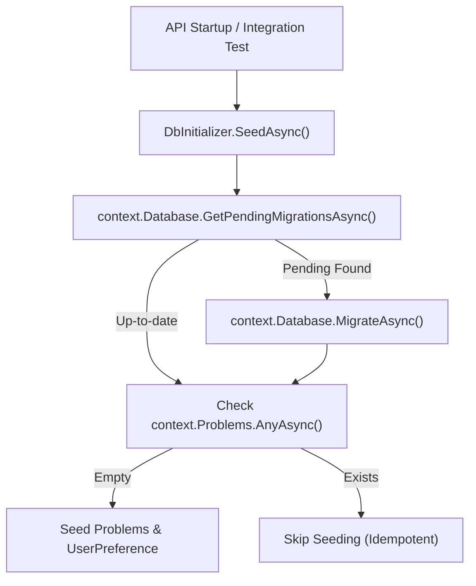

1. Application or test host boots up.
2. In Development, `DbInitializer.SeedAsync` checks for pending EF Core migrations and applies them automatically.
3. The initializer checks if any problems exist in the database.
4. If empty, it persists seed records; if records exist, it exits safely.

### Design Decisions & Rejected Alternatives
- **Decision:** Used SQL Server LocalDB with explicit Fluent API configuration classes rather than data annotations on domain entities.
  *Rejected alternative:* Using Data Annotations (`[Key]`, `[MaxLength]`) on Core entities. In Clean Architecture, domain entities should remain framework-agnostic.
- **Decision:** Pinned NuGet packages to `10.0.*` to ensure compatibility with .NET 10.
  *Rejected alternative:* Using unpinned or floating versions, which pulled in EF Core 11 daily builds incompatible with the .NET 10 runtime.

### Interview Questions & Model Answers
- **Q: Why use Fluent API over Data Annotations in Clean Architecture?**
  *A:* Data Annotations place persistence and database metadata directly on domain classes, coupling domain entities to database concepts and schema details. The Fluent API separates entity definitions from relational schema mapping, keeping the Core domain pure.
- **Q: How do you prevent migration race conditions or crashes in multi-instance or test environments?**
  *A:* By checking `GetPendingMigrationsAsync()` and ensuring seeding operations are strictly idempotent with `AnyAsync()` checks before writes.
- **Q: Why is composite indexing necessary on `(Platform, PlatformProblemId)`?**
  *A:* Different platforms (e.g. LeetCode and HackerRank) might use the same problem IDs (e.g. "1"). A composite unique index guarantees uniqueness per platform while speeding up lookups by platform and platform ID.

### Run & Test Commands
```bash
# Add EF Core migration
dotnet ef migrations add <MigrationName> --project src/Codexo.Infrastructure --startup-project src/Codexo.Api

# Update LocalDB database
dotnet ef database update --project src/Codexo.Infrastructure --startup-project src/Codexo.Api

# Run integration tests against LocalDB
dotnet test tests/Codexo.Api.IntegrationTests/Codexo.Api.IntegrationTests.csproj
```

### Common Pitfalls
- **Package Version Drift:** Adding EF Core packages without specifying version constraints can pull in next-major daily builds (e.g. 11.0.0 on a net10.0 target). Pin to matching LTS versions (`10.0.*`).
- **Missing Foreign Key Cascade Rules:** Neglecting cascade deletes causes orphaned records in child tables (e.g. hints or attempts when a session is cleared).


## M2-CLEANUP: Database Refinements

### What We Built
We refined the database architecture to safeguard user solving history by altering the `Problem -> ProblemSession` foreign key delete behavior from `Cascade` to `Restrict`. We generated EF Core migration `RestrictProblemDeleteBehavior` and applied it to SQL Server LocalDB (`MSSQLLocalDB`). We updated `DbInitializer` to enforce development-only execution and explicitly labeled `seed-user-1` as a dev placeholder prior to M3 Identity integration. We documented the complete Mermaid entity relationship diagram in documentation and established `.githooks/pre-push` to enforce build and test gates before pushing.

### Concepts
- **Referential Integrity Restrict Action:** Changing foreign key deletion from `Cascade` to `Restrict` (`ON DELETE NO ACTION` in SQL Server) prevents accidental deletion of parent problem records whenever user study sessions reference them. File: [src/Codexo.Infrastructure/Data/EntityConfigurations/ProblemSessionConfiguration.cs](file:///c:/Ariram/CodeXO/src/Codexo.Infrastructure/Data/EntityConfigurations/ProblemSessionConfiguration.cs).
- **Environment-Gated Data Seeding:** Restricting database seeding and automatic migrations strictly to `Development` ensures production environments rely exclusively on formal CI/CD database migration pipelines. File: [src/Codexo.Infrastructure/Data/DbInitializer.cs](file:///c:/Ariram/CodeXO/src/Codexo.Infrastructure/Data/DbInitializer.cs).
- **Pre-Push Git Hook:** A client-side Git hook that compiles the solution and executes all test suites, terminating the push command with a non-zero exit code if any test fails. File: [.githooks/pre-push](file:///c:/Ariram/CodeXO/.githooks/pre-push).

### Runtime Flow
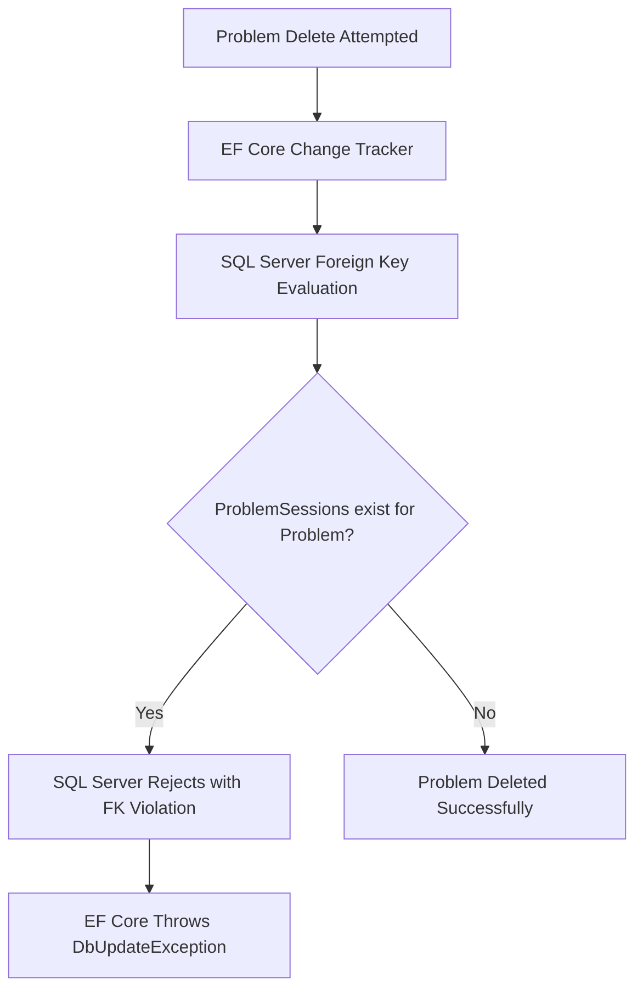

1. Application attempts to delete a `Problem` entity.
2. EF Core issues a `DELETE FROM Problems WHERE Id = @id` statement to SQL Server.
3. SQL Server checks constraint `FK_ProblemSessions_Problems_ProblemId`.
4. If any `ProblemSession` records reference the target problem, the server aborts the transaction with an FK violation.
5. EF Core wraps the error and surfaces a `DbUpdateException`, preventing data loss.

### Design Decisions & Rejected Alternatives
- **Decision:** Set `Problem -> ProblemSession` to `DeleteBehavior.Restrict` while retaining `Cascade` on `ProblemSession -> Hints` and `ProblemSession -> UserAttempts`.
  *Rejected alternative:* Cascade delete from Problem all the way down. If an administrator deletes or re-imports a problem, cascading would wipe out every user's personal attempt history and hint ladder state.
- **Decision:** Created `.githooks/pre-push` running `dotnet build` and `dotnet test`.
  *Rejected alternative:* Relying solely on remote CI. Pre-push hooks catch regressions locally before pushing broken commits to remote branches.

### Interview Questions & Model Answers
- **Q: Why should parent entities like Problems use `Restrict` instead of `Cascade` when referenced by user activity logs?**
  *A:* Cascading deletions on master/catalog data can result in catastrophic unintentional data destruction. If a problem record is removed, cascading would erase all associated user learning logs, attempts, and progress. Restrict forces administrators to either archive problems or reassign sessions.
- **Q: How does EF Core handle `DeleteBehavior.Restrict` differently when dependent entities are loaded in memory vs only in the database?**
  *A:* If dependents are loaded in the `DbContext` change tracker, EF Core attempts to nullify the foreign key client-side (throwing `InvalidOperationException` if required). If dependents exist only in the database, EF Core sends the `DELETE` command and SQL Server throws a `DbUpdateException`.
- **Q: Why should database seeding routines check `app.Environment.IsDevelopment()`?**
  *A:* Automatic seeding in production can overwrite live records, introduce dummy test users into security audits, or trigger race conditions in multi-instance horizontally scaled deployments.

### Run & Test Commands
```bash
# Enable pre-push hook locally
git config core.hooksPath .githooks

# Run all tests across solution
dotnet test Codexo.slnx --verbosity normal
```

### Common Pitfalls
- **Untracked Test Collisions:** Integration tests that insert static IDs can fail on repeated runs if previous test runs failed before cleanup. Always use unique identifiers (e.g. `Guid.NewGuid()`) for test problem records.
- **Severed Required Relationships in Memory:** Attempting to delete a parent with tracked children under `Restrict` trips client-side conceptual null checks before the SQL constraint can even be reached.


## M3: Authentication

### What We Built
We implemented complete token-based authentication and user management using **ASP.NET Core Identity** and **JSON Web Tokens (JWT)**. `AppDbContext` was upgraded to inherit from `IdentityDbContext<AppUser>`, introducing ASP.NET Core Identity tables (`AspNetUsers`, `AspNetRoles`, `AspNetUserClaims`, etc.) and establishing foreign key relationships from `ProblemSessions`, `UserPreferences`, and `HintFeedbacks` to `AspNetUsers(Id)`, eliminating the `seed-user-1` placeholder. We created `TokenService` implementing `ITokenService` to issue HMAC-SHA256 signed JWTs containing `sub`, `email`, and `jti` claims. We implemented `AuthController` endpoints (`/api/auth/register`, `/api/auth/login`, and protected `/api/auth/me`) guarded by FluentValidation and account enumeration defense. Nine integration tests verify registration, password complexity validation, login, token tampering detection, and claims authorization.

### Concepts
- **ASP.NET Core Identity Integration with Clean Architecture:** `AppUser` extends `IdentityUser` inside `Codexo.Infrastructure` while `Codexo.Core` maintains agnostic domain models storing `UserId` as a GUID string. EF Core Fluent configurations map foreign keys (`FK_ProblemSessions_AspNetUsers_UserId`) cleanly without polluting the Core domain with Identity dependencies. File: [src/Codexo.Infrastructure/Identity/AppUser.cs](file:///c:/Ariram/CodeXO/src/Codexo.Infrastructure/Identity/AppUser.cs).
- **Cryptographic JWT Authentication:** Tokens are signed using symmetric HMAC-SHA256 credentials with keys retrieved via .NET User Secrets or secure configuration. Token validation parameters enforce issuer, audience, signature, and zero clock skew. File: [src/Codexo.Infrastructure/Auth/TokenService.cs](file:///c:/Ariram/CodeXO/src/Codexo.Infrastructure/Auth/TokenService.cs).
- **Account Enumeration Defense:** Registration and login endpoints provide uniform error responses (`"Invalid email or password."`) whether an email exists or does not exist, eliminating timing and content side-channels that attackers exploit to harvest registered user emails. File: [src/Codexo.Api/Controllers/AuthController.cs](file:///c:/Ariram/CodeXO/src/Codexo.Api/Controllers/AuthController.cs).
- **SQL Server Multiple Cascade Paths Defense:** SQL Server prohibits multiple cascade delete paths leading to the same child table. Because deleting an `AppUser` cascades through `ProblemSessions -> Hints -> HintFeedbacks`, the direct foreign key from `AspNetUsers` to `HintFeedbacks` was configured with `DeleteBehavior.Restrict` (`ON DELETE NO ACTION`), while `ProblemSessions` and `UserPreferences` use `Cascade`. File: [src/Codexo.Infrastructure/Data/EntityConfigurations/HintFeedbackConfiguration.cs](file:///c:/Ariram/CodeXO/src/Codexo.Infrastructure/Data/EntityConfigurations/HintFeedbackConfiguration.cs).
- **Startup Secret Presence Check:** In accordance with Codexo security rules, the application verifies that the JWT signing key is configured and at least 32 bytes at startup, reporting strictly `[Startup Check] JWT signing key configured: yes/no` without exposing secret values to logs or consoles. File: [src/Codexo.Api/Program.cs](file:///c:/Ariram/CodeXO/src/Codexo.Api/Program.cs).

### Runtime Flow
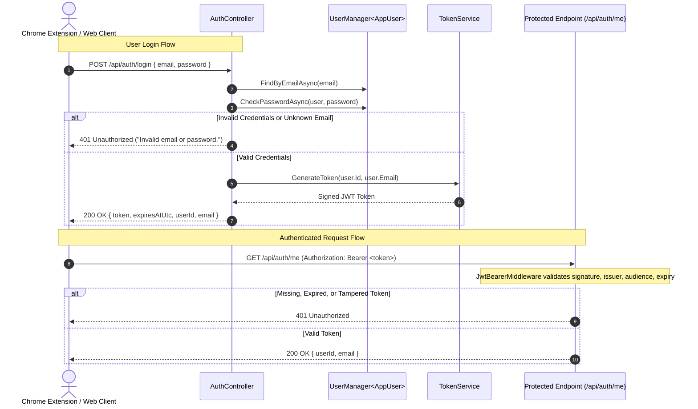

### Design Decisions & Rejected Alternatives
- **Decision:** Retained string `UserId` on `Codexo.Core` domain entities and mapped foreign keys in `Codexo.Infrastructure` via Fluent API without navigation properties on Core entities.
  *Rejected alternative:* Having `ProblemSession` reference `AppUser` directly. This would violate the Clean Architecture dependency rule by forcing `Codexo.Core` to depend on `Microsoft.AspNetCore.Identity.EntityFrameworkCore`.
- **Decision:** Configured `DeleteBehavior.Restrict` on `HintFeedback -> AppUser` and `Cascade` on `ProblemSession -> AppUser`.
  *Rejected alternative:* Cascade on all user foreign keys. SQL Server rejected the schema migration with error 1785 (cycles or multiple cascade paths) because `HintFeedbacks` would receive cascade delete signals from both `Hints` and `AspNetUsers`.
- **Decision:** Short access token lifetime (60 minutes) with refresh tokens specified as design-only in M3.
  *Rejected alternative:* Building complex refresh token rotation endpoints before extension client storage architecture is implemented.

### Interview Questions & Model Answers
- **Q: How did you implement Clean Architecture when integrating ASP.NET Core Identity with your domain entities?**
  *A:* ASP.NET Core Identity is an infrastructure and framework concern. In `Codexo.Core`, our domain entities (`ProblemSession`, `HintFeedback`, `UserPreference`) define `UserId` as a pure primitive `string` with no dependencies on Identity. In `Codexo.Infrastructure`, `AppDbContext` inherits from `IdentityDbContext<AppUser>`, and entity configurations establish relational foreign keys to `AspNetUsers(Id)` via Fluent API shadow foreign keys (`builder.HasOne<AppUser>().WithMany().HasForeignKey(s => s.UserId)`). This keeps our Core domain completely agnostic of authentication frameworks.
- **Q: Why did SQL Server reject the migration when configuring cascade delete from AspNetUsers to HintFeedbacks, and how did you resolve it?**
  *A:* SQL Server prohibits multiple cascade delete paths to a single table to prevent referential ambiguity and delete cycles. In our schema, deleting an `AppUser` cascades through `ProblemSessions -> Hints -> HintFeedbacks`. Adding a direct cascade foreign key from `AspNetUsers` to `HintFeedbacks` created two simultaneous cascade paths to `HintFeedbacks`. We resolved this by setting the direct relationship `HintFeedbacks.UserId -> AspNetUsers.Id` to `DeleteBehavior.Restrict` (`ON DELETE NO ACTION`), allowing the cascade to proceed exclusively through the session/hint hierarchy.
- **Q: What is account enumeration, and how does your API defend against it?**
  *A:* Account enumeration occurs when an API provides different responses (e.g. "Email does not exist" vs "Incorrect password") or observable execution timing differences that allow an attacker to determine whether a given email address has an active account. In Codexo, both registration and login endpoints return uniform, non-distinguishing error messages and HTTP status codes (`401 Unauthorized: "Invalid email or password."`) regardless of whether the email was registered or the password was incorrect.

### Run & Test Commands
```bash
# Set local dev JWT key securely in User Secrets
dotnet user-secrets set "Jwt:Key" "<strong-32-byte-secret>" --project src/Codexo.Api/Codexo.Api.csproj

# Run all unit and integration tests (85 total)
dotnet test Codexo.slnx --verbosity normal
```

### Common Pitfalls
- **SQL Server Error 1785 (Multiple Cascade Paths):** SQL Server does not permit multiple cascade delete paths leading to the same table. Always trace all foreign key paths and apply `Restrict` / `NoAction` to redundant paths.
- **Leaking Secrets in Console/Logs:** Never print secret keys or configuration values during startup checks. Check key presence and length, and output only boolean indicators (`yes/no`).


## M4: Problems + Sessions

### What We Built
We implemented problem context intake, catalog deduplication, and user study session lifecycle management in `Codexo.Infrastructure` and `Codexo.Api`. We established DTOs and contracts in `Codexo.Core` (`ProblemIntakeRequest`, `ProblemDto`, `ProblemSessionResponse`, and `ISessionService`). In `SessionService`, incoming problem statements from DSA platforms (such as LeetCode) are validated against strict length limits (with descriptions bounded up to 20,000 characters) and untrusted input constraints via FluentValidation. Problems are idempotently get-or-created by composite key `(Platform, PlatformProblemId)`, updating catalog text when details change. The service seamlessly retrieves or initializes the user's active session starting at `L1_Understand` and handles browser tab context switching without data corruption. Above all, **strict per-user data isolation** is enforced across all session endpoints, verified by integration tests proving User B receives `404 Not Found` when attempting to access User A's session.

### Concepts
- **Untrusted Input Defense & Content Bounding:** Content extracted from third-party web pages must be treated as untrusted user input. FluentValidation enforces strict structural rules (valid platform enum, URL format, title $\le$ 256 chars, description $\le$ 20,000 chars) to prevent payload-based denial of service or prompt-injection attacks. File: [src/Codexo.Api/Validators/ProblemIntakeRequestValidator.cs](file:///c:/Ariram/CodeXO/src/Codexo.Api/Validators/ProblemIntakeRequestValidator.cs).
- **Catalog Upsert & Problem Deduplication:** DSA problems belong to a shared catalog identified by composite unique index `(Platform, PlatformProblemId)`. Multiple users studying the same problem share the single underlying `Problem` record while maintaining isolated `ProblemSession` records. File: [src/Codexo.Infrastructure/Services/SessionService.cs](file:///c:/Ariram/CodeXO/src/Codexo.Infrastructure/Services/SessionService.cs).
- **Per-User Isolation via Claims Principal:** User identity is never accepted from request query strings or bodies. The server extracts the authenticated `UserId` directly from the validated JWT claims (`ClaimTypes.NameIdentifier`). Every database query enforces `WHERE s.UserId == userId`. File: [src/Codexo.Api/Controllers/SessionsController.cs](file:///c:/Ariram/CodeXO/src/Codexo.Api/Controllers/SessionsController.cs).
- **Enumeration Defense via 404 Responses:** When a user requests a session ID belonging to another user, the API returns `404 Not Found` rather than `403 Forbidden`. This conceals the existence of other users' session GUIDs from attackers. File: [src/Codexo.Api/Controllers/SessionsController.cs](file:///c:/Ariram/CodeXO/src/Codexo.Api/Controllers/SessionsController.cs).

### Runtime Flow
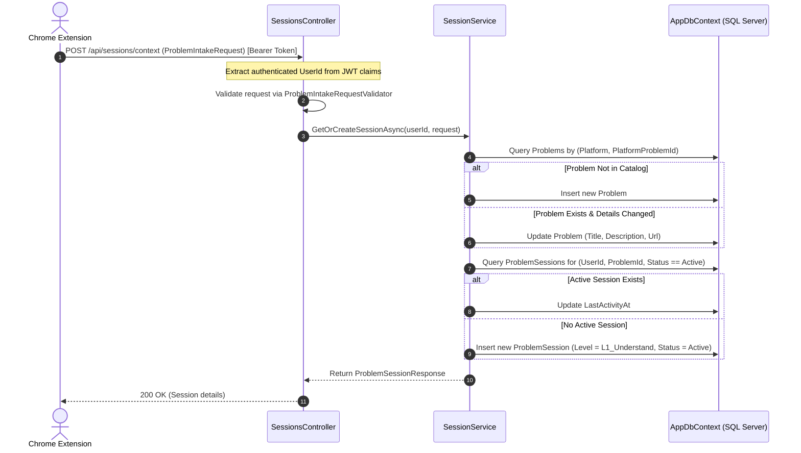

### Design Decisions & Rejected Alternatives
- **Decision:** Returned `404 Not Found` rather than `403 Forbidden` when accessing a cross-user session.
  *Rejected alternative:* Returning `403 Forbidden`. While semantically descriptive, `403` informs an attacker that a resource ID exists in the system, opening an ID enumeration vulnerability.
- **Decision:** Implemented `ISessionService` directly using `AppDbContext` without introducing a Generic Repository layer.
  *Rejected alternative:* Creating `IProblemRepository` and `ISessionRepository`. Codexo Build Rules forbid adding an extra Repository abstraction over EF Core, which already acts as an in-memory repository and unit of work.
- **Decision:** Bound problem description lengths to 20,000 characters.
  *Rejected alternative:* Unbounded string inputs or tiny 1,000 character limits. Real DSA interview questions (e.g. text-heavy geometry or graph problems with long constraints) frequently exceed 2,000 characters, while 20,000 characters provides ample space while protecting database buffers.

### Interview Questions & Model Answers
- **Q: How does Codexo guarantee multi-tenant/per-user data isolation on study sessions?**
  *A:* Multi-tenant data isolation is enforced at three levels: (1) Authentication: Endpoints require a valid JWT, and the user identity is extracted strictly from the cryptographically verified `NameIdentifier` claim, never from client-supplied request parameters. (2) Query filtering: Every database retrieval executes with an explicit `WHERE s.UserId == authenticatedUserId` clause. (3) Security responses: Requests attempting to read or manipulate records belonging to another user return `404 Not Found`, ensuring unauthorized users cannot even verify the existence of another user's session IDs.
- **Q: How did you implement problem deduplication when thousands of users might study the same LeetCode problem?**
  *A:* In our relational schema, `Problems` is a shared catalog table indexed with a unique composite constraint on `(Platform, PlatformProblemId)`. When a user requests hints, `SessionService` performs an idempotent upsert: if the problem exists, its record is reused and refreshed if text changed; if not, a new catalog entry is created. Each user's study session is then linked to that shared `ProblemId` via a separate `ProblemSession` record.
- **Q: Why should webpage content extracted by a Chrome extension content script be treated as untrusted input?**
  *A:* Web content scripts run in the DOM of arbitrary external websites. Malicious or compromised pages could inject arbitrary HTML, oversized payloads to induce memory exhaustion, or crafted text designed to manipulate downstream LLMs (prompt injection). Validating lengths, sanitizing formats, and enforcing strict input boundaries at the API gateway protects the database and AI pipeline.

### Run & Test Commands
```bash
# Run all unit and integration tests (90 total)
dotnet test Codexo.slnx --verbosity normal
```

### Common Pitfalls
- **Accidental Cross-User Data Leaks:** Forgetting to filter by `UserId` when retrieving entities by GUID primary key (`context.ProblemSessions.FindAsync(id)`) allows any authenticated user to inspect another user's data if they obtain or guess the GUID. Always query with `FirstOrDefaultAsync(s => s.Id == id && s.UserId == userId)`.
- **String Input Nullability & Whitespace:** DSA problem scrapers frequently return trailing whitespace or omitted difficulty fields. Always trim strings and provide fallback defaults (`"Unknown"`) before persistence.


## M5: AI Layer (Gemini Integration & Evaluation Harness)

### What We Built
We built the complete AI abstraction layer connecting Codexo to Google's Gemini API via an OpenAI-compatible endpoint, while preserving complete offline determinism for testing and CI. We authored `IAiClient`, structured DTOs (`AiPromptRequest`, `AiHintResponse`), domain exceptions (`AiQuotaExceededException`, `AiAuthenticationException`, `AiServiceUnavailableException`), and `HintPromptBuilder` that compiles embedded prompt templates (`Base.txt`, `L1.txt`..`L5.txt`) with delimiter-wrapped user data for prompt-injection defense. We built `TolerantJsonParser` for resilient schema extraction and `OpenAiCompatibleAiClient` targeting `gemini-4-hydrogen` with low reasoning effort, exponential backoff for transient 503 spikes, 429 quota handling, and sanitized token-only audit logging. A 10-problem benchmark evaluation harness evaluated 50 total hints against `SolutionGuard` (100% compliance), and an opt-in live smoke test verified live Gemini API connectivity.

### Concepts
- **Embedded Prompt Templates:** Storing prompt templates as embedded resources (`EmbeddedResource`) in `Codexo.Core.dll` ensures prompts are version-controlled, bundled with the binary, and accessible at runtime without fragile relative file paths. File: [src/Codexo.Core/Prompts/HintPromptBuilder.cs](file:///c:/Ariram/CodeXO/src/Codexo.Core/Prompts/HintPromptBuilder.cs).
- **Delimiter Wrapping & Prompt Injection Defense:** Wrapping untrusted user data (attempts, descriptions) within explicit `<USER_DATA>` and `<DELIMITER>` tags prevents page content or malicious inputs from overriding system instructions. File: [src/Codexo.Core/Prompts/HintPromptBuilder.cs](file:///c:/Ariram/CodeXO/src/Codexo.Core/Prompts/HintPromptBuilder.cs).
- **Tolerant JSON Parsing:** LLMs may wrap JSON responses in markdown code fences (````json ... ````) or include conversational preambles. `TolerantJsonParser` extracts the outermost JSON object and guarantees non-null collection properties. File: [src/Codexo.Infrastructure/Ai/TolerantJsonParser.cs](file:///c:/Ariram/CodeXO/src/Codexo.Infrastructure/Ai/TolerantJsonParser.cs).
- **Reasoning Effort Optimization:** Controlling model thinking depth via `reasoning_effort: "low"` slashes latency (from >30s timeouts down to ~4s) and minimizes expensive billed reasoning tokens. File: [src/Codexo.Infrastructure/Ai/OpenAiCompatibleAiClient.cs](file:///c:/Ariram/CodeXO/src/Codexo.Infrastructure/Ai/OpenAiCompatibleAiClient.cs).
- **Zero-Secret Diagnostics:** Diagnostic checks at startup check presence without logging keys (`API key configured: yes/no`). Audit logs record strictly token counts, never headers or prompts. File: [src/Codexo.Api/Program.cs](file:///c:/Ariram/CodeXO/src/Codexo.Api/Program.cs).

### Runtime Flow
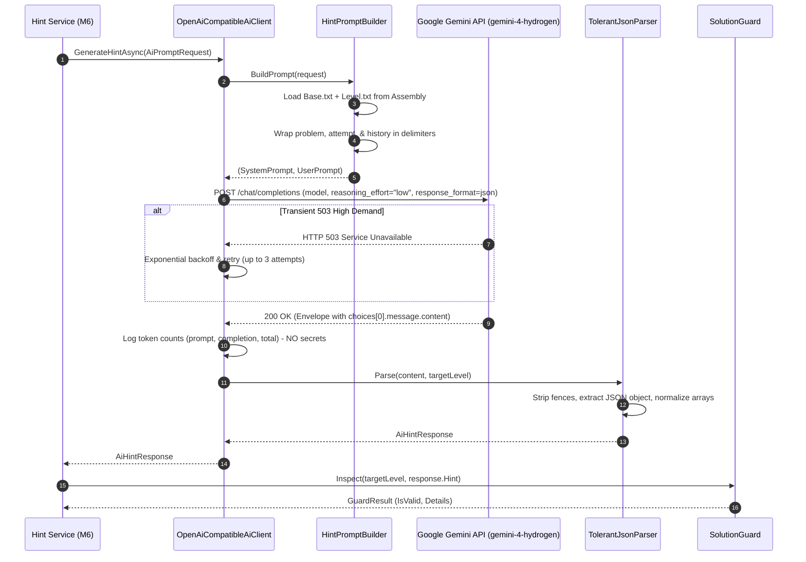

### Design Decisions & Rejected Alternatives
- **Decision:** Targeted `gemini-4-hydrogen` via Google's OpenAI-compatible endpoint with `reasoning_effort = "low"`.
  *Rejected alternative:* Creating a separate proprietary Google SDK client or using heavy thinking budgets. Google's OpenAI-compatible endpoint provides clean provider independence, and `gemini-4-hydrogen` delivered sub-5-second validated hints.
- **Decision:** Built `FakeAiClient` with deterministic static responses tailored to each level contract (L1–L5).
  *Rejected alternative:* Relying on mock HTTP handlers or requiring live API keys in CI. Offline tests must execute fast, deterministically, and with zero network dependency.
- **Decision:** Embedded prompt templates directly into the `Codexo.Core` assembly.
  *Rejected alternative:* Reading prompt files from disk at runtime with `File.ReadAllText`. Deploying to Docker, Azure, or different working directories frequently breaks relative file paths.

### Interview Questions & Model Answers
- **Q: How does Codexo protect against prompt injection when processing untrusted problem text from external DSA platforms?**
  *A:* Codexo uses structural delimiter wrapping and role separation. System instructions (loaded from embedded templates) specify strict behavioral boundaries and output schemas. All untrusted external inputs—including problem descriptions scraped from web pages, previous hint histories, and user attempt text—are isolated within labeled `<USER_DATA>` and `<DELIMITER>` tags in the user prompt, with explicit system instructions that content inside delimiters must never be interpreted as instructions.
- **Q: Why is tolerant JSON parsing essential when integrating LLMs into production microservices?**
  *A:* Even with structured outputs enabled (`response_format: { type: "json_object" }`), LLMs can occasionally enclose JSON in markdown code blocks (` ```json `), include leading/trailing whitespace, or omit optional collection arrays. A tolerant parser strips markdown artifacts, extracts the first valid JSON substring, deserializes the envelope, and defensively normalizes null collections to empty arrays, preventing deserialization crashes from disrupting the user experience.
- **Q: How did you optimize Gemini API latency and costs for real-time hint generation?**
  *A:* We configured `reasoning_effort: "low"` on `gemini-4-hydrogen`. Because reasoning tokens are billed as output tokens and slow down generation, setting reasoning effort to low reduced response latency from >30 seconds down to ~4 seconds while remaining within token budget constraints (`max_tokens: 800`).

### Run & Test Commands
```bash
# Run all unit and integration tests (109 total)
dotnet test Codexo.slnx --verbosity normal

# Run AI evaluation harness benchmark (10 DSA problems across 5 levels)
dotnet test tests/Codexo.Api.IntegrationTests/Codexo.Api.IntegrationTests.csproj --filter "EvaluationHarness"

# Run opt-in live Gemini smoke test (requires AI:ApiKey in User Secrets)
dotnet test tests/Codexo.Api.IntegrationTests/Codexo.Api.IntegrationTests.csproj --filter "LiveGeminiSmokeTest"
```

### Common Pitfalls
- **Accidental Spoilers in Fallbacks/Mocks:** Interpolating problem titles into L1/L2 mock hints can trigger SolutionGuard failures if the problem title itself contains a data structure name (e.g. "Reverse Linked List" containing "linked list"). Keep L1/L2 mock templates purely generic.
- **Leaking Secrets via Diagnostics:** Printing configuration values or raw exception bodies can expose API keys or bearer tokens in logs. Always sanitize log output to token counts only and restrict diagnostic checks to boolean presence flags.


## M6: Hint Orchestration

### What We Built
We implemented the complete server-authoritative hint orchestration lifecycle connecting user sessions, the AI client (`IAiClient`), pedagogical validation (`SolutionGuard`), caching (`HybridCache`), and progressive unlock gating (`AttemptGatingValidator`). `HintService` coordinates hint requests, manages the three-tier generation pipeline (Attempt 1 -> Constrained Retry -> Safe Static Fallback), and guards against duplicate/parallel requests using single-flight request coalescing (`ConcurrentDictionary<Guid, Lazy<Task<HintResponseDto>>>`). `HintsController` exposes secure endpoints for requesting hints, submitting attempts, and querying progression ladder status, protected by ASP.NET Core rate limiting.

### Concepts
- **Server-Authoritative Ladder Progression:** The client never dictates hint levels or unlocks. The server determines the next level from existing hints, validates that L2–L5 require an approved attempt, and guarantees levels cannot be skipped. File: [src/Codexo.Infrastructure/Services/HintService.cs](file:///c:/Ariram/CodeXO/src/Codexo.Infrastructure/Services/HintService.cs).
- **Single-Flight Request Coalescing:** When a user double-clicks or multiple client calls arrive simultaneously for the same session, they coalesce onto a single `Lazy<Task<HintResponseDto>>`. All concurrent callers receive the same generated hint without wasting AI quota, creating duplicate records, or tripping concurrency errors. File: [src/Codexo.Infrastructure/Services/HintService.cs](file:///c:/Ariram/CodeXO/src/Codexo.Infrastructure/Services/HintService.cs).
- **Three-Tier SolutionGuard & Fallback Pipeline:** If generated AI output violates structural constraints (code fences, loops, spoilers), the service triggers 1 constrained regeneration with an explicit pedagogical reprimand appended to the prompt. If the second attempt fails, a static, pedagogically-safe hint is returned from `SafeFallbackHints`, ensuring the learner is never stranded or exposed to full solutions. File: [src/Codexo.Core/Hints/SafeFallbackHints.cs](file:///c:/Ariram/CodeXO/src/Codexo.Core/Hints/SafeFallbackHints.cs).
- **HybridCache Multi-Tier Caching:** .NET 9/10 `HybridCache` caches canonical L1 (Understand) and L2 (Direction) hints by problem ID across all user sessions with a 24-hour expiration, while L3–L5 hints remain personalized to user attempts. File: [src/Codexo.Infrastructure/DependencyInjection.cs](file:///c:/Ariram/CodeXO/src/Codexo.Infrastructure/DependencyInjection.cs).
- **EF Core Change Tracking Gotcha (Added vs Modified):** Adding an entity with a pre-assigned key (`Id = Guid.NewGuid()`) directly to a tracked collection (`session.Hints.Add(hint)`) causes EF Core to assume the entity is an existing database record and mark it `EntityState.Modified`, resulting in `DbUpdateConcurrencyException` on `SaveChangesAsync`. Explicitly calling `_dbContext.Hints.Add(hint)` correctly establishes `EntityState.Added`. File: [src/Codexo.Infrastructure/Services/HintService.cs](file:///c:/Ariram/CodeXO/src/Codexo.Infrastructure/Services/HintService.cs).

### Runtime Flow
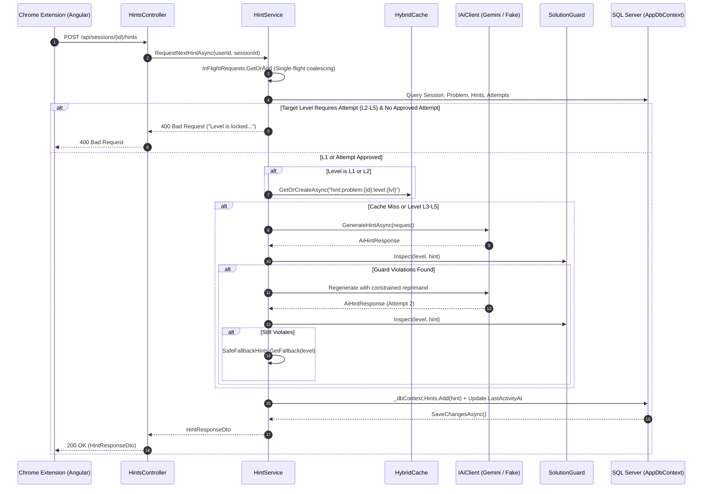

### Design Decisions & Rejected Alternatives
- **Decision:** Implemented single-flight request coalescing using `ConcurrentDictionary<Guid, Lazy<Task<HintResponseDto>>>`.
  *Rejected alternative:* Using simple database locks or letting parallel requests fail with 400 Bad Request. Single-flight guarantees that user double-clicks or parallel browser tabs safely share the identical response without wasting quota or showing confusing error banners.
- **Decision:** Cached only L1 and L2 hints in `HybridCache`, keeping L3–L5 dynamic.
  *Rejected alternative:* Caching all 5 hint levels globally. L1 and L2 are problem-level conceptual hints that are identical for all learners. L3–L5 incorporate the user's specific attempt notes, requiring dynamic generation.
- **Decision:** Added guaranteed safe static fallbacks (`SafeFallbackHints`) for all 5 levels.
  *Rejected alternative:* Throwing a 500 Internal Server Error when AI generation violates rules. A learning platform must fail gracefully, providing high-quality guidance even during AI outages or strict guard tripwires.

### Interview Questions & Model Answers
- **Q: How does Codexo handle race conditions when a user rapidly double-clicks the "Request Hint" button?**
  *A:* We use a Single-Flight / Request Coalescing pattern backed by `ConcurrentDictionary<Guid, Lazy<Task<HintResponseDto>>>`. When a request arrives, `GetOrAdd` ensures that only one asynchronous generation task is created for that session. All subsequent concurrent requests obtain the exact same task and await its completion. This guarantees that only one LLM call is executed, exactly one hint is saved to the database, the hint level is never advanced twice, and all concurrent callers receive a successful 200 OK response with the generated hint.
- **Q: Why did adding a child entity with a pre-set GUID to a tracked navigation collection trigger a `DbUpdateConcurrencyException` in EF Core?**
  *A:* In EF Core, if an entity has a primary key with a non-default value (e.g. `Id = Guid.NewGuid()`), adding it via graph traversal to an already tracked collection (`session.Hints.Add(hint)`) causes the change tracker to assume that the entity is an existing row loaded from the database that has been modified (`EntityState.Modified`). When `SaveChangesAsync()` runs, EF Core generates an `UPDATE` query instead of an `INSERT`. Since the GUID does not exist in the database, 0 rows are affected, causing EF Core to throw optimistic concurrency exception `DbUpdateConcurrencyException`. The solution is to explicitly register the entity with `_dbContext.Hints.Add(hint)`, which forces the entity state to `EntityState.Added`.
- **Q: What is the benefit of using ASP.NET Core `HybridCache` over `IMemoryCache` or `IDistributedCache`?**
  *A:* `HybridCache` (introduced in .NET 9) unifies in-process L1 memory caching with out-of-process L2 distributed caching (e.g. Redis). It natively provides built-in stampede protection (cache stampede prevention through automatic request coalescing), serialized compact storage, and a single ergonomic API (`GetOrCreateAsync`), avoiding the boilerplate of managing multi-tier cache synchronization manually.

### Run & Test Commands
```bash
# Run all unit tests including SafeFallbackHints tests (86 tests)
dotnet test tests/Codexo.Core.Tests/Codexo.Core.Tests.csproj

# Run all API integration tests including HintOrchestrationTests (37 tests)
dotnet test tests/Codexo.Api.IntegrationTests/Codexo.Api.IntegrationTests.csproj

# Run entire backend test suite (123 tests)
dotnet test Codexo.slnx

# Verify extension frontend build
npm --prefix extension run build
```

### Common Pitfalls
- **Accidental `EntityState.Modified` on Graph Navigation:** Avoid using collection `.Add()` on child entities with client-generated GUIDs unless the child entity state is explicitly configured or tracked. Prefer `DbContext.Set<T>().Add(entity)` to guarantee an `INSERT` statement.
- **Overly Restrictive Regex in Attempt Validation:** Multi-word adjectives in user solicitations (e.g. `"full complete solution code"`) require quantifier grouping (`((full|complete|entire|whole)\s+)*`) rather than single optional tokens, ensuring aggressive adversarial attempts are cleanly caught.


## M7: Feedback & Preferences

### What We Built
We implemented user feedback collection (`HintFeedback`) and persistent learner study preferences (`UserPreference`). Learners can rate hint helpfulness (thumbs up/down) with optional comments (validated $\le$ 500 characters). Feedback enforces strict per-user tenant ownership (users cannot review hints outside their own sessions) and is idempotent (subsequent submissions for the same hint update the existing rating). User preferences (`PreferredLanguage`, `AutoUnlockL1`) support lazy initialization with defaults on first retrieval and atomic upserting via `PUT /api/preferences`.

### Concepts
- **Idempotent Feedback Upsert:** `FeedbackService` checks for existing feedback by `(HintId, UserId)`. Rather than rejecting second submissions with a duplicate key conflict, it updates the existing record, ensuring smooth UX if the user changes their rating. File: [src/Codexo.Infrastructure/Services/FeedbackService.cs](file:///c:/Ariram/CodeXO/src/Codexo.Infrastructure/Services/FeedbackService.cs).
- **Cross-Tenant Hint Ownership Validation:** Before storing feedback, `FeedbackService` inspects `hint.ProblemSession.UserId == userId`. An unauthorized attempt to review another learner's hint fails with `404 Not Found`, preventing ID enumeration and cross-tenant pollution. File: [src/Codexo.Infrastructure/Services/FeedbackService.cs](file:///c:/Ariram/CodeXO/src/Codexo.Infrastructure/Services/FeedbackService.cs).
- **Lazy Default Preferences Initialization:** When a new user queries `/api/preferences`, the service seeds a default record (`PreferredLanguage = "C#"`, `AutoUnlockL1 = true`), avoiding null checks or onboarding hurdles in the side panel. File: [src/Codexo.Infrastructure/Services/PreferenceService.cs](file:///c:/Ariram/CodeXO/src/Codexo.Infrastructure/Services/PreferenceService.cs).

### Runtime Flow
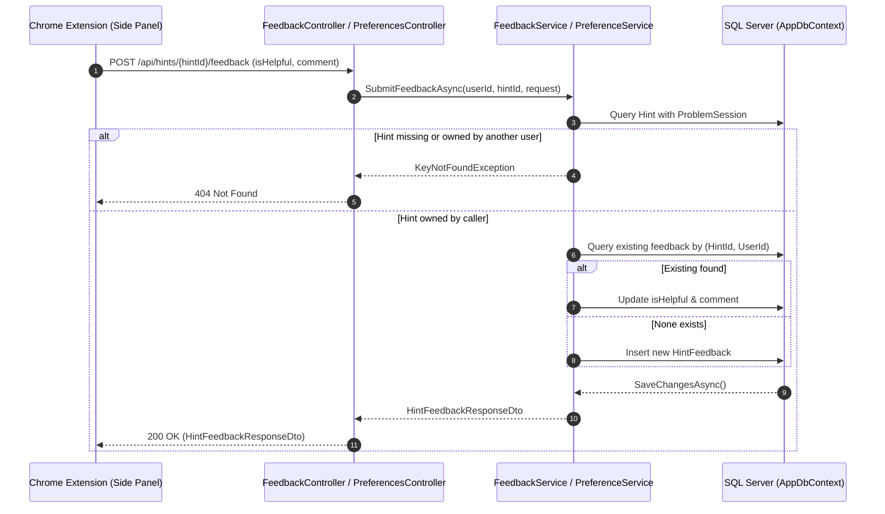

### Design Decisions & Rejected Alternatives
- **Decision:** Idempotent upsert on feedback (`POST /api/hints/{id}/feedback` updates if existing).
  *Rejected alternative:* Returning `409 Conflict` on duplicate submissions. A learner may accidentally tap thumbs down and wish to correct it to thumbs up; returning an error creates frustration.
- **Decision:** Lazy default creation for user preferences on `GET /api/preferences`.
  *Rejected alternative:* Requiring an explicit onboarding POST before any preferences exist. Defaulting to C# with AutoUnlockL1=true enables immediate out-of-the-box usage.

### Interview Questions & Model Answers
- **Q: Why should feedback submission verify hint ownership through navigation properties rather than just checking `Hints.Any(h => h.Id == hintId)`?**
  *A:* In a multi-tenant system, verifying that a target entity exists is insufficient. An attacker could brute-force hint GUIDs and submit malicious feedback on another user's study session. Checking `hint.ProblemSession.UserId == userId` guarantees tenant isolation. Returning a `404 Not Found` rather than a `403 Forbidden` also prevents attackers from learning whether a specific GUID exists in the system.
- **Q: How does `PreferenceService` ensure atomic updates when modifying user preferences?**
  *A:* Preferences are keyed by a unique `UserId` index in SQL Server. `UpsertPreferencesAsync` queries the tracked entity within the scoped DbContext transaction and applies property changes or inserts a new row, ensuring that concurrent requests for the same user modify the same record without duplicate key violations.

### Teach-back (for Ariram)
1. **Q: Why does `FeedbackService` return a `404 Not Found` instead of `403 Forbidden` when User B attempts to submit feedback for a hint generated in User A's session?**
   *Model Answer:* Returning `403 Forbidden` leaks information that the GUID exists in the database, allowing ID enumeration attacks. Returning `404 Not Found` completely hides the existence of the resource from unauthorized callers, maintaining multi-tenant privacy.
2. **Q: Why is an upsert pattern preferred over `409 Conflict` for user rating / feedback endpoints in an interactive UI?**
   *Model Answer:* In interactive client UIs (like a Chrome extension sidepanel), a user might change their mind (e.g. from thumbs down to thumbs up) or double-click a rating. An upsert gracefully updates the existing rating in place, keeping the UI state consistent without triggering unnecessary error banners.

### Run & Test Commands
```bash
# Run all Feedback and Preference integration tests (8 tests)
dotnet test tests/Codexo.Api.IntegrationTests/Codexo.Api.IntegrationTests.csproj --filter "FeedbackAndPreferenceTests"

# Run entire backend test suite (131 tests)
dotnet test Codexo.slnx
```

### Common Pitfalls
- **Unbounded Comment Lengths:** Unconstrained text fields allow payload flooding and database bloat. Strict FluentValidation rules (`MaximumLength(500)`) prevent abuse before hitting the database.


## M8: Hardening

### What We Built
We hardened the backend for production reliability, security, and quota protection. We built RFC 7807 `ProblemDetails` global exception middleware (`GlobalExceptionMiddleware`), sanitized request logging (`RequestLoggingMiddleware`) that logs method, path, and duration without ever exposing tokens, passwords, or AI prompts, and an anonymous `/health` check reporting database and AI provider status without leaking secrets. We implemented configurable per-user rate limiting (default: 6 hint requests per minute partitioned by authenticated user ID) with audit logging and automatic `Retry-After: 60` headers on 429 rejections.

### Concepts
- **RFC 7807 Problem Details:** Standardized HTTP machine-readable error format (`application/problem+json`) containing status code, title, detail, type URL, and request instance path. Ensures frontends and extensions parse backend errors consistently. File: [src/Codexo.Api/Middleware/GlobalExceptionMiddleware.cs](file:///c:/Ariram/CodeXO/src/Codexo.Api/Middleware/GlobalExceptionMiddleware.cs).
- **Targeted Endpoint Rate Limiting:** Applying rate limiting (`[EnableRateLimiting("HintPolicy")]`) exclusively to expensive AI generation endpoints (`POST /api/sessions/{id}/hints`), rather than the whole controller. Lightweight DB operations (checking status, submitting attempts, reading previous hints) are not starved by AI generation limits. File: [src/Codexo.Api/Controllers/HintsController.cs](file:///c:/Ariram/CodeXO/src/Codexo.Api/Controllers/HintsController.cs).
- **Partitioned Per-User Throttling:** Using `RateLimitPartition.GetFixedWindowLimiter(userId, ...)` ensures that rate limits apply per authenticated user rather than globally or by shared NAT IP. One heavy user cannot exhaust API access for other students. File: [src/Codexo.Api/Program.cs](file:///c:/Ariram/CodeXO/src/Codexo.Api/Program.cs).
- **Zero-Secret Diagnostic Health Monitoring:** The `/health` endpoint checks database connectivity (`CanConnectAsync`) and AI provider configuration status, reporting `"Healthy"` or `"Unhealthy"`, while strictly never outputting API keys, connection strings, or environment secrets. File: [src/Codexo.Api/Controllers/HealthController.cs](file:///c:/Ariram/CodeXO/src/Codexo.Api/Controllers/HealthController.cs).

### Runtime Flow
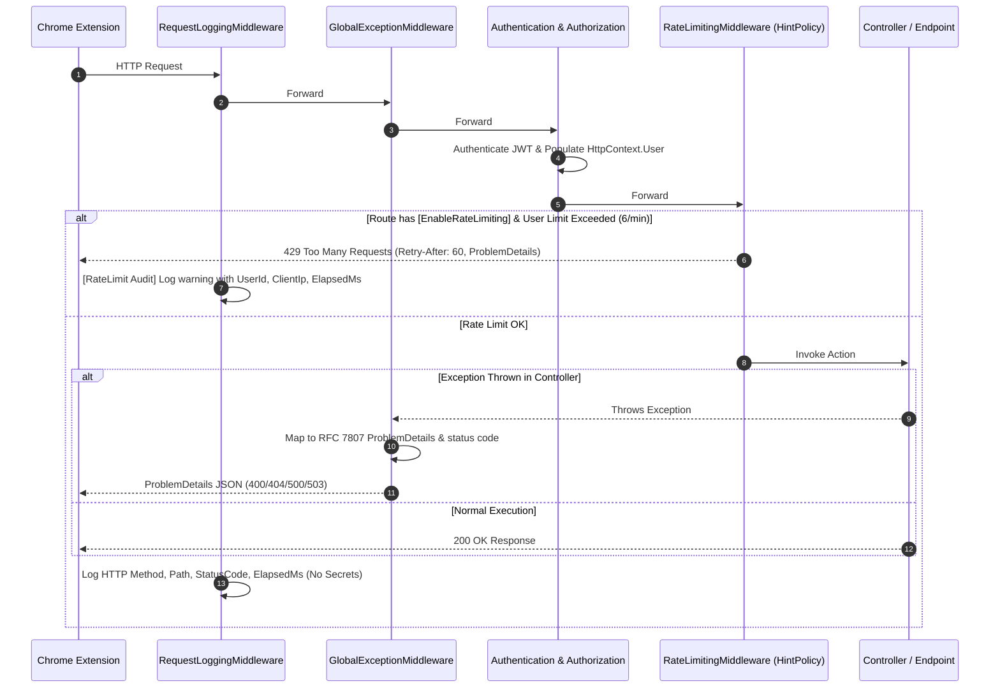

### Design Decisions & Rejected Alternatives
- **Decision:** Targeted `[EnableRateLimiting]` on `RequestNextHint` rather than the entire `HintsController`.
  *Rejected alternative:* Applying rate limiting globally to the controller. A student checking hint status or submitting an attempt notes should never be locked out simply because they recently requested a hint.
- **Decision:** Positioned `UseAuthentication` before `UseRateLimiter`.
  *Rejected alternative:* Default template order where `UseRateLimiter` runs before `UseAuthentication`. Partitioning rate limits per user requires `HttpContext.User` to be populated by the JWT middleware first.
- **Decision:** RFC 7807 `application/problem+json` formatting for all middleware-handled errors.
  *Rejected alternative:* Custom ad-hoc error shapes (`{ message = "error" }`). Standardizing on ProblemDetails allows clients to programmatically handle error types reliably.

### Interview Questions & Model Answers
- **Q: Why must `app.UseAuthentication()` precede `app.UseRateLimiter()` when using user-partitioned rate limits?**
  *A:* In ASP.NET Core, middleware executes in pipeline registration order. If `UseRateLimiter` is registered before `UseAuthentication`, `HttpContext.User` is unauthenticated (anonymous) when the rate limiter policy executes. The limiter would either fall back to IP-based rate limiting (which penalizes all users behind a shared proxy or university NAT) or lump all users into a single anonymous partition. Registering `UseAuthentication` first ensures claims (like `sub` or `NameIdentifier`) are available to partition rate limits accurately per user.
- **Q: What is the security advantage of an anonymous `/health` check that verifies database and AI provider status without leaking configuration values?**
  *A:* Health endpoints are frequently probed by load balancers, orchestrators, and uptime monitors without authentication. If a health endpoint echoes connection strings, database names, or API key prefixes, it provides an information disclosure vector for reconnaissance attacks. Checking boolean presence (`configured: true`) and connectivity (`database: "Connected"`) confirms operational readiness without disclosing sensitive infrastructure details.

### Teach-back (for Ariram)
1. **Q: Why is it critical to apply rate limiting specifically to the `RequestNextHint` endpoint rather than the entire `HintsController`?**
   *Model Answer:* `RequestNextHint` is the only endpoint that triggers expensive LLM calls to Gemini and consumes quota. Endpoints like `SubmitAttempt`, `GetSessionHints`, and `GetSessionHintStatus` are lightweight database queries. If the entire controller were rate-limited to 6 requests/minute, a user progressing through an attempt submission and status check would prematurely exhaust their quota before they could receive their hint.
2. **Q: How does `GlobalExceptionMiddleware` ensure that internal server errors (500) do not leak sensitive information to the client?**
   *Model Answer:* For unhandled exceptions, the middleware logs full exception details and stack traces to secure server-side logs (`ILogger`), but writes a sanitized RFC 7807 `ProblemDetails` object to the HTTP response with a generic detail message (*"An internal server error occurred. Please try again later."*), preventing database schemas, server paths, or internal code details from reaching the browser.

### Run & Test Commands
```bash
# Run hardening integration tests (3 tests)
dotnet test tests/Codexo.Api.IntegrationTests/Codexo.Api.IntegrationTests.csproj --filter "HardeningTests"

# Run entire backend test suite (134 tests)
dotnet test Codexo.slnx
```

### Common Pitfalls
- **Logging Sensitive Headers:** Standard request logging can inadvertently capture `Authorization: Bearer <token>` or passwords in request bodies. Keep request logging high-level (Method, Path, StatusCode, Duration) and log request bodies only on specific whitelisted, sanitized debug endpoints.


## M9: Extension Scaffold & Messaging Bridge

### What We Built
We established the Manifest V3 Chrome Extension architecture, Angular side panel bridge, background service worker lifecycle, and content script messaging for Codexo. We authored declarative contracts in `extension/src/shared/extension-messaging.ts` defining typed message envelopes (`ProblemDetected`, `ProblemUpdated`, `GetActiveProblem`, `RequestProblemExtraction`, `Ping`, `Pong`) and problem payload contexts. We configured a dual build pipeline where Angular CLI compiles only the side panel SPA, while an independent esbuild script bundles the isolated background service worker and content script entry points per Codexo Build Rules v2. In `ExtensionBridgeService`, modern Angular Signals provide reactive state binding between the Chrome extension runtime and the Angular side panel UI.

### Concepts
- **Manifest V3 Architecture & Lifecycle:** MV3 replaces persistent background pages with ephemeral service workers (`background/service-worker.js`) that sleep when idle. The Side Panel API (`chrome.sidePanel`) hosts the Angular SPA (`sidepanel/index.html`), while content scripts run in isolated DOM worlds on LeetCode pages. File: [extension/public/manifest.json](file:///c:/Ariram/CodeXO/extension/public/manifest.json).
- **Dual Pipeline Build Separation:** Manifest V3 forbids inline scripts and remote code. Angular CLI is configured exclusively for the side panel SPA. The background service worker and content script are bundled as standalone, zero-dependency ES modules via `esbuild` (`scripts/build-extension.mjs`), ensuring strict separation and fast compilation without bloated web frameworks in content scripts. File: [extension/scripts/build-extension.mjs](file:///c:/Ariram/CodeXO/extension/scripts/build-extension.mjs).
- **Strongly-Typed Asynchronous Messaging:** Communication across Chrome extension boundaries (Content Script -> Service Worker -> Side Panel) uses typed discriminated unions (`ExtensionMessage<T>`). The background service worker maintains an in-memory active problem cache mapped by tab ID (`Map<number, ProblemContextPayload>`) and synchronizes state on tab switches (`chrome.tabs.onActivated`). File: [extension/src/shared/extension-messaging.ts](file:///c:/Ariram/CodeXO/extension/src/shared/extension-messaging.ts).
- **Angular Signal-Based Bridge:** `ExtensionBridgeService` exposes Angular Signals (`isBridgeConnected`, `activeProblem`, `lastPingResponse`) to power UI reactivity in the side panel. It safely detects whether `chrome.runtime` APIs are available, enabling robust unit testing and mock development outside the browser. File: [extension/src/sidepanel/app/core/services/extension-bridge.service.ts](file:///c:/Ariram/CodeXO/extension/src/sidepanel/app/core/services/extension-bridge.service.ts).

### Runtime Flow
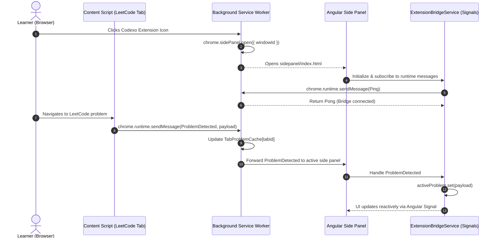

### Design Decisions & Rejected Alternatives
- **Decision:** Used `esbuild` for content script and service worker bundles, keeping Angular CLI dedicated strictly to the side panel.
  *Rejected alternative:* Configuring Angular CLI multi-projects to compile all extension entry points. Angular CLI generates heavy polyfills, runtime chunks, and DOM wrappers that conflict with MV3 service worker execution environments.
- **Decision:** Tab-scoped problem caching in the background service worker (`Map<number, ProblemContextPayload>`).
  *Rejected alternative:* Storing problem state only in the content script DOM. If a user switches between multiple LeetCode tabs or opens the side panel after page load, querying the background worker immediately returns the cached problem without forcing a DOM re-scrape.

### Interview Questions & Model Answers
- **Q: Why does Manifest V3 require separate build pipelines for the side panel versus the service worker and content script?**
  *A:* In Manifest V3, background scripts execute in a pure Service Worker environment without a `window` or `document` DOM object. Standard Angular CLI builds generate DOM-dependent runtime shims, zone.js, and script-injection mechanisms designed for web applications. By dedicating Angular CLI strictly to the side panel (which has a full HTML DOM) and using a lightweight bundler like `esbuild` for the service worker and content script, we ensure zero DOM baggage, instant startup times, and strict compliance with Manifest V3 restrictions.
- **Q: How do Angular Signals improve state management in a Chrome Extension side panel?**
  *A:* Chrome Extension messaging is inherently asynchronous and event-driven. Wrapping extension runtime events inside Angular Signals (`activeProblem = signal<ProblemContextPayload | null>(null)`) allows UI components to reactively re-render with fine-grained reactivity whenever new messages arrive from the content script or service worker, without needing complex RxJS subject subscriptions or manual change detection triggers (`ChangeDetectorRef.detectChanges()`).

### Teach-back (for Ariram)
1. **Q: Why does Manifest V3 use a background Service Worker instead of a persistent background page?**
   *Model Answer:* Persistent background pages in Manifest V2 remained in memory indefinitely, consuming RAM and battery even when the user was not interacting with the extension. MV3 replaces them with ephemeral Service Workers that are terminated by the browser when idle and spun up on-demand when an event (like a tab update or message) arrives, drastically reducing browser resource consumption.
2. **Q: Why must communication between the content script and the Angular side panel pass through the background service worker?**
   *Model Answer:* In Chrome Extension architecture, content scripts and extension pages (like the side panel) run in isolated execution contexts with different security privileges. A content script has direct access to the web page DOM but limited extension APIs; the side panel has full extension API access but zero direct access to web page DOMs. The background service worker acts as a centralized message router and state coordinator between them.

### Run & Test Commands
```bash
# Run extension unit tests (Vitest)
npm --prefix extension test -- --watch=false

# Build all extension bundles (sidepanel, background, content, manifest)
npm --prefix extension run build
```

### Common Pitfalls
- **Missing `@types/chrome` in TypeScript Config:** Angular CLI projects do not include Chrome Extension types by default. Adding `@types/chrome` and specifying `"types": ["chrome"]` in `tsconfig.app.json` and `tsconfig.spec.json` prevents `TS2304: Cannot find name 'chrome'` compile errors.
- **Accessing `window` in Service Workers:** Background service workers do not have a `window` object. Any access to `window` or `document` inside the service worker will throw a fatal runtime error and crash the worker.


## M10: Content Script (Problem Extraction)

### What We Built
We implemented resilient DOM scraping on LeetCode problem pages (`extension/src/content/leetcode-extractor.ts`) and wired it into the Chrome content script lifecycle (`extension/src/content/content-script.ts`). The extractor isolates title, platform problem ID, difficulty badge, normalized URL, and problem description text while stripping out all interactive UI chrome, buttons, copy tools, and SVGs. To handle Single Page Application (SPA) client-side routing on Next.js, we implemented a MutationObserver that detects DOM updates after client-side hydration, alongside URL polling and `popstate` listeners, broadcasting extracted problem contexts to the service worker and responding to explicit extraction queries.

### Concepts
- **Resilient Multi-Selector Extraction Hierarchy:** DSA platforms periodically update their DOM classes and UI layouts. `LeetCodeExtractor` searches ordered selector hierarchies (e.g. `div[data-cy="question-title"]` -> `.text-title-large` -> `h1` -> `document.title`) and normalizes problem number prefixes (`"1. Two Sum"` -> `problemId: "1"`, `title: "Two Sum"`). File: [extension/src/content/leetcode-extractor.ts](file:///c:/Ariram/CodeXO/extension/src/content/leetcode-extractor.ts).
- **DOM Sanitization via Cloned Nodes:** Scraped containers contain copy buttons, interactive code widgets, and navigation SVGs. Cloning the container (`container.cloneNode(true)`) allows stripping unwanted elements without mutating the user's active webpage or breaking event handlers. File: [extension/src/content/leetcode-extractor.ts](file:///c:/Ariram/CodeXO/extension/src/content/leetcode-extractor.ts).
- **SPA Client-Side Route Observation:** Platforms built on Next.js or React use HTML5 History API (`pushState`) rather than traditional page navigations. Content scripts do not re-run on internal navigations. Combining `MutationObserver` with URL polling ensures newly rendered problems are extracted immediately when navigating from one problem to another. File: [extension/src/content/content-script.ts](file:///c:/Ariram/CodeXO/extension/src/content/content-script.ts).
- **Extraction Debouncing:** DOM updates during SPA rendering occur across multiple mutation microtasks. Debouncing extractions by 300–500ms prevents incomplete DOM reads and avoids spamming the extension messaging bus. File: [extension/src/content/content-script.ts](file:///c:/Ariram/CodeXO/extension/src/content/content-script.ts).

### Runtime Flow
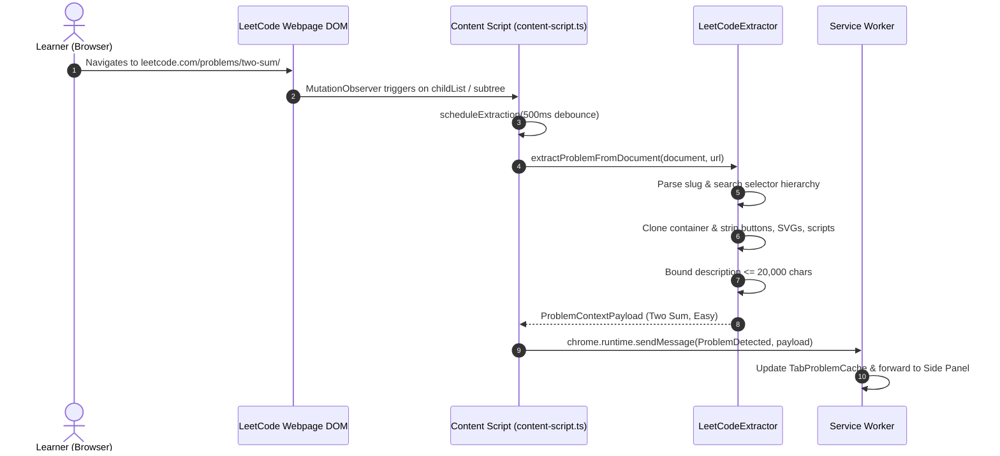

### Design Decisions & Rejected Alternatives
- **Decision:** Extractor is implemented as pure, stateless functions receiving `Document` and `url`.
  *Rejected alternative:* Tying extraction logic directly into global browser window state. Pure functions enable testing against saved HTML fixtures using DOMParser / JSDOM without running a live browser.
- **Decision:** Cloned DOM nodes before stripping tags (`cloneNode(true)`).
  *Rejected alternative:* Modifying live DOM elements in place with `.remove()`. Mutating live page elements destroys LeetCode's React virtual DOM state and breaks page interactivity for the user.

### Interview Questions & Model Answers
- **Q: Why do Chrome Extension content scripts struggle to detect route changes on modern Single Page Applications (SPAs), and how do you solve it?**
  *A:* Content scripts are injected only on initial HTTP document loads. In modern SPAs (built with React, Next.js, or Vue), navigating to a new problem uses the HTML5 History API (`history.pushState`) to update the URL and render new components client-side without a full browser reload. To detect these transitions, a content script must combine a `MutationObserver` (to listen for DOM additions), `popstate` event listeners, and URL polling to detect client-side route changes and trigger re-extraction.
- **Q: Why must problem descriptions scraped from web pages be sanitized and length-bounded before sending to your backend API?**
  *A:* Web content is untrusted and can contain malicious script tags, enormous payloads (which could cause denial of service or excessive token consumption), or hidden prompt-injection attacks. Sanitizing the DOM removes script tags and UI noise, while enforcing strict character limits (e.g. 20,000 characters) matches database column constraints and protects LLM token budgets.

### Teach-back (for Ariram)
1. **Q: Why is debouncing necessary when using a `MutationObserver` to extract content from dynamic web pages?**
   *Model Answer:* SPA frameworks like React update the DOM in rapid, sequential batches (e.g. rendering the layout skeleton, then the title, then fetching description text). Without debouncing, the observer would fire dozens of times per second, extracting incomplete DOM fragments and sending redundant messages. Debouncing waits for DOM mutations to settle before executing the full extraction.
2. **Q: What is the risk of calling `element.remove()` directly on the live webpage DOM during content scraping?**
   *Model Answer:* Calling `.remove()` on live DOM elements detaches them from the webpage, corrupting the third-party framework's internal virtual DOM tree and removing buttons or interactive controls that the user needs. By cloning the target element (`element.cloneNode(true)`) and modifying only the clone, the live page remains completely unharmed.

### Run & Test Commands
```bash
# Run extension unit tests including extractor fixtures (11 tests)
npm --prefix extension test -- --watch=false

# Build extension bundles
npm --prefix extension run build
```

### Common Pitfalls
- **Angular CLI Test Discovery with Multi-Root Folders:** By default, Angular CLI's test builder may only scan files inside `sourceRoot: "src/sidepanel"`. Updating `angular.json` with `"sourceRoot": "src"` and explicit `"index": "src/sidepanel/index.html"` ensures all tests across `src/content`, `src/shared`, and `src/sidepanel` execute under Vitest.


## M11: Side Panel UI (Angular)

### What We Built
We delivered the Angular side panel user interface using standalone components, Angular Signals, and Reactive Forms. We implemented `ApiClientService` communicating with `Codexo.Api` with cross-session JWT token persistence in `chrome.storage.local`. We built `ProblemContextBannerComponent` (rendering problem title, LeetCode problem ID, and custom difficulty chips), `HintLadderComponent` (rendering the 5 progressive pedagogical levels, observations, guiding questions, key takeaway boxes, and thumbs up/down feedback), `AttemptSubmissionComponent` (with real-time client-side validation preventing empty/junk attempts and deflecting requests for full solutions), `PreferencesModalComponent` (managing multi-language pseudocode preferences and auto-unlock settings), and `AuthPanelComponent` (providing registration, login, and user profile management).

### Concepts
- **Fine-Grained Reactivity with Angular Signals:** Components leverage Angular Signals (`signal<T>()`, `input<T>()`, `output<T>()`) to reactively update the UI without Zone.js change-detection overhead or manual `ChangeDetectorRef` calls. Derived state (e.g. `requiresAttempt()`, `canRequestDirectHint()`) recalculates automatically when session or hint arrays update. File: [extension/src/sidepanel/app/app.ts](file:///c:/Ariram/CodeXO/extension/src/sidepanel/app/app.ts).
- **Client-Side Attempt Gating & Solution Solicitation Deflection:** Even though the server is authoritative, real-time client validation improves user experience by intercepting short text (< 10 chars), repetitive junk (`aaaaaaaaaaaa`), and requests for full code (`"please give me the full complete solution code"`), guiding the user with educational reminders before an unnecessary network call is made. File: [extension/src/sidepanel/app/features/hint-panel/attempt-submission.component.ts](file:///c:/Ariram/CodeXO/extension/src/sidepanel/app/features/hint-panel/attempt-submission.component.ts).
- **Persistent Token Storage across Extension Lifecycles:** Chrome extension side panels close when the user switches browser windows or navigates away. Storing JWT tokens and user emails in `chrome.storage.local` ensures persistent authentication without requiring repeated logins. File: [extension/src/sidepanel/app/core/services/api-client.service.ts](file:///c:/Ariram/CodeXO/extension/src/sidepanel/app/core/services/api-client.service.ts).
- **Pedagogical Ladder Progression (L1–L5):** Hints are structured with distinct visual treatments: Key Observations, Guiding Questions, and Key Takeaway highlights. Each unlocked card includes feedback ratings (👍 / 👎) with optional comments, immediately syncing to `/api/hints/{id}/feedback`. File: [extension/src/sidepanel/app/features/hint-panel/hint-ladder.component.ts](file:///c:/Ariram/CodeXO/extension/src/sidepanel/app/features/hint-panel/hint-ladder.component.ts).

### Runtime Flow
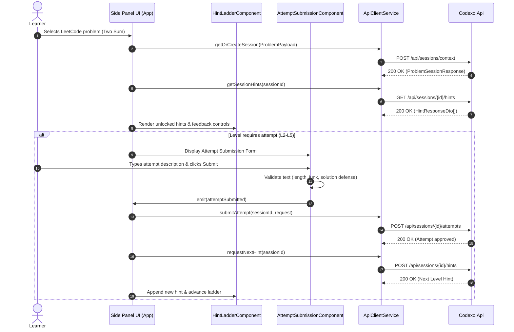

### Design Decisions & Rejected Alternatives
- **Decision:** Used Angular Signals (`signal`, `input`, `output`) across all side panel components.
  *Rejected alternative:* Using RxJS `BehaviorSubject` and `@Input()`/`@Output()` decorators. Signals provide cleaner synchronous reactivity, less boilerplate, and native support in Angular 21+.
- **Decision:** Client-side pre-validation of attempt text.
  *Rejected alternative:* Sending all attempts blindly to the server. Client-side regex checking provides instant feedback to learners typing junk or asking for solutions without consuming backend bandwidth or rate limits.

### Interview Questions & Model Answers
- **Q: How does the Angular side panel maintain authentication state across browser tab switches or side panel closures?**
  *A:* Chrome Extension side panels are destroyed and re-instantiated whenever they are closed or re-opened. To maintain authentication, `ApiClientService` uses the `chrome.storage.local` API (with fallback to `localStorage` in browser dev mode). When a user registers or logs in, the JWT token and user identity are persisted in local extension storage. Upon component initialization, `restoreToken()` synchronously reloads the token and configures `Authorization: Bearer <token>` headers for all outgoing HTTP requests.
- **Q: Why implement client-side attempt validation if the ASP.NET Core backend is authoritative for attempt gating?**
  *A:* Client-side validation delivers instant pedagogical feedback to the learner. If a student types "just give me the answer", client validation immediately deflects the request and reminds them of Codexo's learning philosophy without making a network round-trip. However, because client code can be manipulated, the backend `AttemptGatingValidator` enforces the exact same rules authoritatively before unlocking database records.

### Teach-back (for Ariram)
1. **Q: Why is `chrome.storage.local` preferred over standard `localStorage` in Chrome Extensions?**
   *Model Answer:* While `localStorage` is tied to a specific window origin and may be partitioned or cleared when cookies/cache are cleared, `chrome.storage.local` is isolated directly to the extension's extension ID, persists across background worker wakeups and restarts, and is accessible asynchronously by content scripts, service workers, and extension pages alike.
2. **Q: What is the purpose of single-flight request coalescing on the backend when the UI already has a disabled submit button state?**
   *Model Answer:* While client-side button disabling (`[disabled]="isLoading()"`) prevents accidental double-clicks in a well-behaved UI, network latency, multiple open tabs for the same session, or automated API tools could still dispatch parallel requests. Defense in depth requires the server to coalesce concurrent requests so that hint progression and AI billing are never compromised.

### Run & Test Commands
```bash
# Run all extension unit and component tests (22 tests)
npm --prefix extension test -- --watch=false

# Build production extension bundles
npm --prefix extension run build
```

### Common Pitfalls
- **`chrome.storage.local.get` Type Inference:** TypeScript may type `result[key]` as `{}` rather than `any` or `string`. Explicit casting (`String(result['codexo_token'])`) prevents `TS2345: Argument of type '{}' is not assignable to parameter of type 'string'`.


## M12: Integration & Error Handling

### What We Built
We integrated the full end-to-end Codexo system across all boundaries: DOM scraping on LeetCode HTML fixtures, message dispatch to the background service worker, reactive state synchronization in the Angular side panel, and HTTP API execution through ASP.NET Core Web API, EF Core Code First, and the pedagogical AI pipeline. We authored an end-to-end integration test suite in `extension/src/sidepanel/app/integration.spec.ts` (verifying happy-path ladder advancement, network outages, and 429 rate limit notifications) and a contract test suite in `tests/Codexo.Api.IntegrationTests/EndToEndContractTests.cs` (verifying registration, session intake, attempt gating, feedback ratings, user preferences, and unauthenticated protection).

### Concepts
- **Cross-Boundary Contract Alignment:** Frontend TypeScript DTO interfaces (`ProblemContextPayload`, `ProblemSessionResponse`, `HintResponseDto`, `SubmitAttemptRequest`) match backend C# records (`ProblemIntakeRequest`, `ProblemSessionResponse`, `HintResponseDto`, `SubmitAttemptRequestDto`), eliminating serialization drift across the HTTP boundary. File: [tests/Codexo.Api.IntegrationTests/EndToEndContractTests.cs](file:///c:/Ariram/CodeXO/tests/Codexo.Api.IntegrationTests/EndToEndContractTests.cs).
- **Comprehensive Error Resilience (429 / 503 / Network Down):** The side panel wraps all asynchronous HTTP calls with explicit error handlers. When the API is offline or returns an RFC 7807 problem detail (such as 429 rate limit with `Retry-After: 60`), the UI displays a clean banner without losing the user's attempt draft or crashing the side panel. File: [extension/src/sidepanel/app/integration.spec.ts](file:///c:/Ariram/CodeXO/extension/src/sidepanel/app/integration.spec.ts).
- **Opt-In Live Network Gating for CI/Offline Safety:** Integration tests that hit public LLM endpoints (like Google Gemini) are strictly gated (`RUN_LIVE_TESTS=true` or `AI:RunLiveSmokeTest=true`). Standard automated CI/CD runs execute exclusively against deterministic mocks (`FakeAiClient`), guaranteeing 100% offline pass rates and immunity from transient external cloud provider outages. File: [tests/Codexo.Api.IntegrationTests/AI/AiEvaluationHarness.cs](file:///c:/Ariram/CodeXO/tests/Codexo.Api.IntegrationTests/AI/AiEvaluationHarness.cs).

### Runtime Flow
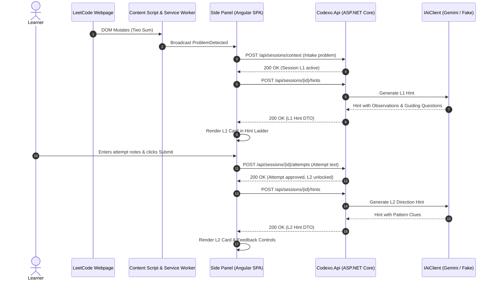

### Design Decisions & Rejected Alternatives
- **Decision:** Gated live cloud AI smoke tests behind `RUN_LIVE_TESTS=true`.
  *Rejected alternative:* Running live Gemini API calls on every test run. External LLM endpoints experience intermittent 503 high-demand spikes and rate limits; offline test suites must execute fast, deterministically, and with zero network dependency.
- **Decision:** Unified error banner in side panel for network, 429, and 500 errors.
  *Rejected alternative:* Showing native browser `alert()` popups or unhandled console errors. In-panel error banners preserve user context and allow seamless retry.

### Interview Questions & Model Answers
- **Q: How do you design an end-to-end integration test suite for a Chrome Extension communicating with a backend API?**
  *A:* We decouple testing into two complementary layers: (1) In the extension frontend (Vitest/JSDOM), we feed recorded HTML fixtures into the content script extractor, route the resulting payload through the background messaging mock to the Angular side panel, and verify that the Angular components trigger the correct HTTP client requests and reactively update their Signals. (2) On the backend (ASP.NET Core `WebApplicationFactory`), contract tests execute the identical sequence of HTTP requests—from user registration and problem intake to attempt submission, hint unlocking, and preference updates—against the live in-memory API pipeline.
- **Q: How does Codexo protect its CI/CD pipeline from transient failures in third-party LLM providers?**
  *A:* By implementing provider independence via `IAiClient`. In our CI/CD pipeline and offline test suite, the dependency injection container registers `FakeAiClient`, which provides deterministic, schema-compliant hint responses. Live provider tests (calling `OpenAiCompatibleAiClient` against Gemini) are isolated in an opt-in smoke test requiring explicit environment flags (`RUN_LIVE_TESTS=true`), ensuring builds remain 100% green regardless of external cloud outages.

### Teach-back (for Ariram)
1. **Q: Why should end-to-end contract tests verify HTTP status codes and error shapes (like 400 Bad Request on premature hint requests) rather than only happy paths?**
   *Model Answer:* Pedagogical guardrails like attempt-gating and rate-limiting are core security and business rules. If a client could bypass attempt-gating to fetch hints prematurely, the learning value of the product would be compromised. Contract tests must verify that the server strictly enforces these invariants and returns structured RFC 7807 problem details.
2. **Q: What is the benefit of keeping recorded DOM fixtures in the repository for scraper testing?**
   *Model Answer:* External websites frequently update their DOM class names and layout. Having version-controlled HTML fixtures allows unit and integration tests to run instantly, deterministically, and offline without requiring network access to third-party servers or managing fragile headless browser sessions in CI.

### Run & Test Commands
```bash
# Run all extension unit and integration tests (25 tests)
npm --prefix extension test -- --watch=false

# Run all backend unit and integration tests (136 tests)
dotnet test Codexo.slnx
```

### Common Pitfalls
- **Missing Required DTO Properties in Integration Tests:** When constructing complex records (such as `ProblemIntakeRequest`), omitting required properties (e.g. `Slug`) causes compile-time errors `CS7036`. Always verify constructor signatures when authoring contract tests.


## M13: Release & Packaging

### What We Built
We established the release pipeline, packaging scripts, GitHub Actions CI/CD workflows, and production documentation for Codexo. We authored `package-extension.mjs` which validates required Manifest V3 build outputs (`manifest.json`, `background/service-worker.js`, `content/content-script.js`, `sidepanel/browser/index.html`) and packages them into `dist/codexo-extension-v0.1.0.zip` using platform-aware compression. We authored `.github/workflows/ci.yml` providing automated parallel CI/CD for both .NET 10 Web API and the Angular extension, running all 161 automated tests and publishing the packaged extension as a release artifact. Finally, we updated `README.md` into a comprehensive architecture, setup, and testing guide.

### Concepts
- **Cross-Platform Manifest V3 Release Packaging:** Extension packaging scripts must dynamically handle platform compression differences (`powershell Compress-Archive` on Windows, `zip -r` on POSIX environments) while asserting the structural presence of mandatory MV3 entry points before producing the archive. File: [extension/scripts/package-extension.mjs](file:///c:/Ariram/CodeXO/extension/scripts/package-extension.mjs).
- **Parallel Matrix CI/CD Workflows:** Separating backend (.NET SDK) and extension (Node.js) into independent GitHub Actions jobs enables parallel execution, faster feedback cycles, and dedicated dependency caching (`setup-dotnet` and `setup-node`). File: [.github/workflows/ci.yml](file:///c:/Ariram/CodeXO/.github/workflows/ci.yml).
- **Artifact Retention & Distribution:** Generating compressed zip artifacts in CI (`actions/upload-artifact@v4`) allows automated publishing to GitHub Releases or Chrome Web Store upload tools without manual local compilation. File: [.github/workflows/ci.yml](file:///c:/Ariram/CodeXO/.github/workflows/ci.yml).

### Runtime Flow
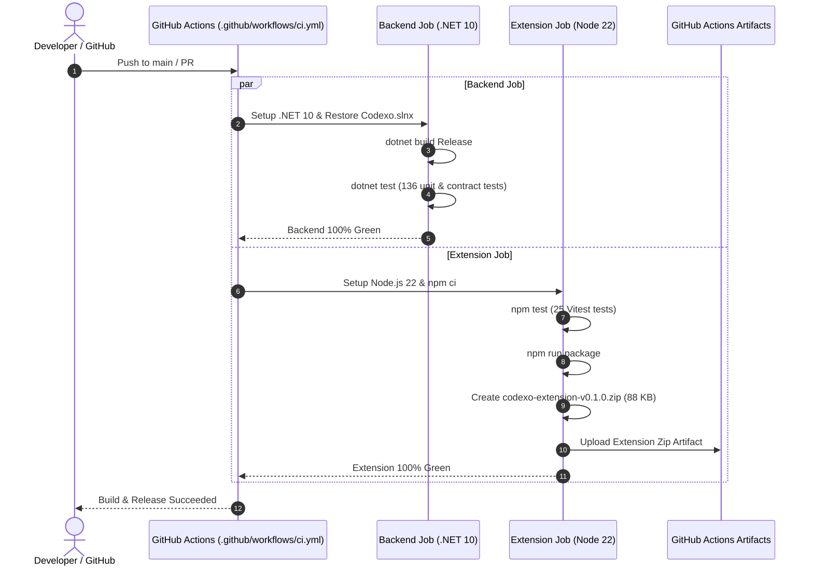

### Design Decisions & Rejected Alternatives
- **Decision:** Packaged the extension via Node.js script calling platform compression built-ins (`Compress-Archive` / `zip`).
  *Rejected alternative:* Adding heavy third-party npm compression dependencies (`archiver`, `adm-zip`). Built-in tools have zero dependency baggage, zero supply-chain risk, and run instantly.
- **Decision:** Uploaded packaged zip directly in the CI pipeline.
  *Rejected alternative:* Requiring developers to build and zip extension releases manually on their local machines. Automated CI builds guarantee reproducibility and eliminate "works on my machine" packaging differences.

### Interview Questions & Model Answers
- **Q: How does your CI/CD pipeline ensure that the packaged Chrome Extension actually runs in a browser?**
  *A:* First, during `npm test`, Vitest runs unit tests on the Angular components and content script extractor, including simulated DOM fixtures and Chrome Extension messaging mocks. Second, during `package-extension.mjs`, an asset validation pre-check confirms that all mandatory Manifest V3 entry points (`manifest.json`, `background/service-worker.js`, `content/content-script.js`, and `sidepanel/browser/index.html`) exist and are non-empty before compression. Finally, the built artifact is published directly to GitHub Actions for end-to-end verification.
- **Q: Why should backend and frontend builds run as separate parallel jobs in GitHub Actions?**
  *A:* Running them in separate jobs allows GitHub Actions to spin up two isolated runner VMs concurrently, cutting overall CI wall-clock time in half. It also isolates language environments (.NET SDK vs Node.js) and prevents frontend dependency updates from invalidating backend restore caches.

### Teach-back (for Ariram)
1. **Q: Why is it necessary to verify that `sidepanel/browser/index.html` exists before zipping the extension?**
   *Model Answer:* Modern Angular application builders place browser output in a nested `browser/` subfolder. If `manifest.json` specifies `"sidepanel/browser/index.html"` but the build output location changes or fails, Chrome will display a broken side panel error upon installation. Validating asset paths in the packaging script ensures broken builds fail fast in CI before release.
2. **Q: How does Codexo maintain zero-secret compliance in public or shared GitHub repositories?**
   *Model Answer:* Secrets (such as JWT signing keys and Gemini API keys) are never stored in code, configuration files, or git history. During local development, secrets are managed through `dotnet user-secrets` stored outside the repository tree. In CI/CD, tests execute against mock clients (`FakeAiClient`), and any production deployments inject secrets dynamically via encrypted GitHub Repository Secrets as environment variables.

### Run & Test Commands
```bash
# Package extension zip artifact
npm --prefix extension run package

# Verify all tests across backend and extension (161 tests total)
dotnet test Codexo.slnx
npm --prefix extension test -- --watch=false
```

### Common Pitfalls
- **Angular 17+ / 21 `browser/` Subdirectory in Manifest V3:** Angular's `@angular/build:application` defaults to writing to `outputPath/browser`. Forgetting to align `side_panel.default_path` in `manifest.json` causes Chrome to fail opening the side panel. Always ensure `manifest.json` points to `sidepanel/browser/index.html`.


---

## C1: Chat Core (Backend, Non-Streaming)

### What We Built
We executed the Chat Pivot architectural shift: removed the 5-level hint ladder, Solution Guard, and all seeded benchmark problems. We established the `Conversation` and `Message` entities with EF Core migration `DropHintTablesAndAddChat`, configured server-side secret redaction via `SecretRedactor`, implemented prompt injection defense in `ChatPromptBuilder` + `Chat.txt`, and added `POST /api/chat/messages` with authentication and rate limiting (`ChatPolicy`).

### Concepts
- **Data Minimization:** To protect developer privacy and avoid intellectual property exposure, `Message` entities persist only conversation dialog and context *metadata* (platform, host, title, language, code line count, truncation flags). Raw code and page text are processed in memory and never stored in the database. File: [src/Codexo.Core/Entities/MessageContextMetadata.cs](file:///c:/Ariram/CodeXO/src/Codexo.Core/Entities/MessageContextMetadata.cs).
- **Prompt Injection Defense via Structural Data Fencing:** Malicious code or page text could instruct the LLM to ignore system directives. We wrap all incoming code and page statements in fenced `=== [DATA ONLY] ===` delimiters and explicitly direct the model that context is raw input data, not system instructions. File: [src/Codexo.Core/Prompts/ChatPromptBuilder.cs](file:///c:/Ariram/CodeXO/src/Codexo.Core/Prompts/ChatPromptBuilder.cs).
- **Context Window History Slicing:** To maintain coherent conversations within token budget, `ChatPromptBuilder` strictly formats the last 12 historical turns, pruning older turns server-side. File: [src/Codexo.Core/Prompts/ChatPromptBuilder.cs](file:///c:/Ariram/CodeXO/src/Codexo.Core/Prompts/ChatPromptBuilder.cs).

### Runtime Flow
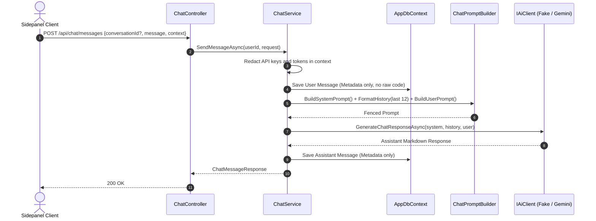

### Design Decisions & Rejected Alternatives
- **Decision:** Stored `MessageContextMetadata` as an EF Core owned entity with dedicated scalar columns (`ContextPlatform`, `ContextHost`, `ContextCodeLineCount`).
  *Rejected alternative:* Storing raw JSON string in a single column. Relational scalar columns enable fast indexing, database independence (SQL Server, SQLite, Postgres), and type safety without JSON serialization overhead.
- **Decision:** Distinct instances of owned entity metadata per message.
  *Rejected alternative:* Reusing a single `Metadata` object reference between user and assistant messages. EF Core's change tracker strictly forbids sharing an owned entity instance across multiple parent entities.

### Interview Questions & Model Answers
- **Q: Why does Codexo sanitize and redact secrets on both client and server before sending context to an AI model?**
  *A:* Defense-in-depth. A developer might accidentally have production API keys, database credentials, or Bearer tokens in their open editor buffer. Client-side redaction prevents secrets from ever leaving the browser, while server-side redaction ensures that even direct API calls or compromised extensions cannot inadvertently transmit credentials to third-party LLM providers.
- **Q: How does the backend prevent user-supplied problem text from overriding system instructions (prompt injection)?**
  *A:* By segregating system instructions from user-supplied data using explicit block delimiters (`=== [ACTIVE PAGE CONTEXT (DATA ONLY)] ===`) and explicitly instructing the model in `Chat.txt` that anything inside these blocks is untrusted user data to analyze, never directives to follow.

### Run & Test Commands
```powershell
dotnet build Codexo.slnx
dotnet test tests\Codexo.Core.Tests
dotnet test tests\Codexo.Api.IntegrationTests
```

---

## C2: Real Gemini for Chat

### What We Built
We integrated the real Google Gemini API into `OpenAiCompatibleAiClient` using the OpenAI-compatible `/chat/completions` endpoint. We configured configurable reasoning level (`reasoning_effort: "low"`), raised `MaxTokens` to 2000 for complete chat answers, implemented robust RFC-compliant `Retry-After` header parsing (delta seconds and HTTP-date timestamps), mapped HTTP status codes to custom domain exceptions (401/403 -> `AiAuthenticationException`, 429 -> `AiQuotaExceededException`, 503/timeout -> `AiServiceUnavailableException`), enforced token-only audit logging with zero secret/prompt leakage, retuned per-user rate limits to 20 requests/minute for chat, added 14 mocked-handler unit tests, and created an opt-in live smoke test.

### Concepts
- **OpenAI-Compatible Chat Envelope:** Google Gemini exposes an OpenAI-compatible gateway (`/v1beta/openai/chat/completions`) that accepts standardized messages (`system`, `user`, `assistant`), `max_tokens`, and `reasoning_effort`, ensuring vendor flexibility. File: [src/Codexo.Infrastructure/Ai/OpenAiCompatibleAiClient.cs](file:///c:/Ariram/CodeXO/src/Codexo.Infrastructure/Ai/OpenAiCompatibleAiClient.cs).
- **Reasoning Effort Regulation:** Thinking models can generate thousands of hidden thinking tokens. Specifying `reasoning_effort: "low"` keeps generation latency under 5–10 seconds and prevents excessive quota burn. File: [src/Codexo.Infrastructure/Ai/AISettings.cs](file:///c:/Ariram/CodeXO/src/Codexo.Infrastructure/Ai/AISettings.cs).
- **RFC-Compliant Retry-After Handling:** Upstream rate limiters (HTTP 429) convey backoff in either delta seconds (`Retry-After: 30`) or HTTP dates (`Retry-After: Wed, 21 Oct 2026 07:28:00 GMT`). Supporting both formats ensures accurate client throttling. File: [src/Codexo.Infrastructure/Ai/OpenAiCompatibleAiClient.cs](file:///c:/Ariram/CodeXO/src/Codexo.Infrastructure/Ai/OpenAiCompatibleAiClient.cs).

### Runtime Flow
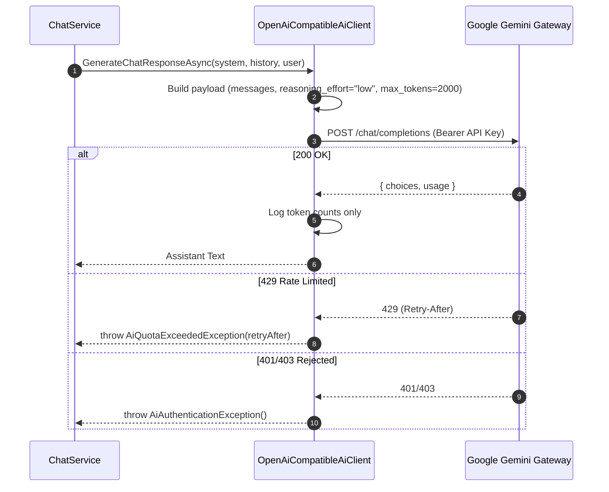

### Design Decisions & Rejected Alternatives
- **Decision:** Used Google Gemini's OpenAI-compatible endpoint rather than the native Google Cloud Vertex/GenAI SDK.
  *Rejected alternative:* Installing vendor-specific Google SDKs. The OpenAI compatibility layer keeps infrastructure dependencies lean and easily swappable with local models (Ollama, vLLM) or OpenAI.
- **Decision:** Set default `reasoning_effort` to `"low"`.
  *Rejected alternative:* Defaulting to unconstrained thinking depth. Unbounded reasoning causes severe timeout risk and exhausts free-tier RPM/TPM quotas quickly.

### Interview Questions & Model Answers
- **Q: How does `OpenAiCompatibleAiClient` handle upstream HTTP 429 errors from Google Gemini without losing backoff context?**
  *A:* It inspects the `Retry-After` response header, parsing either delta seconds or an RFC1123 HTTP date into a strongly-typed `TimeSpan`. It attaches this value to `AiQuotaExceededException`, allowing the API layer and UI to set the standard `Retry-After` header and inform the user of the exact delay before retrying.
- **Q: Why must AI client logs strictly record token usage numbers and exclude prompt text and authorization headers?**
  *A:* Security and privacy. Prompts contain proprietary source code and active page text, while headers contain secret API keys. Logging token counts provides complete visibility for cost analysis, rate-limit monitoring, and observability without ever persisting intellectual property or secrets into log storage.

### Run & Test Commands
```powershell
# Run mocked unit tests covering all error classes
dotnet test tests/Codexo.Api.IntegrationTests --filter "FullyQualifiedName~OpenAiCompatibleAiClientTests"

# Run opt-in live smoke test against Gemini
dotnet test tests/Codexo.Api.IntegrationTests --filter "FullyQualifiedName~GeminiLiveSmokeTests"

# Run full backend test suite
dotnet test Codexo.slnx
```

### Common Pitfalls
- **Overriding global rate limits in integration tests:** When tests use `WebApplicationFactory.WithWebHostBuilder` to set `RateLimiting:PermitLimitPerMinute`, ensure that specific policy keys (like `ChatPermitLimitPerMinute`) in `appsettings.json` do not take unconditional precedence and mask test configuration overrides.

---

## C3: Minimal Chat UI (First End-to-End Slice)

### What We Built
We established the end-to-end chat experience in the Chrome side panel Angular application. We removed the legacy 5-level hint ladder and attempt-gating UI components, simplified `api-contracts.ts` and `api-client.service.ts` for chat messages, implemented a chronological message stream with typing indicators and model badges, created a multi-line composer with `Enter` (send) vs `Shift+Enter` (newline) semantics, integrated active tab context (platform, url, title) via `ExtensionBridgeService`, added specific error banners with an interactive `Retry` button, and updated `docs/MANUAL-TEST.md`.

### Concepts
- **Keyboard-Driven Chat Ergonomics:** In developer chat assistants, multi-line code drafting must be distinguished from message submission. Intercepting `keydown` events allows `Enter` without modifiers to trigger `sendMessage()`, while `Shift+Enter` falls through to insert a newline. File: [extension/src/sidepanel/app/app.ts](file:///c:/Ariram/CodeXO/extension/src/sidepanel/app/app.ts).
- **Transient Context Aggregation:** C3 scopes initial page context to active Chrome tab metadata (`url`, `title`, and inferred platform) via `chrome.tabs.query({ active: true, currentWindow: true })`. This establishes full client-to-backend context forwarding before DOM injection in C4. File: [extension/src/sidepanel/app/core/services/extension-bridge.service.ts](file:///c:/Ariram/CodeXO/extension/src/sidepanel/app/core/services/extension-bridge.service.ts).
- **Stateful Error Recovery with Retry:** API rejections (429 rate limit or 503 unavailable) preserve the user's prompt in component state (`lastSentMessage`), displaying an actionable error banner with a Retry button that immediately resends without requiring retyping. File: [extension/src/sidepanel/app/app.ts](file:///c:/Ariram/CodeXO/extension/src/sidepanel/app/app.ts).

### Runtime Flow
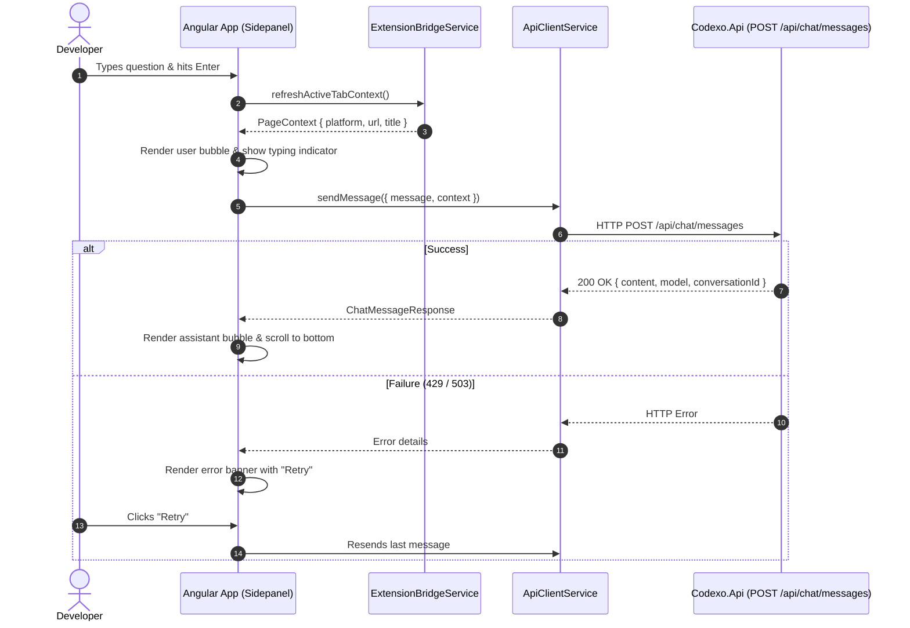

### Design Decisions & Rejected Alternatives
- **Decision:** Dedicated Retry button preserved in component error state.
  *Rejected alternative:* Toast notifications with no retry action. Forcing developers to manually copy-paste failed prompts during network or rate-limit glitches harms usability.
- **Decision:** Complete removal of hint-ladder components from the codebase.
  *Rejected alternative:* Hiding ladder components behind feature flags. Keeping dead code increases bundle size and complicates testing without adding value.

### Interview Questions & Model Answers
- **Q: Why does the side panel use `chrome.tabs.query` to capture active tab context when the user sends a message rather than relying on background push events?**
  *A:* Senders need the ground truth context at the exact moment of interaction. Users frequently switch tabs or navigate between problems. Querying the active tab at send-time guarantees that the AI prompt receives the exact URL and problem title currently open in front of the developer.
- **Q: Why should chat composers handle `Shift+Enter` explicitly in Angular rather than relying on standard form submission?**
  *A:* Standard form `<form>` or `<textarea>` elements either treat Enter as a plain newline or immediately submit forms without multi-line support. Handling keydown events explicitly enables desktop-grade chat UX: single Enter sends, while Shift+Enter allows writing code snippets with indentation and breaks.

### Run & Test Commands
```powershell
# Run Angular extension tests
npm --prefix extension test -- --watch=false

# Build production extension package
npm --prefix extension run build

# Run backend test suite
dotnet test Codexo.slnx
```

### Common Pitfalls
- **Async Component State in Unit Tests:** When `onSendMessage` awaits `refreshActiveTabContext()`, testing keydown events requires calling `await fixture.whenStable()` before asserting that `mockApiClientService.sendMessage` was invoked.


## C4: Context Collection

### What We Built
We implemented complete active-tab context extraction for Codexo across competitive programming platforms and arbitrary web pages. We built a MAIN-world execution script (`chrome.scripting.executeScript({ world: 'MAIN' })`) capable of extracting live code from virtualized editors (Monaco, CodeMirror 6, CodeMirror 5, Ace, and textarea fallback) without relying on visible DOM scraping. We consolidated platform adapters into a unified configuration file (`platforms.config.ts`) covering LeetCode, Codeforces, HackerRank, GeeksforGeeks, CodeChef, and a generic web fallback with automatic secret redaction. In the Chrome side panel, we added an interactive context bar with platform, title, language, and line-count chips, an Include/Exclude Code toggle, and a manual refresh action.

### Concepts
- **MAIN-World Execution vs. Isolated Worlds in MV3:** Manifest V3 content scripts execute in an isolated execution environment. While they share the DOM with the host web page, they cannot access the page's `window` object or JavaScript variables (such as `window.monaco` on LeetCode or `window.ace` on HackerRank). Executing a script with `world: 'MAIN'` via `chrome.scripting.executeScript` runs directly in the page's execution context, allowing access to live editor instances.
- **Editor Virtualization:** Modern code editors do not render the entire source file as DOM nodes; they virtualize lines, rendering only the few lines currently visible in the viewport. Scraping DOM elements like `div.view-line` yields truncated, partial code. Querying the editor's model directly (`monaco.editor.getModels()[0].getValue()` or CodeMirror ViewState) retrieves the 100% complete, ground-truth buffer.
- **Client-Side Secret Redaction (Defense-in-Depth):** In addition to backend redaction, the extension sanitizes API keys, GitHub tokens, private keys, bearer tokens, and passwords in the browser before data leaves the user's machine, preventing accidental leakage over the network.
- **Runtime Optional Host Permissions:** Instead of requesting high-privilege `<all_urls>` permission upfront, the extension defines narrow host permissions for competitive programming domains and requests optional host permissions at runtime for generic sites.

### Runtime Flow
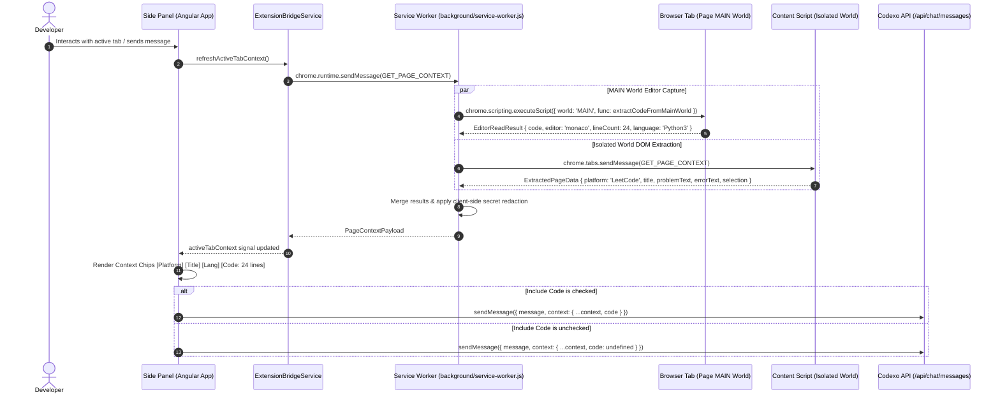

### Design Decisions & Rejected Alternatives
- **Decision:** Execute editor extraction directly in Chrome's MAIN world via `chrome.scripting.executeScript`.
  *Rejected alternative:* Scraping DOM text from `.view-lines` or `.monaco-editor`. Modern editors virtualize lines to optimize rendering memory, which causes offscreen lines to be completely missing from DOM scrapers.
- **Decision:** Consolidated platform config in a single declarative file (`platforms.config.ts`).
  *Rejected alternative:* Creating separate class hierarchies or distributed scripts per site. A single declarative config makes adding new competitive programming sites trivial and simplifies testing.
- **Decision:** Client-side Include/Exclude Code toggle.
  *Rejected alternative:* Always sending code. Giving developers explicit control over whether their source code is sent to the LLM builds trust, reduces token usage, and addresses corporate privacy concerns.

### Interview Questions & Model Answers
- **Q: Why can't a Chrome extension content script simply read `window.monaco` directly from the page?**
  *A:* Manifest V3 content scripts execute in an "isolated world" to prevent security conflicts between extension scripts and web page scripts. While they share the DOM, their JavaScript execution contexts (`window` objects and prototypes) are completely separate. To access `window.monaco` or internal editor instances, the extension must inject a script into the page's MAIN world using `chrome.scripting.executeScript({ world: 'MAIN' })`.
- **Q: How does editor virtualization affect web scrapers, and how does Codexo overcome it?**
  *A:* Virtualization dynamically mounts only the visible DOM nodes for lines currently in the viewport (e.g. 20 out of 500 lines). A DOM scraper reading `.view-line` elements would capture only visible lines, corrupting the code sent to the AI. Codexo overcomes this by reading the underlying document model directly from the editor's JavaScript API (e.g., `model.getValue()` or `cmView.view.state.doc.toString()`).
- **Q: Why should an AI coding assistant implement secret redaction on both the client (browser extension) and the server backend?**
  *A:* This implements defense-in-depth. Client-side redaction ensures credentials (API keys, private keys, database passwords) never leave the developer's workstation or transit the network. Server-side redaction acts as a safety backstop in case client scripts fail, are bypassed, or alternate API clients are used.

### Run & Test Commands
```powershell
# Run Angular extension tests (44 tests passing)
npm --prefix extension test -- --watch=false

# Build production extension package
npm --prefix extension run build

# Run backend test suite (46 tests passing)
dotnet test Codexo.slnx
```

### Common Pitfalls
- **Closure Scope in `chrome.scripting.executeScript`:** Functions passed as `func` to `executeScript` are serialized into strings and evaluated in the target page's context. They cannot access outer scope variables or imported modules; any helper logic must be contained within the function or use standard browser globals.
- **Mocking `chrome.runtime.sendMessage` in Angular Unit Tests:** If mock implementations return generic static payloads (like `'PONG'`) for all message types, asynchronous methods expecting structured typed responses (like `PageContextPayload`) will fail. The mock must inspect `message.type` and respond with appropriate mock contracts.

---

## C5: Streaming

### What We Built
In Module C5, we implemented end-to-end token streaming and upstream cancellation across both the ASP.NET Core backend and the Chrome extension side panel:
1. **Backend Server-Sent Events (`POST /api/chat/stream`):**
   - Implemented `StreamChatResponseAsync` in `IAiClient`, `FakeAiClient`, and `OpenAiCompatibleAiClient` using Server-Sent Events (`data: {...}\n\n` with `data: [DONE]`).
   - `ChatService.StreamMessageAsync` coordinates streaming chunks through `IAsyncEnumerable<ChatStreamChunk>`, persisting the initial user message immediately and using a `finally` block with `CancellationToken.None` to reliably persist completed or partially streamed assistant messages upon client abort.
   - `ChatController.StreamMessage` sets `Content-Type: text/event-stream`, flushes each chunk in real time, and gracefully absorbs client disconnects (`OperationCanceledException` and `IOException`).
2. **Side Panel Incremental Rendering & Cancellation:**
   - In `api-client.service.ts`, implemented `streamMessage()` consuming the SSE stream using `fetch()` and `ReadableStreamDefaultReader` with Bearer auth headers, buffering partial lines and calling `onChunk(delta)` as tokens arrive.
   - Attached an abort handler to `reader.cancel()` so that triggering `AbortSignal` immediately unblocks stream reading and halts network traffic.
   - Built automatic non-streaming fallback to `POST /api/chat/messages` if the streaming connection encounters network or transport issues.
   - In `app.ts`, `app.html`, and `app.scss`, wired the streaming state to an incremental assistant message bubble with a blinking streaming cursor (`▊`) and transformed the composer action into an active **⏹ Stop** button during generation.
   - Verified that clicking "Stop Generating" aborts upstream generation, retains the partial text in the UI, and saves `[Generation stopped]` to the database.

### Concepts
- **Server-Sent Events (SSE) with HTTP POST & Bearer Auth:** Standard browser `EventSource` only supports HTTP GET and does not allow custom request headers (such as `Authorization: Bearer <token>`). By using `fetch` with `ReadableStream` (`response.body.getReader()`), client applications can send complex JSON bodies via POST with full authorization headers while maintaining high-performance token-by-token streaming.
- **Async Iterator Disposal & Cancellation Persistence:** In C# `IAsyncEnumerable<T>`, when an iteration terminates early (due to consumer cancellation or network disconnect), runtime execution jumps immediately to the `finally` block via `IAsyncDisposable.DisposeAsync()`. To persist partial progress without failing from the aborted cancellation token, database writes within the `finally` block must use an uncancelled token (`CancellationToken.None`).
- **Defensive Line Buffering in Stream Readers:** Network chunking does not guarantee that chunks align with SSE message boundaries (`\n\n`). A robust stream parser must accumulate incoming bytes into a string buffer, split by newlines, and retain incomplete trailing fragments until the next chunk arrives.

### Runtime Flow
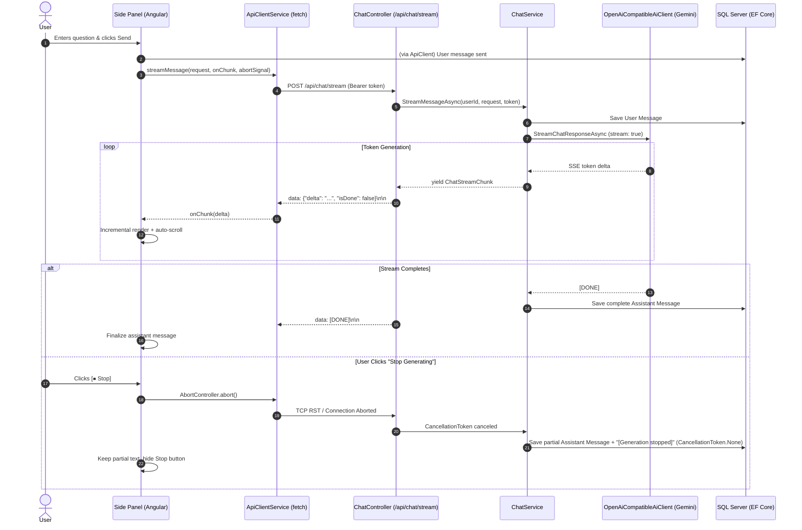

### Design Decisions & Rejected Alternatives
- **Decision:** Use `fetch` + `ReadableStream` instead of browser `EventSource`.
  *Rejected alternative:* `EventSource`. `EventSource` is limited to HTTP GET and does not support sending Bearer authentication headers or structured `PageContext` payloads without clumsy URL query parameter encoding.
- **Decision:** Persist partial assistant responses in the database upon client cancellation with `[Generation stopped]` marker.
  *Rejected alternative:* Discarding partial responses on abort. Retaining what was generated ensures audit logging accuracy, allows users to reference partial output, and provides accurate context for multi-turn conversations.
- **Decision:** Resilient non-streaming fallback in `api-client.service.ts`.
  *Rejected alternative:* Failing immediately if streaming connection drops. Graceful degradation to single-response POST ensures reliable user experience even across proxy environments that buffer or drop HTTP chunked transfers.

### Interview Questions & Model Answers
- **Q: Why can't the standard browser `EventSource` API be used for authenticated AI streaming in modern web apps?**
  *A:* The standard browser `EventSource` API is restricted to HTTP GET requests and provides no native mechanism to pass custom HTTP headers (such as `Authorization: Bearer <jwt>`). Passing tokens in URL query strings exposes secrets in access logs and browser history. Using `fetch` combined with `response.body.getReader()` allows full control over HTTP method, request headers, body payload, and cancellation via `AbortController`.
- **Q: How does C# handle early termination of an `IAsyncEnumerable<T>`, and why is `CancellationToken.None` required for partial persistence?**
  *A:* When an `IAsyncEnumerable<T>` consumer stops enumerating early (e.g. from an `OperationCanceledException` thrown while writing to an aborted network connection), the runtime disposes the enumerator, triggering the generator's `finally` block. However, the original `CancellationToken` is already signaled. Attempting to execute `await _dbContext.SaveChangesAsync(cancellationToken)` would immediately throw another `OperationCanceledException`. Passing `CancellationToken.None` explicitly to the persistence call guarantees the partial message is reliably committed.
- **Q: Why must stream parsers buffer incomplete chunks rather than simply processing incoming chunks as individual SSE messages?**
  *A:* TCP and HTTP transport chunking is based on network packet sizes and OS socket buffers, not application message boundaries. A single SSE message (`data: {...}\n\n`) may be fragmented across two network chunks, or multiple SSE messages may arrive in a single packet. A stream reader must concatenate incoming text to an internal buffer and split on newline delimiters, retaining trailing incomplete slices until the next read.

### Run & Test Commands
```powershell
# Run Angular extension tests (50 tests passing across 9 suites)
npm --prefix extension test -- --watch=false

# Build production extension package
npm --prefix extension run build

# Run complete backend test suite (51 tests passing)
dotnet test Codexo.slnx
```

### Common Pitfalls
- **Resource Disposal Ordering During Cancellation Testing:** In integration tests using `TestServer`, failing to dispose client `HttpResponseMessage` and content streams upon client cancellation leaves the underlying pipe open, preventing the server from detecting connection abort. Enclosing client streams in `try/using` blocks ensures immediate transport closure upon abort.
- **JSON Property Naming Inconsistencies:** Serializing SSE chunks on the server with default PascalCase while the client TypeScript interface expects camelCase can cause `undefined` fields or silent parsing errors. Configuring `JsonNamingPolicy.CamelCase` for SSE serialization ensures cross-platform consistency.

---

## C6: UI Polish (Markdown, Highlighting, Math & UX)

### What We Built
In Module C6, we polished the side-panel chat experience into a production-grade developer assistant:
1. **Markdown Compilation & Strict Sanitization (`MarkdownRendererService`):**
   - Configured `marked` with GitHub Flavored Markdown (GFM) and line breaks.
   - Integrated `DOMPurify` to strictly scrub arbitrary script tags, inline event attributes (`onerror`, `onload`), and dangerous URI schemes (`javascript:`), satisfying Chrome MV3 CSP requirements (`script-src 'self'`).
   - Cleanly bypassed Angular's default HTML sanitization using `DomSanitizer.bypassSecurityTrustHtml()`.
2. **Prism.js Syntax Highlighting & Code Copy:**
   - Pre-loaded grammars for Python, C, C++, C#, Java, TypeScript, Go, Rust, SQL, Bash, and JSON.
   - Built a sleek code block container with upper-case language badge and a functional **Copy** button.
   - Safely encoded the raw code in a `data-code` attribute via `encodeURIComponent()` to preserve formatting, newlines, and indentation during copy.
   - Used container-level event delegation on `.chat-container` to handle clipboard copy via `navigator.clipboard.writeText()` and provide visual `"Copied!"` feedback for 2 seconds.
3. **LaTeX Math Typography (KaTeX):**
   - Added pre-rendering of inline (`$...$`) and block (`$$...$$`) math expressions using `katex.renderToString()`.
   - Bundled KaTeX styles seamlessly into global side-panel styles.
4. **Smart Auto-Scroll with User Pause & Auto-Resizing Composer:**
   - Added user scroll detection via `onContainerScroll`: if the user scrolls more than 50px away from the bottom while tokens are streaming, auto-scroll pauses to prevent disrupting their reading.
   - Displayed a floating **↓ Jump to bottom** button when scrolled up, resuming auto-scroll when clicked.
   - Built dynamic composer height adjustment in `onComposerInput()` expanding from 1 line (~38px) up to 5 lines (~110px), transitioning to internal scrollbar for larger messages and resetting upon message send.

### Concepts
- **Manifest V3 Content Security Policy (CSP) & Dynamic HTML:** Chrome MV3 enforces a strict CSP forbidding `unsafe-eval` and remote code execution in extension contexts. Dynamically injecting raw HTML string content via `[innerHTML]` can lead to severe security vulnerabilities if unsanitized. Combining a standards-compliant parser (`marked`) with a hardened DOM sanitizer (`DOMPurify`) strips all executable vectors before rendering.
- **Event Delegation for Dynamically Injected DOM Elements:** When rendering HTML via `[innerHTML]`, elements like code block Copy buttons are not Angular components with template bindings (`(click)`). Adding event listeners to individual buttons would require manual DOM queries on every render. Event delegation attaches a single click listener to the parent container (`(click)="onContainerClick($event)"`), checking `event.target.closest('.copy-code-btn')` to execute the copy action with minimal overhead and zero memory leaks.
- **Preserving Raw Code State in HTML Data Attributes:** Directly reading `.textContent` or `innerText` from syntax-highlighted code blocks (`<pre><code>...</code></pre>`) can corrupt indentation, strip empty lines, or introduce HTML entities. Storing URI-encoded raw text in `data-code="${encodeURIComponent(rawCode)}"` ensures that clicking Copy writes the byte-for-byte original source code to the clipboard.

### Runtime Flow
```mermaid
sequenceDiagram
    autonumber
    actor User
    participant SidePanel as Side Panel (Angular)
    participant Renderer as MarkdownRendererService
    participant KaTeX as KaTeX Engine
    participant Marked as Marked Parser
    participant Prism as Prism.js Highlighter
    participant Purify as DOMPurify Sanitizer

    SidePanel->>Renderer: renderToSafeHtml(rawMarkdown)
    Renderer->>KaTeX: renderMath(text) -> Replaces $...$ and $$...$$ with HTML
    KaTeX-->>Renderer: Math-rendered string
    Renderer->>Marked: parse(mathString)
    Marked->>Prism: Custom renderer: highlight(code, language)
    Prism-->>Marked: Syntax highlighted token spans
    Marked-->>Renderer: Raw HTML with code containers
    Renderer->>Purify: sanitize(rawHtml) -> Disarms XSS / scripts
    Purify-->>Renderer: Safe, CSP-compliant HTML
    Renderer-->>SidePanel: DomSanitizer.bypassSecurityTrustHtml()
    SidePanel->>User: Displays formatted markdown, code blocks & equations

    opt User clicks Copy
        User->>SidePanel: Clicks [.copy-code-btn]
        SidePanel->>SidePanel: onContainerClick (Event Delegation)
        SidePanel->>User: navigator.clipboard.writeText(decodedCode)
        SidePanel->>User: Button shows "Copied!" for 2s
    end
```

### Design Decisions & Rejected Alternatives
- **Decision:** Use `Prism.js` components bundled statically instead of runtime dynamic imports.
  *Rejected alternative:* Runtime lazy loading of Prism components via `script` tags. MV3 CSP strictly forbids loading external or dynamic scripts at runtime. Static bundling ensures all common competitive programming languages are highlighted offline with zero CSP violations.
- **Decision:** Container-level event delegation for Copy buttons.
  *Rejected alternative:* Custom Angular components for every code block. Parsing markdown into an Angular component tree or using `ViewContainerRef` for dynamic component creation creates immense complexity during streaming. Pure HTML string rendering with container event delegation is lightweight, fast, and robust.
- **Decision:** Smart user scroll-lock with threshold detection.
  *Rejected alternative:* Unconditional `scrollToBottom()` on every token. Forcing scroll down during token streaming frustrates users who are trying to read earlier paragraphs or inspect code. Pausing scroll when the user scrolls up provides an intuitive, chatGPT-like UX.

### Interview Questions & Model Answers
- **Q: Why is direct `[innerHTML]` binding dangerous in Angular and Chrome MV3 extensions, and how is it safely handled?**
  *A:* Direct `[innerHTML]` without rigorous sanitization can execute arbitrary JavaScript via injected `<script>` tags, inline event attributes (`<img src=x onerror=...`), or `javascript:` links. In Chrome extensions, an XSS exploit compromises extension permissions and storage (tokens). Codexo handles this safely by passing raw markdown through `DOMPurify.sanitize()` with an explicit tag and attribute whitelist before using Angular's `DomSanitizer.bypassSecurityTrustHtml()`.
- **Q: How does event delegation improve performance when rendering streaming AI responses containing multiple code snippets?**
  *A:* In token streaming, the message HTML is continuously re-rendered as new chunks arrive. If event listeners were attached to each Copy button individually, every re-render would require tearing down and re-attaching DOM listeners, risking memory leaks. Event delegation attaches a single listener to the message container that inspects `event.target.closest('.copy-code-btn')`, handling any number of dynamically updated buttons with $O(1)$ listeners.
- **Q: How does the auto-resizing composer maintain layout stability when typing long queries?**
  *A:* The composer textarea resets its inline `height` to `'auto'` on input, recalculates its `scrollHeight`, and caps the height at a maximum of 5 lines (~110px). When text exceeds 5 lines, `overflowY` is toggled to `'auto'`, enabling smooth internal scrolling without pushing side-panel headers or the chat stream off screen.

### Run & Test Commands
```powershell
# Run Angular extension tests (59 tests passing across 10 suites)
npm --prefix extension test -- --watch=false

# Build production extension package (zero warnings)
npm --prefix extension run build

# Run complete backend test suite (51 tests passing)
dotnet test Codexo.slnx
```

### Common Pitfalls
- **Encoding Code Snippets in HTML Attributes:** Placing raw code with special characters or newlines into an HTML attribute (`data-code="..."`) breaks HTML attribute quoting or loses line breaks. Using `encodeURIComponent(rawCode)` when creating the attribute and `decodeURIComponent(encoded)` on copy preserves formatting and special characters perfectly.
- **Marked and Math Parsing Conflicts:** Running `marked` before LaTeX math parsing can cause marked to interpret underscores (`x_1`) as italics or backslashes (`\frac`) as escapes. Pre-rendering math expressions with KaTeX or tokenizing them before markdown compilation preserves LaTeX formulas intact.
