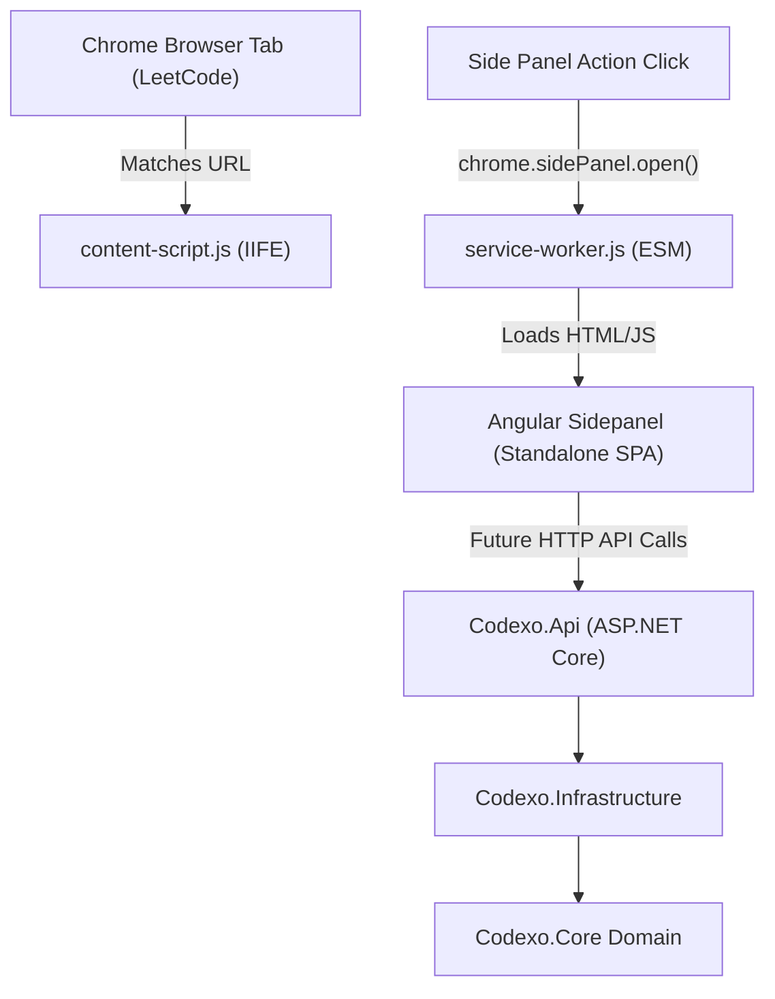
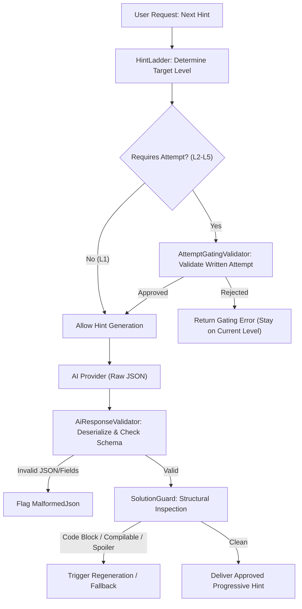
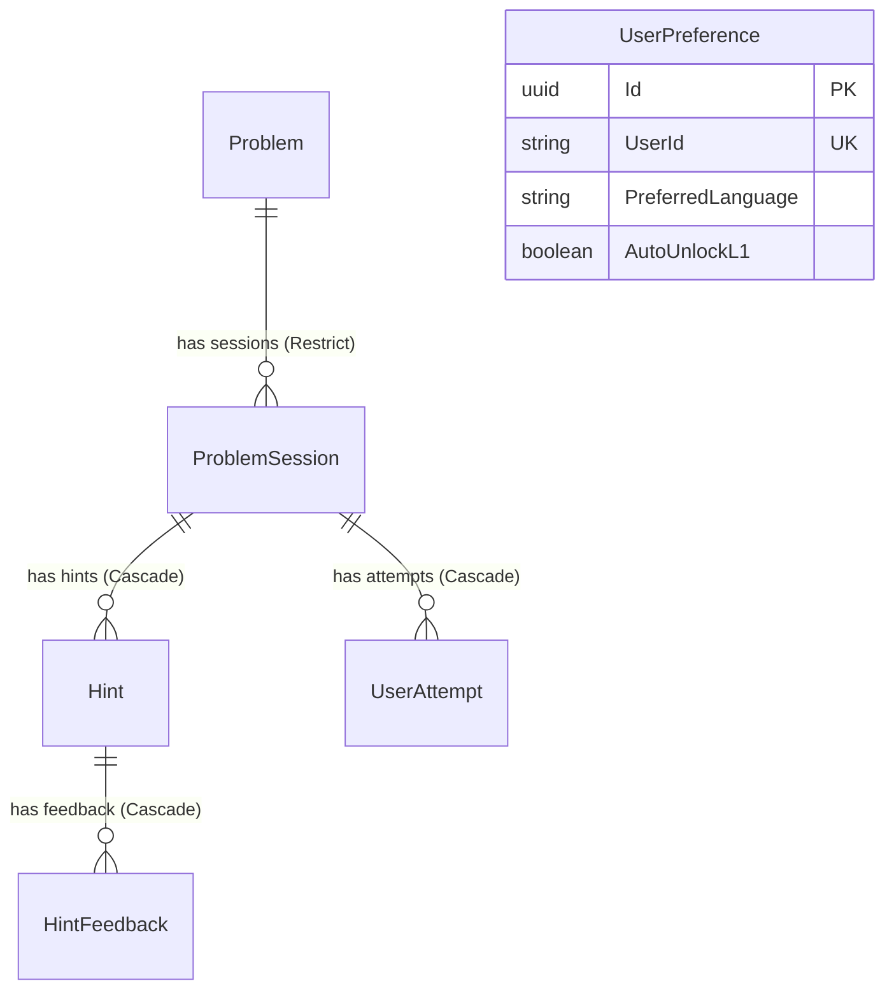
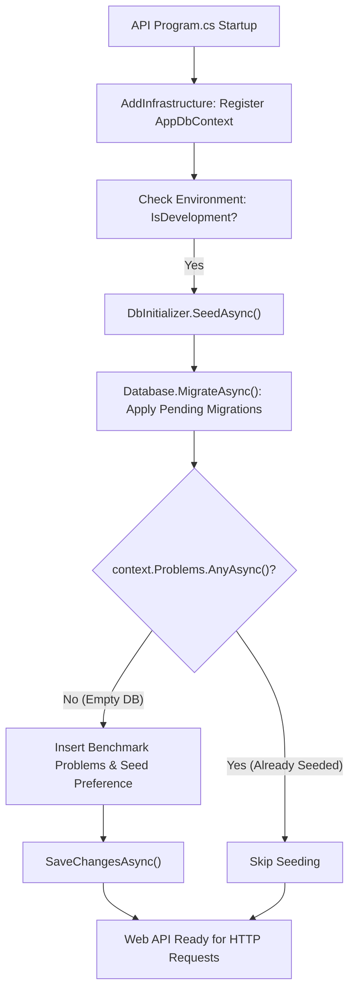
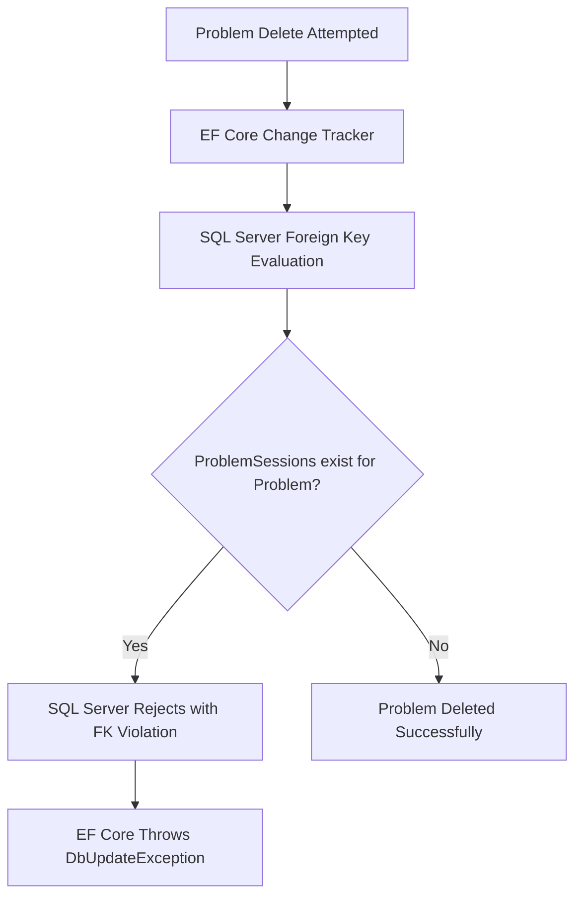

# Codexo — Learning Log

## Module Status

| Module | Name | Status | Branch | Commits | Date |
|--------|------|--------|--------|---------|------|
| M0 | Scaffolding | IMPLEMENTED | `main` | `896762b..8d9b0c1` | 2026-11-15 |
| M1 | Domain + Hint Logic | IMPLEMENTED | `main` | `e8ffb00..9b7fc2b` | 2026-11-15 |
| M2 | Database | IMPLEMENTED | `main` | `719c47e..a073149` | 2026-11-15 |
| M2-CLEANUP | Database Refinements | IMPLEMENTED | `main` | `2831a96..79bd1f6` | 2026-11-16 |
| M3 | Authentication | NOT IMPLEMENTED | — | — | — |
| M4 | Problems + Sessions | NOT IMPLEMENTED | — | — |
| M5 | AI Layer | NOT IMPLEMENTED | — | — |
| M6 | Hint Orchestration | NOT IMPLEMENTED | — | — |
| M7 | Feedback + Preferences | NOT IMPLEMENTED | — | — |
| M8 | Hardening | NOT IMPLEMENTED | — | — |
| M9 | Extension Scaffold | NOT IMPLEMENTED | — | — |
| M10 | Content Script | NOT IMPLEMENTED | — | — |
| M11 | Side Panel UI | NOT IMPLEMENTED | — | — |
| M12 | Integration | NOT IMPLEMENTED | — | — |
| M13 | Release | NOT IMPLEMENTED | — | — |

---

*Learning entries will be appended below as modules are completed.*


## M0: Scaffolding

### What We Built
We set up the complete foundational structure for Codexo across .NET 10 and Chrome Extension targets. The solution contains three backend projects (`Codexo.Api`, `Codexo.Infrastructure`, `Codexo.Core`) and two test projects enforcing strict dependency inversion (`Api -> Infrastructure -> Core`). The extension shell separates the Angular 21 side-panel application from the MV3 background service worker and content script bundled via esbuild. Foundational documentation, security baseline, and GitHub Actions CI pipelines were established with zero business logic.

### Concepts
- **Clean Architecture Dependency Rule:** Source code dependencies point inward toward business concepts. `Codexo.Core` has no dependencies on database, Web API, or AI libraries. File: [src/Codexo.Core/Codexo.Core.csproj](file:///c:/Ariram/CodeXO/src/Codexo.Core/Codexo.Core.csproj).
- **Chrome Extension Manifest V3 (MV3):** Google's extension platform requiring non-persistent background service workers, dedicated Side Panel API, and banning remotely hosted/inline code. File: [extension/public/manifest.json](file:///c:/Ariram/CodeXO/extension/public/manifest.json).
- **Dual-Bundler Build Architecture:** Angular CLI compiles SPA components into static HTML/JS/CSS, while `esbuild` compiles the service worker and content script into isolated scripts without polluting browser scopes. File: [extension/scripts/build-extension.mjs](file:///c:/Ariram/CodeXO/extension/scripts/build-extension.mjs).

### Runtime Flow


1. User opens a LeetCode problem page; Chrome injects `content-script.js`.
2. User triggers the extension icon; `service-worker.js` listens to `action.onClicked` and invokes `chrome.sidePanel.open()`.
3. Side panel loads `sidepanel/browser/index.html` hosting the standalone Angular application.
4. Future modules route requests to `Codexo.Api`, propagating downward to Core.

### Design Decisions & Rejected Alternatives
- **Decision:** Bundled content script and background worker using `esbuild` rather than adding multiple projects to `angular.json`.
  *Rejected alternative:* Multi-project Angular workspace for extension scripts. MV3 forbids DOM access in service workers and requires specific module formats that Angular's application builder complicates.
- **Decision:** Used .NET 10 solution (`.slnx`) with project references enforcing `Api -> Infrastructure -> Core`.
  *Rejected alternative:* Direct reference from Core to external packages.

### Interview Questions & Model Answers
- **Q: Why separate the content script and service worker build from Angular's application build in an MV3 extension?**
  *A:* MV3 content scripts run directly in the webpage context (IIFE format) while background service workers run in an isolated worker context without DOM access. Angular's CLI targets browser SPAs; bundling background scripts separately via esbuild gives precise control over formats, sourcemaps, and avoids loading heavy framework runtimes where unnecessary.
- **Q: Why does `Codexo.Core` have zero package references to EF Core or ASP.NET Core?**
  *A:* Clean architecture ensures core domain rules and algorithms are independent of UI frameworks, persistence mechanisms, or external services. This allows pure, fast unit testing without mocking HTTP contexts or databases.
- **Q: Why is `outputHashing: "none"` set for the Angular extension build?**
  *A:* Chrome extensions require static paths defined in `manifest.json`. Cache-busted hash names break references like `sidepanel/browser/index.html`.

### Run & Test Commands
```bash
# Build backend solution
dotnet build Codexo.slnx

# Run all backend unit & integration tests
dotnet test Codexo.slnx --verbosity normal

# Install and build extension
cd extension
npm run build
```

### Common Pitfalls
- **Manifest path mismatches:** Angular 21 defaults output to `dist/codexo/sidepanel/browser/index.html`. Ensure `manifest.json` points to the exact path generated.
- **Leaking references into Core:** Accompanying NuGet packages like `Microsoft.AspNetCore.Http` into Core violates architectural boundaries.


## M1: Domain + Hint Logic

### What We Built
We implemented the domain model and hint-safety engine in `Codexo.Core` with zero external dependencies. The domain entities model DSA problems, user sessions, progressive hints, attempts, and feedback. `HintLadder` enforces server-authoritative 5-level progression (L1 to L5) and prevents duplicate level advancements. `AttemptGatingValidator` validates that unlocking L2+ requires a meaningful written attempt, rejecting empty submissions, keysmash gibberish, trivial one-liners, and full-solution solicitations. `SolutionGuard` and `AiResponseValidator` structurally inspect AI outputs for markdown code blocks, compilable statements, full solution dumps, and level-specific spoilers (banning algorithms/data structures at L1 and algorithm/pattern names at L2).

### Concepts
- **Server-Authoritative Progression:** The server alone computes and advances hint levels; client-provided level values are ignored to prevent tampering or skipping ahead. File: [src/Codexo.Core/Hints/HintLadder.cs](file:///c:/Ariram/CodeXO/src/Codexo.Core/Hints/HintLadder.cs).
- **Structural Solution Guarding:** Rather than relying merely on naive keyword searches, `SolutionGuard` detects programming syntax patterns (function declarations, semicolon-terminated assignments, loops) and code fences to guarantee that no compilable code is leaked. File: [src/Codexo.Core/Hints/SolutionGuard.cs](file:///c:/Ariram/CodeXO/src/Codexo.Core/Hints/SolutionGuard.cs).
- **Attempt Gating:** A pedagogical safeguard that blocks hints past L1 until the user submits a verifiable written reflection (minimum 15 characters, 3 words, non-trivial, non-gibberish) describing what they tried or understood. File: [src/Codexo.Core/Hints/AttemptGatingValidator.cs](file:///c:/Ariram/CodeXO/src/Codexo.Core/Hints/AttemptGatingValidator.cs).

### Runtime Flow


1. User requests a hint for a problem session.
2. `HintLadder` determines the authorized target level based on current level and attempts.
3. For levels > L1, `AttemptGatingValidator` checks the user's attempt string.
4. If the attempt fails quality or solicitation checks, progression is halted at the current level.
5. AI hint response is parsed and schema-verified by `AiResponseValidator`.
6. `SolutionGuard` checks the text structurally for code fences, statement declarations, and level spoilers.
7. Only hints passing all guard checks are cleared for user delivery.

### Design Decisions & Rejected Alternatives
- **Decision:** Implemented `SolutionGuard` using multi-lingual structural regex tokenizers (function heads, typed assignments, loops) alongside code fence matchers.
  *Rejected alternative:* Keyword blocklists alone. Words like `for`, `in`, `map`, or `return` appear in normal English prose; searching for raw keywords produces unacceptable false positives.
- **Decision:** L1 is automatically unlockable without an attempt; L2 through L5 require a validated attempt.
  *Rejected alternative:* Requiring an attempt before L1. Users need to read and understand the problem scope before they can formulate a meaningful attempt.

### Interview Questions & Model Answers
- **Q: Why must hint level progression be calculated entirely server-side rather than accepted from the browser client?**
  *A:* Clients are inherently untrusted environments where malicious users or modified extension scripts can forge request payloads. If the client specified the target level, a user could bypass attempt-gating and jump directly to L4 pseudocode or L5 deep analysis. Server authority guarantees progressive disclosure invariants.
- **Q: How does `SolutionGuard` distinguish between pseudocode allowed at L4 and compilable code which is forbidden?**
  *A:* Compilable code exhibits concrete language syntax: formal type signatures (`public int[]`), language-specific function definitions (`def `, `fn `), variable assignment statements terminated with semicolons, and exact loop header syntax. Pseudocode uses high-level operational descriptions without compilable assignment tokens.
- **Q: Why does `AttemptGatingValidator` reject attempts soliciting a full solution?**
  *A:* Codexo's mission is minimum effective guidance so the learner can solve the next problem independently. A request asking "give me the complete Python code" is a solution-begging shortcut, not an attempt. The validator rejects it and guides the user to articulate what they understand about the problem.

### Run & Test Commands
```bash
# Run all unit tests for domain and hint logic
dotnet test tests/Codexo.Core.Tests/Codexo.Core.Tests.csproj --verbosity normal

# Run all tests across the solution
dotnet test Codexo.slnx
```

### Common Pitfalls
- **Accidental Spoilers at L1/L2:** Casual phrases like "use a hash map" or "notice the sliding window" destroy the learning curve. `SolutionGuard` strictly enforces term boundaries.
- **Top-Row Keyboard False Positives:** English words like "error" or "require" fall entirely on the QWERTY keyboard row (`qwertyuiop`). Keysmash filters must check consonant clusters rather than blindly checking keyboard row subsets.


## M2: Database

### What We Built
We built the EF Core Code First database layer in `Codexo.Infrastructure` targeting SQL Server LocalDB (`MSSQLLocalDB`). `AppDbContext` maps all 6 domain entities via dedicated Fluent API configuration classes that isolate schema rules from domain POCOs. We implemented unique composite indexes, non-clustered lookup indexes, column constraints, and cascade delete rules. We generated and applied the `InitialCreate` migration to LocalDB and built `DbInitializer` to idempotently seed benchmark DSA problems (Two Sum, Valid Anagram, Merge Two Sorted Lists) and user preferences. All schema contracts, relationships, and constraints were documented in `Database-Design.md` and verified with integration tests.

### Concepts
- **Fluent API Entity Configuration:** Separating database mappings into `IEntityTypeConfiguration<T>` classes rather than decorating domain models with attributes ensures `Codexo.Core` remains purely decoupled from persistence concerns. File: [src/Codexo.Infrastructure/Data/EntityConfigurations/ProblemConfiguration.cs](file:///c:/Ariram/CodeXO/src/Codexo.Infrastructure/Data/EntityConfigurations/ProblemConfiguration.cs).
- **Composite Unique Index:** A constraint spanning multiple columns (e.g. `Platform` and `PlatformProblemId`) that guarantees uniqueness per external platform without relying on synthetic primary keys alone. File: [src/Codexo.Infrastructure/Data/EntityConfigurations/ProblemConfiguration.cs](file:///c:/Ariram/CodeXO/src/Codexo.Infrastructure/Data/EntityConfigurations/ProblemConfiguration.cs).
- **Idempotent Data Seeding:** A startup routine that inspects current database state before inserting data, ensuring migrations and seeds run safely across container, CI, or local test restarts. File: [src/Codexo.Infrastructure/Data/DbInitializer.cs](file:///c:/Ariram/CodeXO/src/Codexo.Infrastructure/Data/DbInitializer.cs).

### Entity-Relationship Diagram


### Runtime Flow


1. Web API starts; `AddInfrastructure` registers `AppDbContext` connecting to LocalDB with SQL connection resiliency.
2. In development, `Program.cs` resolves `AppDbContext` in a scoped lifetime.
3. `DbInitializer.SeedAsync` checks for and applies any pending migrations.
4. If no problems exist, it inserts initial benchmark DSA problems and seed user preferences.
5. The application enters its listening loop ready to serve authenticated API requests.

### Design Decisions & Rejected Alternatives
- **Decision:** Used Fluent API (`IEntityTypeConfiguration<T>`) exclusively in `Codexo.Infrastructure`.
  *Rejected alternative:* Data Annotations (`[Required]`, `[MaxLength]`, `[Index]`) on domain entities in `Codexo.Core`. Core must never import EF Core namespaces.
- **Decision:** Direct `AppDbContext` usage in future services without a generic repository or UnitOfWork pattern.
  *Rejected alternative:* Generic Repository and UnitOfWork abstraction layer. EF Core's `DbSet` is already an in-memory repository and `DbContext` is already a Unit of Work; wrapping them adds boilerplate and obscures LINQ capabilities.

### Interview Questions & Model Answers
- **Q: Why avoid a generic Repository pattern on top of Entity Framework Core?**
  *A:* `DbContext` already implements the Unit of Work pattern, and `DbSet<T>` implements the Repository pattern with full `IQueryable` support. Adding another abstraction often either leaks `IQueryable` anyway (breaking the abstraction) or restricts query expressiveness (leading to N+1 query problems or in-memory filtering).
- **Q: How does `ApplyConfigurationsFromAssembly` work and why is it preferred?**
  *A:* It uses reflection to discover all classes implementing `IEntityTypeConfiguration<T>` in the specified assembly and automatically invokes `modelBuilder.ApplyConfiguration()`. This keeps `OnModelCreating` concise and avoids manual registration errors when new entities are added.
- **Q: Why use `Trusted_Connection=True` and omit credentials from `appsettings.Development.json`?**
  *A:* Storing database credentials or secrets in source control is a severe security risk. LocalDB supports Windows Integrated Authentication out of the box, ensuring developers can run locally without committing secrets to Git.

### Run & Test Commands
```bash
# Apply pending EF Core migrations to LocalDB
dotnet ef database update --project src/Codexo.Infrastructure --startup-project src/Codexo.Api

# Run database integration tests
dotnet test tests/Codexo.Api.IntegrationTests/Codexo.Api.IntegrationTests.csproj --verbosity normal

# Run all tests across the solution
dotnet test Codexo.slnx
```

### Common Pitfalls
- **Package Version Drift:** Adding EF Core packages without specifying version constraints can pull in next-major daily builds (e.g. 11.0.0 on a net10.0 target). Pin to matching LTS versions (`10.0.*`).
- **Missing Foreign Key Cascade Rules:** Neglecting cascade deletes causes orphaned records in child tables (e.g. hints or attempts when a session is cleared).


## M2-CLEANUP: Database Refinements

### What We Built
We refined the database architecture to safeguard user solving history by altering the `Problem -> ProblemSession` foreign key delete behavior from `Cascade` to `Restrict`. We generated EF Core migration `RestrictProblemDeleteBehavior` and applied it to SQL Server LocalDB (`MSSQLLocalDB`). We updated `DbInitializer` to enforce development-only execution and explicitly labeled `seed-user-1` as a dev placeholder prior to M3 Identity integration. We documented the complete Mermaid entity relationship diagram in documentation and established `.githooks/pre-push` to enforce build and test gates before pushing.

### Concepts
- **Referential Integrity Restrict Action:** Changing foreign key deletion from `Cascade` to `Restrict` (`ON DELETE NO ACTION` in SQL Server) prevents accidental deletion of parent problem records whenever user study sessions reference them. File: [src/Codexo.Infrastructure/Data/EntityConfigurations/ProblemSessionConfiguration.cs](file:///c:/Ariram/CodeXO/src/Codexo.Infrastructure/Data/EntityConfigurations/ProblemSessionConfiguration.cs).
- **Environment-Gated Data Seeding:** Restricting database seeding and automatic migrations strictly to `Development` ensures production environments rely exclusively on formal CI/CD database migration pipelines. File: [src/Codexo.Infrastructure/Data/DbInitializer.cs](file:///c:/Ariram/CodeXO/src/Codexo.Infrastructure/Data/DbInitializer.cs).
- **Pre-Push Git Hook:** A client-side Git hook that compiles the solution and executes all test suites, terminating the push command with a non-zero exit code if any test fails. File: [.githooks/pre-push](file:///c:/Ariram/CodeXO/.githooks/pre-push).

### Runtime Flow


1. Application attempts to delete a `Problem` entity.
2. EF Core issues a `DELETE FROM Problems WHERE Id = @id` statement to SQL Server.
3. SQL Server checks constraint `FK_ProblemSessions_Problems_ProblemId`.
4. If any `ProblemSession` records reference the target problem, the server aborts the transaction with an FK violation.
5. EF Core wraps the error and surfaces a `DbUpdateException`, preventing data loss.

### Design Decisions & Rejected Alternatives
- **Decision:** Set `Problem -> ProblemSession` to `DeleteBehavior.Restrict` while retaining `Cascade` on `ProblemSession -> Hints` and `ProblemSession -> UserAttempts`.
  *Rejected alternative:* Cascade delete from Problem all the way down. If an administrator deletes or re-imports a problem, cascading would wipe out every user's personal attempt history and hint ladder state.
- **Decision:** Created `.githooks/pre-push` running `dotnet build` and `dotnet test`.
  *Rejected alternative:* Relying solely on remote CI. Pre-push hooks catch regressions locally before pushing broken commits to remote branches.

### Interview Questions & Model Answers
- **Q: Why should parent entities like Problems use `Restrict` instead of `Cascade` when referenced by user activity logs?**
  *A:* Cascading deletions on master/catalog data can result in catastrophic unintentional data destruction. If a problem record is removed, cascading would erase all associated user learning logs, attempts, and progress. Restrict forces administrators to either archive problems or reassign sessions.
- **Q: How does EF Core handle `DeleteBehavior.Restrict` differently when dependent entities are loaded in memory vs only in the database?**
  *A:* If dependents are loaded in the `DbContext` change tracker, EF Core attempts to nullify the foreign key client-side (throwing `InvalidOperationException` if required). If dependents exist only in the database, EF Core sends the `DELETE` command and SQL Server throws a `DbUpdateException`.
- **Q: Why should database seeding routines check `app.Environment.IsDevelopment()`?**
  *A:* Automatic seeding in production can overwrite live records, introduce dummy test users into security audits, or trigger race conditions in multi-instance horizontally scaled deployments.

### Run & Test Commands
```bash
# Enable pre-push hook locally
git config core.hooksPath .githooks

# Run all tests across solution
dotnet test Codexo.slnx --verbosity normal
```

### Common Pitfalls
- **Untracked Test Collisions:** Integration tests that insert static IDs can fail on repeated runs if previous test runs failed before cleanup. Always use unique identifiers (e.g. `Guid.NewGuid()`) for test problem records.
- **Severed Required Relationships in Memory:** Attempting to delete a parent with tracked children under `Restrict` trips client-side conceptual null checks before the SQL constraint can even be reached.
